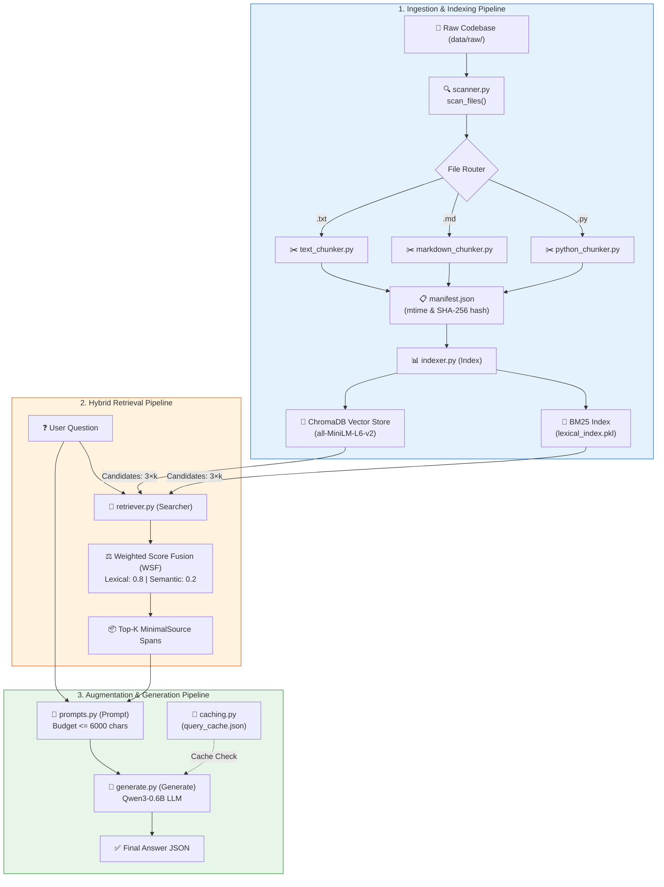
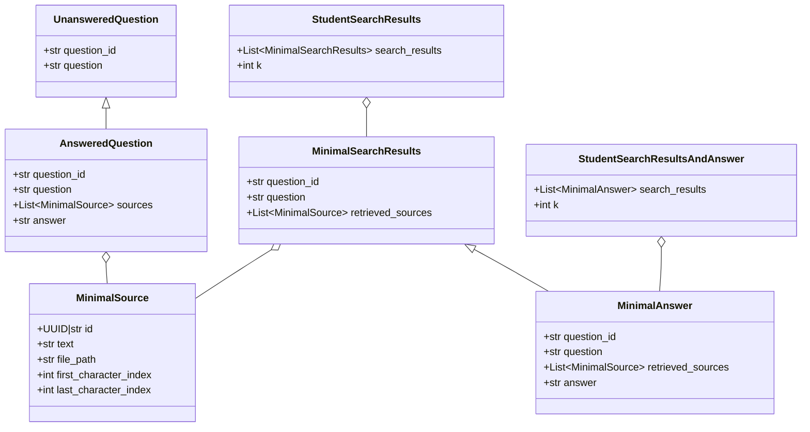
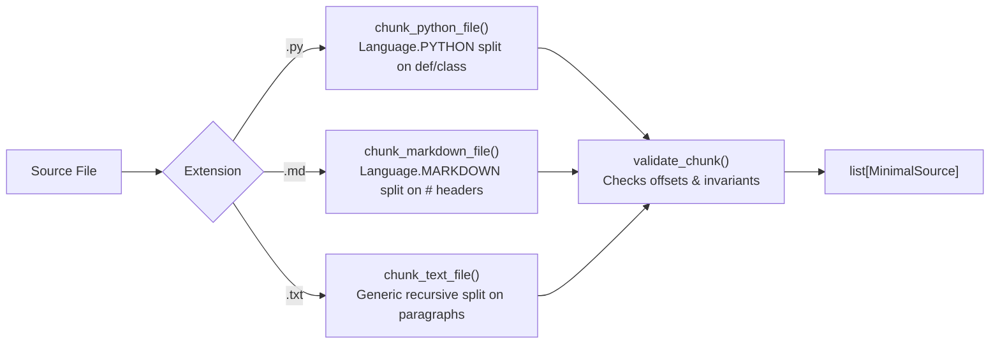
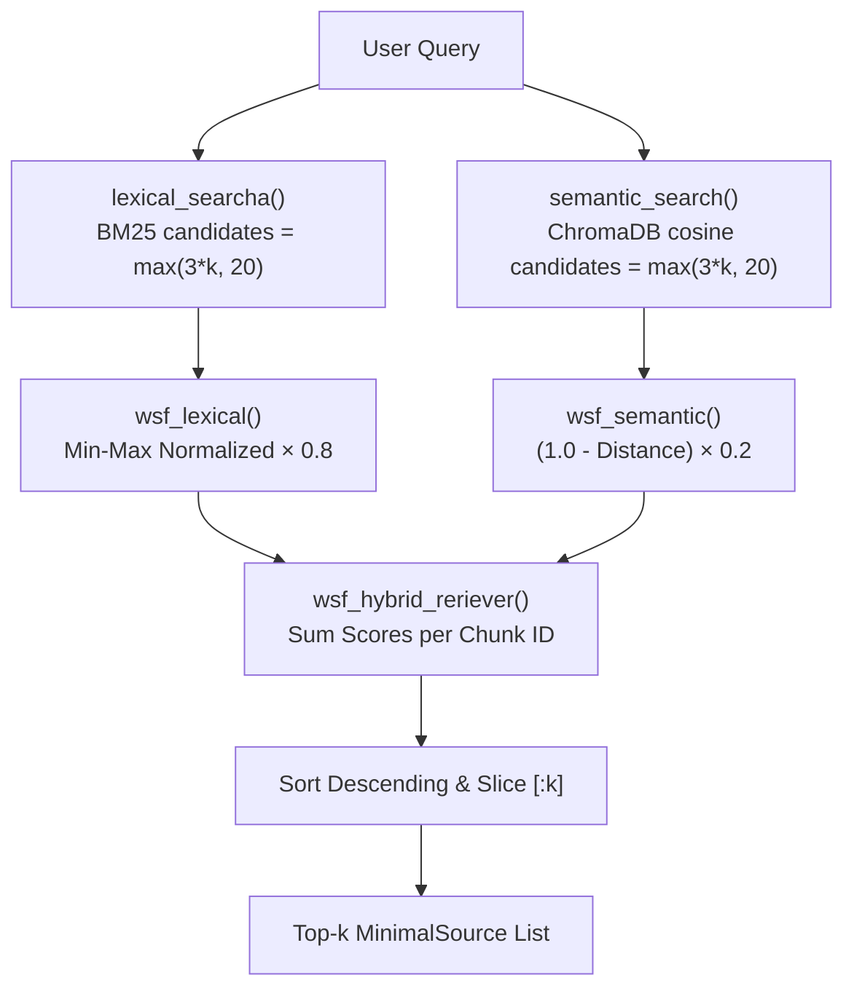

# 🏗️ RAG System Architecture Documentation

> **Project**: `rag-against-the-machine` — Retrieval-Augmented Generation for the **vLLM codebase**

---

## 1. Project Directory Structure

```
RAG/
├── src/                          # Core source code
│   ├── __init__.py               # Package marker
│   ├── __main__.py               # CLI entry point (Python Fire)
│   ├── config.py                 # Global constants & file paths
│   ├── models.py                 # Pydantic data schemas
│   ├── scanner.py                # File discovery (raw corpus scanner)
│   ├── indexer.py                # Dual index builder (BM25 + ChromaDB)
│   ├── retriever.py              # Hybrid retrieval engine (WSF / RRF)
│   ├── prompts.py                # Prompt construction & context budget
│   ├── generate.py               # LLM answer generation (Qwen3-0.6B)
│   ├── evaluator.py              # Recall@k evaluation engine
│   ├── caching.py                # JSON-based query/answer cache
│   ├── server.py                 # FastAPI HTTP REST API
│   └── chunking/                 # Text splitting sub-package
│       ├── __init__.py           # Exports all chunkers
│       ├── base.py               # Invariant validator
│       ├── python_chunker.py     # Python AST / syntax splitter
│       ├── markdown_chunker.py   # Markdown header splitter
│       └── text_chunker.py       # Generic text splitter
├── data/
│   ├── raw/vllm-0.10.1/          # Target raw codebase (.py, .md, .txt)
│   ├── processed/                # Built indices (BM25 pkl, ChromaDB, manifest)
│   ├── datasets/                 # Evaluation datasets (Answered / Unanswered)
│   ├── cache/                    # query_cache.json
│   └── output/                   # Search results & answered JSONs
├── evaluations/                  # Historical evaluation logs
├── pyproject.toml                # Dependencies & tool configurations
├── Makefile                      # Automated workflow targets
└── README.md                     # Project overview & benchmark scores
```

---

## 2. High-Level Architecture Diagram



---

## 3. Detailed File-by-File Breakdown

### 3.1 [`src/config.py`](src/config.py)
Central configuration holding all system constants:
- **Paths**: `RAW_DIR`, `PROCESSED_DIR`, `INDEX_PATH`, `FILE_METADATA`, `CACHE_PATH`, `DATASET_DIR`.
- **Search & Chunk Defaults**: `TOP_K = 10`, `MAX_CHUNK_SIZE = 2000`.
- **LLM Settings**: `QWEN_MODEL_ID = "Qwen/Qwen3-0.6B"`, `QWEN_MAX_NEW_TOKENS = 300`, `QWEN_TEMPERATURE = 0.0`.

---

### 3.2 [`src/models.py`](src/models.py)
Pydantic schemas ensuring end-to-end data validation:



---

### 3.3 [`src/scanner.py`](src/scanner.py)
- **Function**: `scan_files(root: Path = RAW_DIR) -> dict[str, list[Path]]`
- **Role**: Recursively traverses `root` and categorizes files into `"py"`, `"md"`, and `"txt"`, returning sorted path lists.

---

### 3.4 [`src/chunking/`](src/chunking/)
Enforces semantic boundaries and guarantees that character offsets match the raw disk files.



- **`validate_chunk(chunk, file_content, max_chunk_size)`**: Asserts `last - first == len(text)`, `len(text) <= 2000`, and `file_content[first:last] == text`.
- **`chunk_python_file()`**: LangChain recursive splitter configured for Python grammar.
- **`chunk_markdown_file()`**: Header-aware Markdown splitter.
- **`chunk_text_file()`**: Generic paragraph and whitespace splitter.

---

### 3.5 [`src/indexer.py`](src/indexer.py)
Dual-indexing engine supporting incremental updates.

- **Class `IndexData`**:
  - `bm25`: Fitted BM25 instance from `bm25s`.
  - `chunks`: List of `MinimalSource` objects.
  - `tokenized_corpus`: Tokenized corpus cache.
- **Class `Index`**:
  - `__init__()`: Loads `SentenceTransformer("all-MiniLM-L6-v2")` and persistent ChromaDB collection `"semantic_index"`.
  - `build_lexical_index(chunks)`: Builds BM25 token index using `bm25s`.
  - `build_semantic_index(chunks)`: Encodes chunks into 384-dimensional dense vectors.
  - `save_semantic_index(vectors, chunks)`: Upserts chunks and embeddings into ChromaDB in batches of 5000.
  - `save_lexical_index(index)` / `load_index()`: Pickles/unpickles BM25 data to `lexical_index.pkl`.
  - `build_and_save_from_raw()`: Orchestrates scanning, change detection, chunking, and dual-index persistence.
  - `is_file_dirty(file_path)`: Uses modification time (`mtime`) and SHA-256 hash to skip unchanged files.
  - `remove_modifie_file()` / `remove_removed_file()`: Cleans up ChromaDB vectors and manifest for modified or deleted files.

---

### 3.6 [`src/retriever.py`](src/retriever.py)
Hybrid retrieval system uniting lexical precision and semantic similarity.



- **Class `Searcher`**:
  - `lexical_searcha(query)`: BM25 score query against tokenized corpus.
  - `semantic_search(query)`: Encodes query with `all-MiniLM-L6-v2`, searches ChromaDB collection.
  - `wsf_hybrid_reriever(lex, sem)`: Weighted Score Fusion combining normalized BM25 (weight 0.8) and semantic similarity (weight 0.2).
  - `rrf_hybrid_retrieval(lex, sem)`: Alternative Reciprocal Rank Fusion ($1 / (60 + \text{rank})$).
  - `format_as_student_results(questions)`: Batch runs queries across question lists.

---

### 3.7 [`src/prompts.py`](src/prompts.py)
- **Class `Prompt`**:
  - `load_chunk_text(chunk)`: Slices raw file on disk if text isn't in memory.
  - `truncate_contexts(contexts, budget=6000)`: Caps total context characters to stay within prompt token budget.
  - `build_prompt(question, contexts)`: Formats context snippets and user question into the final LLM prompt.

---

### 3.8 [`src/generate.py`](src/generate.py)
- **Class `Generate`**:
  - `__init__()`: Loads `Qwen/Qwen3-0.6B` and tokenizer with `device_map="auto"`.
  - `generate_answer(prompt)`: Formats chat template, disables sampling (`do_sample=False`), generates up to 300 tokens.
  - `answer_dataset(student_result, save_result_path)`: Batch answers search results while checking the query cache.

---

### 3.9 [`src/caching.py`](src/caching.py)
- **Class `Caching`**:
  - `normalize(query)`: Trims and lowercases questions.
  - `get_answer_from_cache(query)`: Retrieves previously generated answer for key `"{norm_query} [top_k={k}]"`.
  - `save_query_and_answer(query, answer)`: Persists response to `data/cache/query_cache.json`.

---

### 3.10 [`src/evaluator.py`](src/evaluator.py)
- **Class `Evaluator`**:
  - `check_is_valid(raw, student)`: Validates that student source matches ground truth file and has character-span **IoU $\ge 0.05$**.
  - `check_top_k(raw, student_sources, k)`: Returns `True` if any source in top-$k$ is valid.
  - `get_score()`: Computes Recall@1, Recall@3, Recall@5, and Recall@10.

---

### 3.11 [`src/server.py`](src/server.py)
FastAPI service exposing HTTP endpoints:
- `GET /search?query={str}&k={int}`: Returns ranked top-$k$ source spans.
- `GET /answer?query={str}&k={int}`: Returns cached or generated answer with source context.

---

### 3.12 [`src/__main__.py`](src/__main__.py)
CLI powered by Python Fire exposing all system commands:
- `index`: Builds lexical and semantic indices.
- `search`: Queries the hybrid searcher for a single prompt.
- `search_dataset`: Batch searches an unanswered question file.
- `answer`: Generates an answer for a single prompt.
- `answer_dataset`: Generates answers for batch search outputs.
- `evaluate`: Evaluates student search results against ground-truth datasets.
- `serve`: Launches the FastAPI server via Uvicorn.
