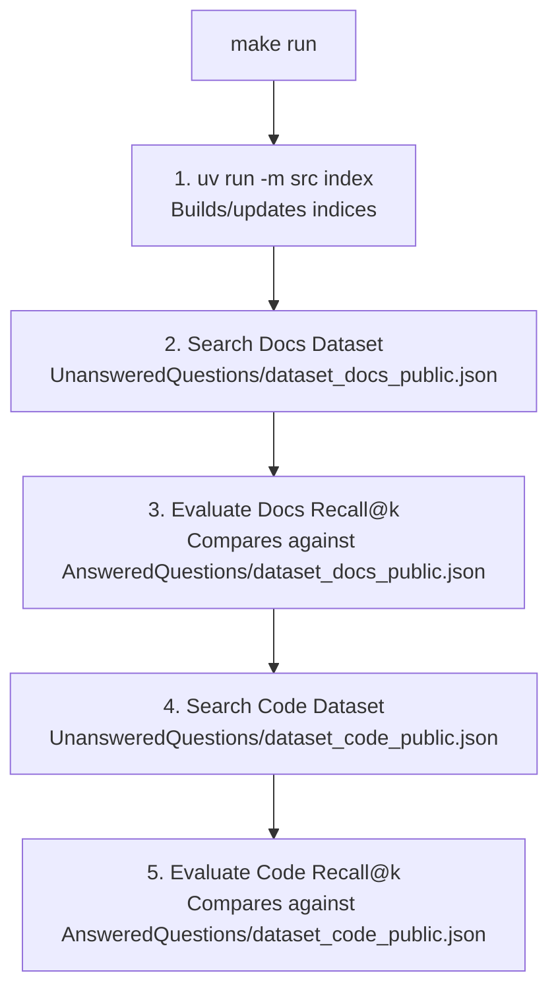

# 🛠️ Pipeline Tuning, Benchmarking & Extension Guide

This guide explains what each optimization, benchmark command, and extension option mentioned in our previous message actually means, where the code lives, how to modify it, and what impact it will have on your RAG system.

---

## 1. What "Tweaking & Optimizing the Pipeline" Means

Your RAG system relies on several hyperparameters that directly affect its **retrieval accuracy (Recall@k)**, **latency**, and **answer quality**.

---

### A. Tuning Hybrid Search Weights (`src/retriever.py`)

#### How it works now:
In [`src/retriever.py`](src/retriever.py#L194-L220), your searcher uses **Weighted Score Fusion (WSF)**:
```python
def wsf_lexical(self, lexical_result: list[dict[str, Any]], weight: float = 0.8) -> None:
    ...
    chunk["score"] *= weight  # Default: 0.8 (80% influence)

def wsf_semantic(self, semantic_result: list[dict[str, Any]], weight: float = 0.2) -> None:
    ...
    chunk["score"] = similarity * weight  # Default: 0.2 (20% influence)
```

#### Why is Lexical (BM25) set to 0.8 and Semantic set to 0.2?
- **Codebases contain exact tokens**: Function names like `PagedAttention`, parameter names like `gpu_memory_utilization`, or classes like `LLMEngine` are exact words. BM25 excels at matching these specific technical tokens.
- **Dense semantic vectors** (`all-MiniLM-L6-v2`) capture conceptual similarity, but can sometimes dilute exact code identifier matches.

#### Experiments you can run:
| Lexical Weight | Semantic Weight | Best Use Case |
|---|---|---|
| `0.8` (current) | `0.2` (current) | **Balanced Code & Docs**: Best overall recall on technical tokens. |
| `0.5` | `0.5` | **Conceptual Questions**: Better when questions describe behavior without naming the function (e.g., *"How does memory paging free up blocks?"*). |
| `0.9` | `0.1` | **Pure Code Search**: Heavily prioritizes exact keyword and symbol matches. |

#### Testing Alternative Fusion: Reciprocal Rank Fusion (RRF)
Your [`src/retriever.py`](src/retriever.py#L140-L165) already contains `rrf_hybrid_retrieval()`!
To test RRF instead of WSF, switch one line in `get_resources()`:
```python
def get_resources(self, query: str) -> list[MinimalSource]:
    lexical_result = self.lexical_searcha(query)
    semantic_result = self.semantic_search(query)
    # Switch from: return self.wsf_hybrid_reriever(lexical_result, semantic_result)
    return self.rrf_hybrid_retrieval(lexical_result, semantic_result)
```

---

### B. Adjusting Chunk Sizes (`src/config.py`)

#### Current Setting:
In [`src/config.py`](src/config.py#L13):
```python
MAX_CHUNK_SIZE: int = 2000  # Maximum character limit per chunk
```

#### The Trade-Offs:
- **Smaller Chunks (e.g. 500 – 1000 chars)**:
  - ✅ **Higher Embedding Precision**: `all-MiniLM-L6-v2` has a 256-word token limit. Chunks larger than ~1,000 characters get truncated by the embedding model.
  - ❌ **Fragmented Code**: A class or large function may be split in half, losing context.
  - ❌ **More Chunks**: Increases index size in ChromaDB and BM25.
- **Larger Chunks (e.g. 1500 – 2000 chars)**:
  - ✅ **Complete Context**: Entire functions with their docstrings and comments fit into one chunk.
  - ❌ **Embedding Averaging**: Dense vectors represent the "average" meaning of a large block, which can lower semantic precision.
  - ⚠️ **Project Constraint**: Must remain $\le 2000$ to comply with the project evaluation specification.

> **Note**: Whenever you change `MAX_CHUNK_SIZE`, you must re-index:
> ```bash
> uv run python -m src index --max_chunk_size <new_size>
> ```

---

### C. Adjusting Prompt Budget & Generation (`src/prompts.py` & `src/config.py`)

In [`src/prompts.py`](src/prompts.py#L5):
```python
MAX_CONTEXT_CHARS: int = 6000  # Total context passed to LLM
```
- If this is too small: The LLM might lack context and output `"I don't know."`
- If this is too large: Generation slows down and smaller models like `Qwen3-0.6B` might suffer from "lost-in-the-middle" attention degradation.

---

## 2. What "Test or Benchmark with `make run`" Means

Running `make run` executes the entire automated testing and evaluation pipeline defined in your [`Makefile`](Makefile):



### How the Evaluation Metric Works (`src/evaluator.py`)
For each question, the evaluator checks if any of your retrieved top-$k$ sources match the ground-truth reference:
1. **File Match**: `raw_source.file_path == student_source.file_path`
2. **Span Overlap (IoU $\ge 0.05$)**:
   $$\text{IoU} = \frac{\text{Intersection of character spans}}{\text{Union of character spans}} \ge 0.05$$
3. **Recall@k**: Percentage of questions where at least one correct source appeared in the top-$k$ retrieved chunks.

### Target Thresholds:
| Evaluation | Metric | Target | Current Score |
|---|---|---|---|
| **Docs Dataset** | Recall@5 | $\ge 80.0\%$ | **81.0%** ✅ |
| **Docs Dataset** | Recall@10 | — | **89.0%** ✅ |
| **Code Dataset** | Recall@5 | $\ge 50.0\%$ | **55.6%** ✅ |
| **Code Dataset** | Recall@10 | — | **59.6%** ✅ |

---

## 3. What "Add New Features" Means

Here are concrete enhancements you can add to take the project further:

### Idea 1: Add a Cross-Encoder Reranker
Instead of only ranking with BM25 + bi-encoder vectors, pass the top-20 candidates to a Cross-Encoder (e.g., `cross-encoder/ms-marco-MiniLM-L-6-v2`) to re-score the top-$k$:
```python
from sentence_transformers import CrossEncoder

reranker = CrossEncoder("cross-encoder/ms-marco-MiniLM-L-6-v2")
pairs = [[query, chunk.text] for chunk in candidate_chunks]
scores = reranker.predict(pairs)
# Sort candidate_chunks by score
```
*Impact*: Typically boosts Recall@5 and answer relevance significantly.

---

### Idea 2: Add Streaming Answers in FastAPI Server (`src/server.py`)
Currently, `/answer` waits until the entire answer is generated. You can stream tokens using FastAPI's `StreamingResponse`:
```python
from fastapi.responses import StreamingResponse
from transformers import TextIteratorStreamer
import threading

@app.get("/answer/stream")
def stream_answer(query: str, k: int = 10):
    ...
```

---

### Idea 3: Add Unit Tests (`tests/`)
Add automated tests using `pytest` to verify:
1. `validate_chunk` catches negative offsets and out-of-bounds text.
2. `is_file_dirty` correctly detects modified vs unchanged files.
3. Cache serialization and deserialization work deterministically.

---

## 4. Quick Command Summary

| Action | Command |
|---|---|
| **Run full indexing & benchmark** | `make run` |
| **Re-index only** | `uv run python -m src index --max_chunk_size 2000` |
| **Search a question** | `uv run python -m src search "What is PagedAttention?" --k 5` |
| **Generate an answer** | `uv run python -m src answer "What is PagedAttention?" --k 5` |
| **Run evaluation manually** | `uv run python -m src evaluate` |
| **Start HTTP API server** | `uv run python -m src serve --port 8000` |
| **Run linter & type checks** | `make lint` |
