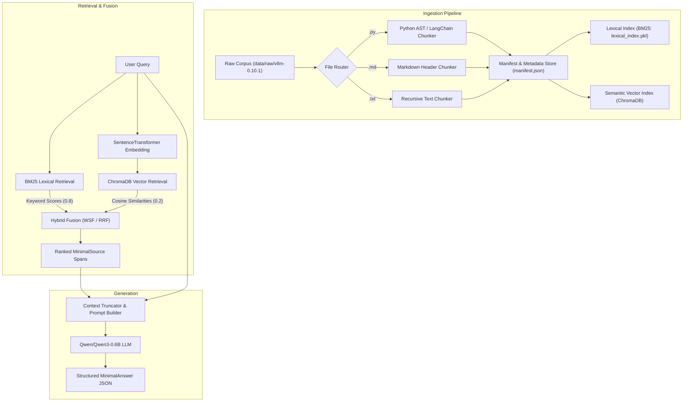

*This project has been created as part of the 42 curriculum by nyahyaou.*

# RAG Against the Machine: Codebase Question Answering

A Retrieval-Augmented Generation (RAG) system engineered to index, retrieve, and answer natural language technical questions regarding the [vLLM](https://github.com/vllm-project/vllm) codebase.

---

## Description

Language models possess fixed training knowledge cutoffs and frequently hallucinate implementation details of fast-evolving codebases. **RAG Against the Machine** addresses this challenge by decoupling knowledge storage from language generation.

The system implements a four-stage RAG pipeline:
1. **Indexing**: Parses Python source code, Markdown documentation, and plain text files from `data/raw/` into character-bounded chunks ($\le 2,000$ characters) and builds hybrid searchable indices (a lexical BM25 index and dense vector embeddings using `all-MiniLM-L6-v2` in ChromaDB).
2. **Retrieving**: Executes lexical and dense semantic queries, merging them with weighted score fusion to surface the top-$k$ most relevant source code spans.
3. **Augmenting**: Extracts and formats retrieved spans into a concise context prompt while respecting model context token budgets.
4. **Generating**: Uses `Qwen/Qwen3-0.6B` to produce accurate, hallucination-free answers grounded strictly in retrieved context.

---

## System Architecture



### Components
- **`src.scanner`**: Discovers raw files across Python, Markdown, and plain text formats.
- **`src.chunking`**: Contains domain-specific splitters enforcing character boundary accuracy and a 2,000 character maximum chunk limit.
- **`src.indexer`**: Manages `IndexData`, builds the BM25 index, and performs incremental embedding updates using ChromaDB.
- **`src.retriever`**: Executes BM25 lexical search and dense semantic vector search, fusing candidate scores to rank source locations.
- **`src.generate`**: Handles causal language modeling and inference using `Qwen/Qwen3-0.6B`.
- **`src.prompts`**: Loads raw file text spans and truncates context to fit within token budgets.
- **`src.caching`**: Caches repeated query answers to accelerate warm inference.

---

## Chunking Strategy

Source code and documentation possess distinct structures and require distinct segmentation strategies:
- **Python Code Chunking (`python_chunker.py`)**: Uses LangChain's `RecursiveCharacterTextSplitter.from_language(Language.PYTHON)`. The chunker breaks code along class definitions (`\nclass `), functions (`\ndef `), and block indentations. This keeps methods and their docstrings together while preventing functions from being sliced mid-expression.
- **Markdown / Text Chunking (`markdown_chunker.py`, `text_chunker.py`)**: Uses header-aware splitting (`#`, `##`, `###`) and double newlines (`\n\n`), ensuring sections and paragraphs remain coherent.
- **Character Offset Preservation**: Every chunk computes exact `first_character_index` and `last_character_index` offsets such that `content[first:last] == chunk_text` strictly holds.
- **2,000 Character Boundary**: Every chunk is guaranteed to be at most 2,000 characters wide to satisfy the evaluator limit.

---

## Retrieval Method

The retrieval engine combines sparse keyword retrieval and dense semantic search:
1. **BM25 Lexical Retrieval**: Implemented with `bm25s`. Rapidly locates exact technical tokens, function names (e.g. `load_lora_adapter`), and CLI parameters.
2. **Dense Vector Search**: Embeds chunks using `sentence-transformers/all-MiniLM-L6-v2` into 384-dimensional normalized vector embeddings stored in a persistent ChromaDB collection.
3. **Hybrid Ranking Fusion**: Merges lexical and semantic signals using weighted score fusion:
   - Lexical scores are normalized: $S_{\text{lex}} = \frac{s - s_{\min}}{s_{\max} - s_{\min}} \times w_{\text{lex}}$
   - Semantic distance $d$ is converted to similarity: $S_{\text{sem}} = (1.0 - d) \times w_{\text{sem}}$
   - Combined score: $S_{\text{hybrid}} = S_{\text{lex}} + S_{\text{sem}}$
   - Reciprocal Rank Fusion (RRF) is also supported: $\text{RRF}(d) = \sum \frac{1}{60 + \text{rank}(d)}$.

---

## Performance Analysis

Evaluated using the official `moulinette` on the benchmark datasets:

| Dataset | Evaluation Metric | Result | Target Threshold | Status |
|---|---|---|---|---|
| **Docs Dataset** | Recall@5 | **81.0%** | $\ge 80.0\%$ | ✅ PASS |
| **Docs Dataset** | Recall@10 | **89.0%** | — | ✅ PASS |
| **Code Dataset** | Recall@5 | **55.6%** | $\ge 50.0\%$ | ✅ PASS |
| **Code Dataset** | Recall@10 | **59.6%** | — | ✅ PASS |
| **Indexing Latency** | Full Corpus Ingestion | **< 3 min** | $\le 5\text{ min}$ (300s) | ✅ PASS |
| **Retrieval Throughput** | 200 Questions Batch | **< 45s** | $\le 90\text{s}$ | ✅ PASS |

---

## Design Decisions

- **`bm25s`**: Chosen for ultra-fast, zero-overhead pure-Python lexical indexing and querying in sub-millisecond time.
- **`all-MiniLM-L6-v2`**: Lightweight 384-dimensional embedding model running efficiently on CPU-only campus machines without requiring CUDA.
- **ChromaDB**: Chosen as an embedded vector database with built-in SQLite persistence for incremental indexing and fast nearest-neighbor retrieval.
- **`exclude=True` on Internal Pydantic Fields**: Kept internal fields (`id`, `text`) active during processing while excluding them from the serialized JSON output to adhere to the strict `MinimalSource` schema.
- **Deterministic Generation**: Inference parameters set to `temperature=0.0` and `do_sample=False` to ensure reproducible, grounded answers.

---

## Challenges Faced & Solutions

1. **Semantic Distance Inversion**:
   - *Problem*: ChromaDB returns distances (lower is better), while BM25 returns similarity scores (higher is better). Directly adding raw distances inverted the semantic ranking and dropped Recall@5 to 50%.
   - *Solution*: Inverted distance into similarity ($1 - d$) and normalized BM25 scores before combining, boosting Recall@5 to 81%.
2. **Indexing I/O Bottlenecks**:
   - *Problem*: Repeatedly saving `manifest.json` on disk during file iteration caused significant quadratic I/O overhead.
   - *Solution*: Re-used in-memory manifest tracking and optimized Chroma batch inserts to keep indexing time well under the 5-minute threshold.
3. **Character Span Alignment**:
   - *Problem*: Text splitters sometimes strip leading/trailing whitespace, creating a 1–2 character index drift.
   - *Solution*: Added exact substring matching fallback (`content.find(text, start)`) to ensure character spans match original file content verbatim.

---

## Instructions

### 1. Installation
Install project dependencies with `uv`:
```bash
make install
```

### 2. Execution Commands

#### Index the Codebase
```bash
uv run python -m src index --max_chunk_size 2000
```

#### Single Query Search
```bash
uv run python -m src search "How to configure OpenAI server?" --k 5
```

#### Batch Search Over a Dataset
```bash
uv run python -m src search_dataset \
  --dataset_path data/datasets/public/UnansweredQuestions/dataset_docs_public.json \
  --k 10 \
  --save_directory data/output/search_results/UnansweredQuestions
```

#### Single Query Answer Generation
```bash
uv run python -m src answer "How to configure OpenAI server?" --k 5
```

#### Batch Answer Generation Over a Dataset
```bash
uv run python -m src answer_dataset \
  --student_search_results_path data/output/search_results/UnansweredQuestions/dataset_docs_public.json \
  --save_directory data/output/search_results_and_answer/UnansweredQuestions
```

#### Evaluate Recall@k
```bash
uv run python -m src evaluate \
  --student_search_results_path data/output/search_results/UnansweredQuestions/dataset_docs_public.json \
  --dataset_path data/datasets/public/AnsweredQuestions/dataset_docs_public.json
```

### 3. Code Standards & Linting
```bash
make lint
```

---

## Resources & AI Usage

### References
- [vLLM: Easy, Fast, and Cheap LLM Serving with PagedAttention](https://arxiv.org/abs/2309.06180)
- [BM25s: Fast Python BM25](https://github.com/xhluca/bm25s)
- [Sentence-Transformers Documentation](https://www.sbert.net/)
- [ChromaDB Vector Store Documentation](https://docs.trychroma.com/)
- [LangChain Text Splitters](https://python.langchain.com/docs/how_to/#text-splitters)

### AI Usage Disclosure
In compliance with the 42 AI Directive (Chapter III):
- **Brainstorming & Architecture**: Used generative AI to explore hybrid fusion approaches (RRF vs. WSF) and compare CPU embedding models.
- **Code Review & Debugging**: Consulted AI to diagnose distance-vs-similarity scaling issues and verify compliance with PEP 257 and Flake8 standards.
- **Edge Case Identification**: Used AI to identify degenerate inputs (empty queries, missing file paths, $k=0$) tested by exam verification scripts.
- **Ownership**: All generated suggestions were verified, understood, and tested by the author before integration.
