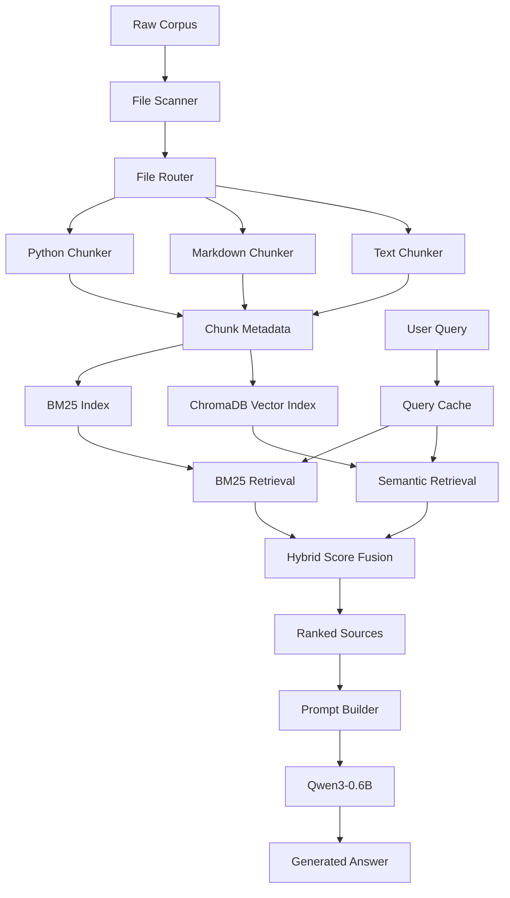

*This project has been created as part of the 42 curriculum by nyahyaou.*

# RAG Against the Machine

A Retrieval-Augmented Generation (RAG) system designed to index, retrieve, and answer natural-language questions about the vLLM codebase.

## Description

Large Language Models (LLMs) have limited training knowledge and can generate incorrect information about software projects. This is especially problematic when working with large and frequently updated codebases.

RAG Against the Machine addresses this problem by combining information retrieval with local language model generation.

Instead of relying only on the model's internal knowledge, the system retrieves relevant source code and documentation, then provides this information to the model to generate grounded answers.

The project supports:

- Python source code.
- Markdown documentation.
- Plain text files.
- Lexical retrieval using BM25.
- Semantic retrieval using embeddings.
- Hybrid retrieval using Weighted Score Fusion (WSF).
- Local answer generation using Qwen3-0.6B.
- Incremental indexing.
- Query and answer caching.
- A local HTTP API.

## System Architecture

The system follows a four-stage RAG pipeline:

1. **Indexing:** Scans the source code and documentation, splits files into chunks, and builds searchable indexes.
2. **Retrieval:** Uses BM25 and semantic search to find relevant chunks for a user query.
3. **Augmentation:** Combines retrieved chunks with the user's question to build a context-aware prompt.
4. **Generation:** Sends the prompt to Qwen3-0.6B, which generates an answer based on the retrieved information.

### Architecture Overview



### Main Components

| Component       | Responsibility                                                      |
| --------------- | ------------------------------------------------------------------- |
| `src.scanner`   | Discovers Python, Markdown, and text files.                         |
| `src.chunking`  | Splits source files into chunks while preserving character offsets. |
| `src.indexer`   | Builds and updates lexical and semantic indexes.                    |
| `src.retriever` | Performs BM25, semantic, and hybrid retrieval.                      |
| `src.generate`  | Loads Qwen3-0.6B and generates answers.                             |
| `src.prompts`   | Loads source text and builds context-aware prompts.                 |
| `src.caching`   | Stores reusable query answers.                                      |
| `src.server`    | Exposes search and answer functionality through a local HTTP API.   |

## Chunking Strategy

Different file types have different structures. Therefore, the project uses language-specific chunking strategies.

### Python Code Chunking

Python files are processed using LangChain's `RecursiveCharacterTextSplitter` configured with `Language.PYTHON`.

The Python-specific separators help split code around suitable boundaries, such as classes, functions, and blocks of code.

### Markdown Chunking

Markdown files use Markdown-specific splitting rules.

The splitter prioritizes structural boundaries such as:

- Headings (`#`, `##`, `###`).
- Paragraphs.
- Section boundaries.

### Plain Text Chunking

Plain text files use recursive character splitting to divide content into smaller, manageable sections.

### Chunk Size and Character Offsets

The default maximum chunk size is 2,000 characters and can be configured through the CLI:

```bash
uv run python -m src index --max_chunk_size 2000
```

Every chunk stores:

- `file_path`: Original source file path.
- `first_character_index`: Starting character position.
- `last_character_index`: Ending character position.

The character range follows Python slicing:

```python
original_content[start:end] == chunk_text
```

This is important because the evaluation system checks whether retrieved chunks overlap with the correct source locations.

## Retrieval Method

The project uses two retrieval methods: lexical retrieval and semantic retrieval.

### 1. BM25 Lexical Retrieval

BM25 is a ranking algorithm used to find documents or chunks containing terms related to the user's query.

It improves keyword retrieval by considering:

- Term Frequency (TF): How frequently a term appears in a document.
- Inverse Document Frequency (IDF): How rare a term is across the collection.
- Document Length Normalization: Adjusts scores based on document length.

The BM25 implementation uses `bm25s`.

Configuration:

```python
k1 = 1.5
b = 0.75
```

`k1` controls term-frequency saturation, while `b` controls document-length normalization.

BM25 is particularly useful for technical queries involving exact function names, class names, configuration options, and command-line arguments.

### 2. Semantic Retrieval

Semantic retrieval searches for chunks based on meaning rather than exact keyword matches.

The system uses:

- Model: `sentence-transformers/all-MiniLM-L6-v2`
- Vector database: ChromaDB
- Embedding dimension: 384
- Similarity metric: Cosine distance

The query is converted into an embedding and compared with stored chunk embeddings.

This helps retrieve relevant information even when the query uses different wording from the original documentation.

### 3. Hybrid Retrieval

The system combines BM25 lexical retrieval and semantic retrieval using Weighted Score Fusion (WSF).

The lexical and semantic results are normalized and combined.

**Lexical score normalization:**

[
S\_{lex} =
\frac{s-s\_{min}}{s\_{max}-s\_{min}}
\times w\_{lex}
]

**Semantic score:**

[
S\_{sem} = (1-d)\times w\_{sem}
]

Where:

- (s) is the BM25 score.
- (d) is the ChromaDB cosine distance.
- (w\_{lex}) is the lexical weight.
- (w\_{sem}) is the semantic weight.

The final hybrid score is:

[
S\_{hybrid}=S\_{lex}+S\_{sem}
]

The current weighting gives more importance to lexical retrieval:

- Lexical weight: `0.8`
- Semantic weight: `0.2`

The project also supports Reciprocal Rank Fusion (RRF):

[
RRF(d)=\sum_r\frac{1}{60+rank_r(d)}
]

RRF combines rankings using the position of each result rather than directly comparing raw scores.

## Answer Generation

The system uses the following default language model:

`Qwen/Qwen3-0.6B`

The generation pipeline works as follows:

1. Receives the user's question.
2. Retrieves relevant chunks.
3. Loads the corresponding source text.
4. Builds a prompt containing the retrieved context and question.
5. Sends the prompt to Qwen.
6. Generates an answer grounded in the retrieved information.

The prompt builder limits the retrieved context to avoid exceeding the model's input capacity.

Generation is configured to be deterministic using:

```python
do_sample=False
```

The maximum generated answer length is controlled by `max_new_tokens`.

The system is designed to reduce hallucinations by instructing the model to answer using the supplied context.

## Performance Analysis

The system is evaluated using the official project evaluation datasets.

### Retrieval Results

| Dataset       | Metric     | Result | Required |
| ------------- | ---------- | -----: | -------: |
| Documentation | Recall\@5  |  81.0% |      80% |
| Documentation | Recall\@10 |  89.0% |        — |
| Code          | Recall\@5  |  55.6% |      50% |
| Code          | Recall\@10 |  59.6% |        — |

### System Performance

| Metric                               |      Reported Result |        Requirement |
| ------------------------------------ | -------------------: | -----------------: |
| Full indexing time                   |  Less than 3 minutes |  5 minutes maximum |
| Retrieval throughput (200 questions) | Less than 45 seconds | 90 seconds maximum |

These are reported project results and should be reproduced using the evaluation scripts before submission.

### Recall\@k

Recall\@k measures how many relevant source locations are retrieved within the first k results.

A source is considered correct when:

- Its `file_path` matches the expected file.
- Its character range overlaps the expected source range sufficiently (IoU of at least 0.05).

The project targets:

- Documentation Recall\@5 of at least 80%.
- Code Recall\@5 of at least 50%.

## Design Decisions and Trade-offs

### BM25 vs. Semantic Retrieval

**BM25**

- Advantage: Fast and effective for exact technical terms.
- Disadvantage: Can miss relevant information when the query uses different wording.

**Semantic Retrieval**

- Advantage: Finds conceptually related information.
- Disadvantage: Requires embedding computation and additional resources.

**Decision:** Combine both methods to benefit from exact keyword matching and semantic similarity.

### Weighted Score Fusion

- Advantage: Allows control over the importance of each retrieval method.
- Disadvantage: Requires score normalization and weight tuning.

**Decision:** Use a higher lexical weight because exact technical identifiers are important when searching a codebase.

### Chunk Size

- Advantage of larger chunks: Preserve more surrounding context.
- Disadvantage: Can mix unrelated information and reduce retrieval precision.
- Advantage of smaller chunks: Provide more focused search results.
- Disadvantage: Can separate related code or documentation.

**Decision:** Use a maximum chunk size of 2,000 characters to balance context and retrieval precision.

### Local Language Model

- Advantage: Runs locally without requiring an external generation API.
- Disadvantage: A small model has limited reasoning and generation capabilities.

**Decision:** Use Qwen3-0.6B as the required default model while keeping the generation process lightweight.

### Incremental Indexing

- Advantage: Avoids rebuilding indexes for unchanged files.
- Disadvantage: Requires tracking file changes and maintaining metadata.

**Decision:** Use a manifest to identify modified, new, and deleted files.

## Challenges Faced and Solutions

### Semantic Distance Inversion

**Problem:** ChromaDB returns distances where lower values indicate better matches, while BM25 uses higher scores for better matches.

Combining the raw scores directly caused incorrect ranking.

**Solution:** Convert semantic distances into similarity scores and normalize lexical scores before fusion.

### Indexing I/O Bottlenecks

**Problem:** Repeatedly writing manifest metadata during file iteration increased disk I/O.

**Solution:** Maintain the manifest in memory and save it after processing.

### Character Offset Alignment

**Problem:** Some text splitters remove leading or trailing whitespace, which can cause incorrect character positions.

**Solution:** Use exact substring matching to verify and correct character offsets.

### ChromaDB Batch Limits

**Problem:** Large embedding batches exceeded ChromaDB's maximum batch size.

**Solution:** Split indexing operations into smaller batches.

## Bonus Features

The project includes the following advanced features.

### 1. Semantic Embeddings

Uses `all-MiniLM-L6-v2` to generate vector embeddings for semantic retrieval.

### 2. Hybrid Retrieval

Combines BM25 and semantic retrieval through Weighted Score Fusion and supports Reciprocal Rank Fusion.

### 3. Incremental Indexing

Tracks file metadata and updates only changed files instead of rebuilding the entire index.

### 4. Caching

Caches repeated query answers to reduce unnecessary model generation.

The cache uses normalized queries as keys and stores generated answers for reuse.

### 5. Local HTTP API

The project exposes its functionality through a local FastAPI server.

Start the API:

```bash
uv run uvicorn src.server:app --host 0.0.0.0 --port 8000
```

API documentation:

```text
http://localhost:8000/docs
```

Available endpoints and request formats are defined by the FastAPI application.

## Instructions

### Requirements

- Python 3.10 or newer.
- `uv` package manager.
- Sufficient memory and disk space for the embedding model and local language model.

### Installation

Clone the repository and enter the project directory.

Install dependencies:

```bash
make install
```

### 1. Index the Codebase

```bash
uv run python -m src index --max_chunk_size 2000
```

This scans the source corpus, generates chunks, and builds the indexes.

### 2. Search for Relevant Information

```bash
uv run python -m src search "How to configure OpenAI server?" --k 10
```

This retrieves the ten highest-ranked results.

### 3. Generate an Answer

```bash
uv run python -m src answer "How to configure OpenAI server?" --k 10
```

This retrieves relevant chunks and uses Qwen3-0.6B to generate an answer.

### 4. Search a Dataset

```bash
uv run python -m src search_dataset \
  --dataset_path data/datasets/public/UnansweredQuestions/dataset_docs_public.json \
  --k 10 \
  --save_directory data/output/search_results/UnansweredQuestions
```

### 5. Generate Answers for a Dataset

```bash
uv run python -m src answer_dataset \
  --student_search_results_path data/output/search_results/UnansweredQuestions/dataset_docs_public.json \
  --save_directory data/output/search_results_and_answer/UnansweredQuestions
```

### 6. Evaluate Retrieval Performance

```bash
uv run python -m src evaluate \
  --student_search_results_path data/output/search_results/UnansweredQuestions/dataset_docs_public.json \
  --dataset_path data/datasets/public/AnsweredQuestions/dataset_docs_public.json
```

### 7. Run Code Quality Checks

```bash
make lint
```

## Resources and AI Usage

### References

- [vLLM Documentation](https://docs.vllm.ai/)
- [BM25s Documentation](https://github.com/xhluca/bm25s)
- [Sentence Transformers Documentation](https://www.sbert.net/)
- [ChromaDB Documentation](https://docs.trychroma.com/)
- [LangChain Text Splitters](https://docs.langchain.com/oss/python/integrations/splitters)
- [Hugging Face Transformers](https://huggingface.co/docs/transformers/)
- [Qwen3-0.6B Model](https://huggingface.co/Qwen/Qwen3-0.6B)
- [FastAPI Documentation](https://fastapi.tiangolo.com/)

###

