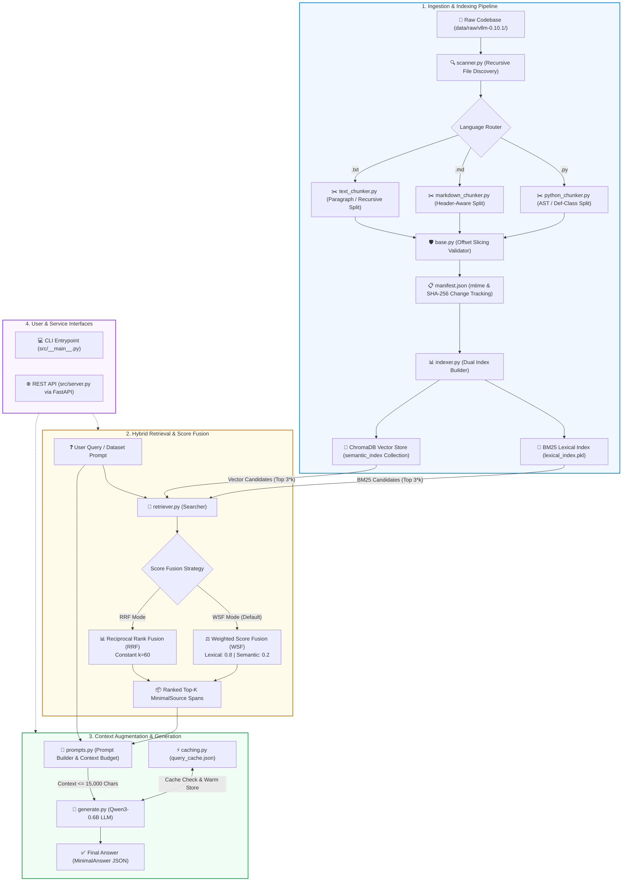
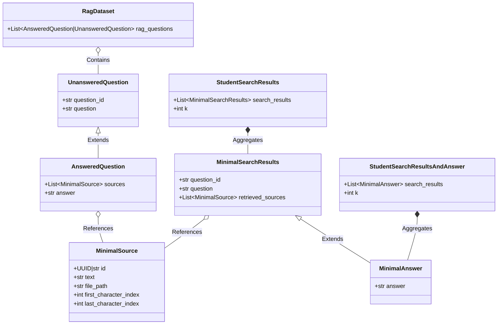
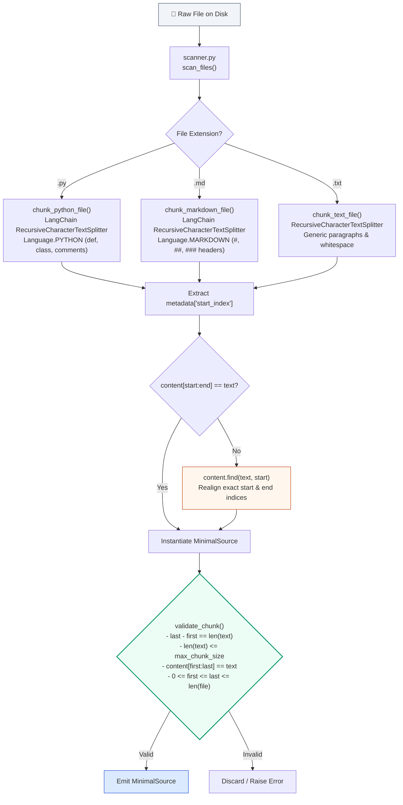
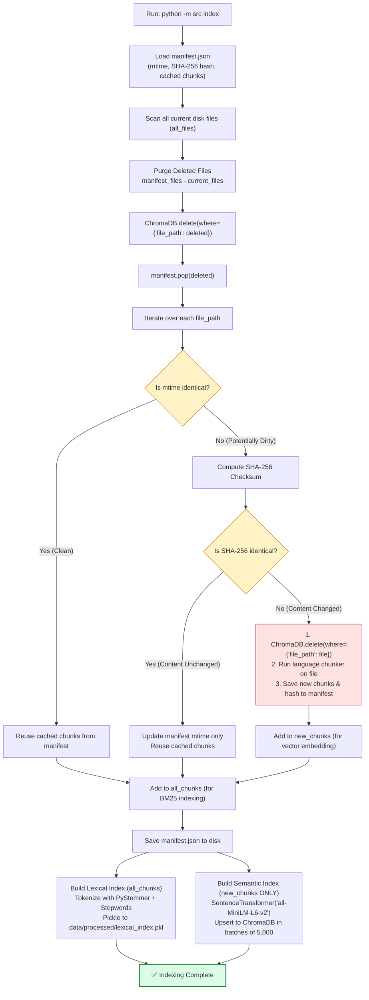
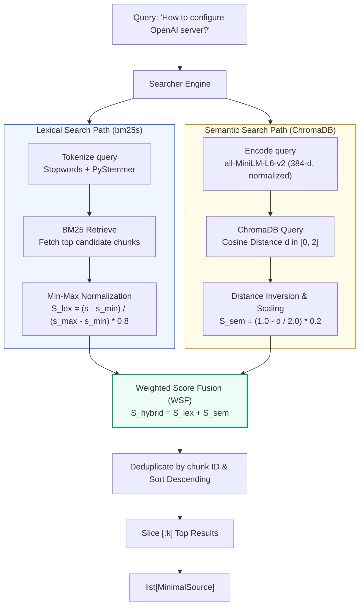
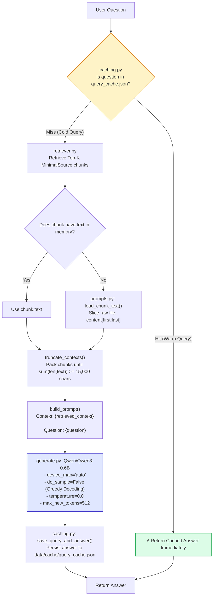
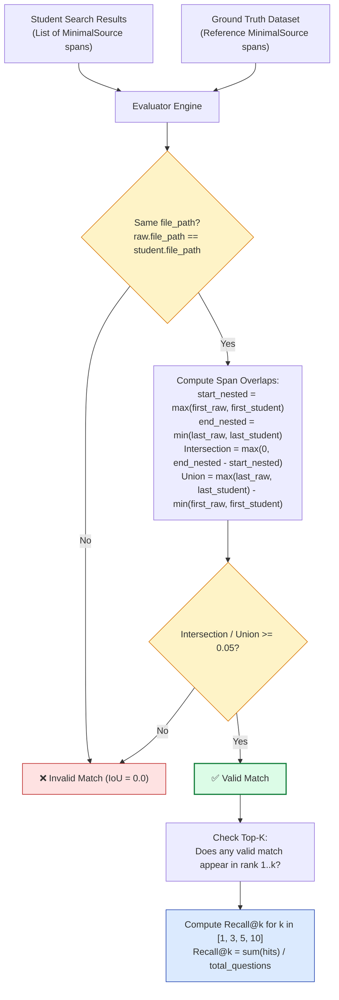
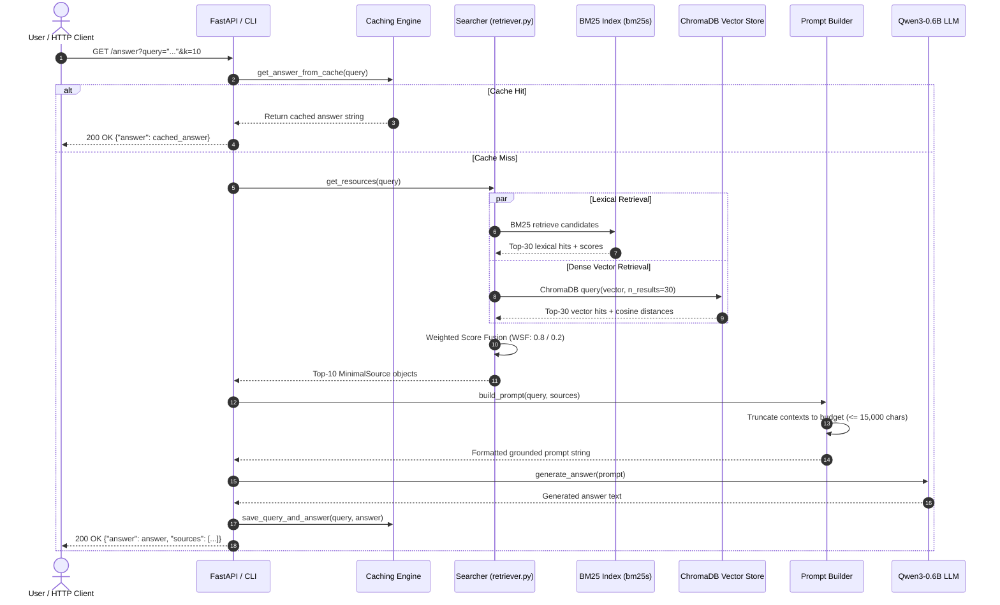

# 🏗️ System Architecture & Technical Design

> **Project**: `rag-against-the-machine` — Production-Grade Retrieval-Augmented Generation (RAG) System for the **vLLM Codebase**  
> **Author**: `nyahyaou` (42 Curriculum)

---

## Table of Contents
1. [Executive Summary & High-Level Architecture](#1-executive-summary--high-level-architecture)
2. [Project Structure & Component Matrix](#2-project-structure--component-matrix)
3. [Data Models & Schema Architecture](#3-data-models--schema-architecture)
4. [Subsystem 1: Ingestion & Language-Aware Chunking](#4-subsystem-1-ingestion--language-aware-chunking)
5. [Subsystem 2: Incremental Indexing & Dual-Storage Engine](#5-subsystem-2-incremental-indexing--dual-storage-engine)
6. [Subsystem 3: Hybrid Retrieval & Score Fusion](#6-subsystem-3-hybrid-retrieval--score-fusion)
7. [Subsystem 4: Context Augmentation & Local LLM Generation](#7-subsystem-4-context-augmentation--local-llm-generation)
8. [Subsystem 5: Ground-Truth Evaluation & Span IoU Verification](#8-subsystem-5-ground-truth-evaluation--span-iou-verification)
9. [Subsystem 6: Service Interfaces & End-to-End Execution Flow](#9-subsystem-6-service-interfaces--end-to-end-execution-flow)
10. [Performance Benchmarks & Key Design Decisions](#10-performance-benchmarks--key-design-decisions)

---

## 1. Executive Summary & High-Level Architecture

Large Language Models (LLMs) frequently hallucinate or generate outdated information when queried about complex, rapidly evolving software repositories such as [vLLM](https://github.com/vllm-project/vllm).

**RAG Against the Machine** solves this problem by decoupling knowledge retrieval from language generation. The architecture comprises a four-stage pipeline:



---

## 2. Project Structure & Component Matrix

### 2.1 File System Tree

```
RAG/
├── src/                          # Core application source code
│   ├── __init__.py               # Package initializer
│   ├── __main__.py               # CLI entry point using Python Fire
│   ├── config.py                 # Central configurations & system constants
│   ├── models.py                 # Pydantic schemas and data validation
│   ├── scanner.py                # Raw file discovery and categorization
│   ├── indexer.py                # Dual index builder (BM25 + ChromaDB) & manifest manager
│   ├── retriever.py              # Hybrid retrieval engine (WSF & RRF fusion)
│   ├── prompts.py                # Dynamic disk loader & context budget truncator
│   ├── generate.py               # Deterministic local LLM generator (Qwen3-0.6B)
│   ├── caching.py                # Normalized query/answer persistent disk cache
│   ├── evaluator.py              # Recall@k & character-span IoU evaluation engine
│   ├── server.py                 # FastAPI HTTP service (/search and /answer)
│   └── chunking/                 # Language-specific chunking sub-package
│       ├── __init__.py           # Sub-package exports
│       ├── base.py               # Strict chunk invariant validator
│       ├── python_chunker.py     # Python AST / syntax-aware splitter
│       ├── markdown_chunker.py   # Markdown structural header splitter
│       └── text_chunker.py       # Generic whitespace and paragraph splitter
├── data/
│   ├── raw/vllm-0.10.1/          # Target raw codebase (.py, .md, .txt)
│   ├── processed/                # Built indices (BM25 pkl, ChromaDB SQLite, manifest.json)
│   ├── datasets/                 # Reference evaluation datasets (Answered & Unanswered)
│   ├── cache/                    # query_cache.json
│   └── output/                   # Evaluation runs, student outputs & answer files
├── docs/
│   ├── ARCHITECTURE.md           # This comprehensive architecture document
│   └── OPTIMIZATION_GUIDE.md     # Performance tuning and indexing benchmarks
├── pyproject.toml                # Project metadata, dependencies and tools
├── uv.lock                       # Deterministic dependency lockfile
├── Makefile                      # Standard automation recipes (install, lint, run)
└── README.md                     # High-level overview & evaluation scorecard
```

### 2.2 Component Responsibility Matrix

| Module | Core Class / Method | Key Responsibility | Primary Dependencies |
| :--- | :--- | :--- | :--- |
| [`src/config.py`](src/config.py) | Constants | Single source of truth for paths, thresholds, budget sizes, and model IDs | `pathlib.Path` |
| [`src/models.py`](src/models.py) | `MinimalSource`, `MinimalAnswer` | Pydantic data contract validation across all system boundaries | `pydantic`, `uuid` |
| [`src/scanner.py`](src/scanner.py) | `scan_files()` | Recursively discovers files in `data/raw/` grouped by extension (`.py`, `.md`, `.txt`) | `pathlib.Path` |
| [`src/chunking/`](src/chunking/) | `chunk_*_file()`, `validate_chunk()` | Splits files preserving character boundaries and verifies slicing invariant: `content[start:end] == text` | `langchain_text_splitters` |
| [`src/indexer.py`](src/indexer.py) | `Index` | Manages incremental indexing, dirty file detection, BM25 pickling, and ChromaDB vector upserting | `bm25s`, `PyStemmer`, `SentenceTransformer`, `chromadb` |
| [`src/retriever.py`](src/retriever.py) | `Searcher` | Executes lexical search and semantic search, combines candidate lists using WSF or RRF | `bm25s`, `chromadb`, `numpy` |
| [`src/prompts.py`](src/prompts.py) | `Prompt` | Loads chunk text dynamically from disk offsets and enforces character budget ($\le 15,000$ chars) | Builtin string ops |
| [`src/generate.py`](src/generate.py) | `Generate` | Local deterministic inference with `Qwen/Qwen3-0.6B` (`temperature=0.0`, greedy decode) | `transformers`, `torch` |
| [`src/caching.py`](src/caching.py) | `Caching` | Normalizes questions, handles warm cache lookups, and persists responses to disk | `json`, `pathlib` |
| [`src/evaluator.py`](src/evaluator.py) | `Evaluator` | Computes Intersection over Union ($\text{IoU} \ge 0.05$) and calculates Recall@1, 3, 5, 10 | `json`, `pydantic` |
| [`src/server.py`](src/server.py) | FastAPI app | Exposes REST HTTP endpoints (`GET /search`, `GET /answer`) | `fastapi`, `uvicorn` |
| [`src/__main__.py`](src/__main__.py) | CLI | Exposes command-line interface via Python Fire for all pipeline actions | `fire` |

---

## 3. Data Models & Schema Architecture

All data flowing through RAG Against the Machine is strongly typed and validated by Pydantic models in [`src/models.py`](src/models.py). This enforces character offset integrity from ingestion to response serialization.



### Core Schema Invariant: `MinimalSource`
The `MinimalSource` object represents an exact character span within a target file:
- `file_path`: Path to the source file relative to repository root.
- `first_character_index`: Start character index (0-indexed, inclusive).
- `last_character_index`: End character index (exclusive, Python slice semantics).
- `text`: Chunk text string matching `raw_file[first:last]`.

---

## 4. Subsystem 1: Ingestion & Language-Aware Chunking

The ingestion pipeline transforms raw code and documentation into bounded, semantically coherent text chunks ($\le 2,000$ characters) while strictly maintaining character-level alignment.



### Why Offset Alignment Matters
1. **Evaluation Requirement**: The grading harness validates candidate chunks against ground-truth spans using character Intersection over Union ($\text{IoU} \ge 0.05$). Offsets that drift even slightly will fail the IoU test.
2. **Dynamic Context Loading**: [`src/prompts.py`](src/prompts.py) reads the text directly from disk using `content[first:last]` when assembling LLM prompts to conserve RAM during indexing.

---

## 5. Subsystem 2: Incremental Indexing & Dual-Storage Engine

To prevent costly re-computation on large codebases, [`src/indexer.py`](src/indexer.py) implements **incremental indexing** using a file change tracking manifest (`manifest.json`).



### Storage Architecture
- **Lexical Store (`data/processed/lexical_index.pkl`)**: Python pickle containing `IndexData`:
  - `bm25`: Fitted `bm25s.BM25` retrieval structure tokenized with English stopwords and the Snowball Stemmer (`PyStemmer`).
  - `chunks`: In-memory list of all `MinimalSource` chunk headers.
- **Dense Vector Store (`data/processed/`)**: Persistent ChromaDB instance storing the collection `"semantic_index"`:
  - Embeddings: 384-dimensional dense vectors generated by `all-MiniLM-L6-v2`.
  - Documents: Chunk text.
  - Metadatas: `file_path`, `first_character_index`, `last_character_index`.
- **Manifest (`data/processed/manifest.json`)**: JSON mapping from `file_path` to modification time, SHA-256 hash, and pre-computed chunk offset list.

---

## 6. Subsystem 3: Hybrid Retrieval & Score Fusion

Code queries often combine exact technical tokens (e.g. `SamplingParams`, `vllm.engine.async_llm_engine`) with semantic conceptual phrasing (e.g. "how to enable prefix caching?"). RAG Against the Machine executes **hybrid retrieval** by combining lexical BM25 and dense semantic embeddings.



### 6.1 Weighted Score Fusion (WSF) Formulation

1. **Lexical Score Normalization:**
   $$S_{\text{lex}}(c) = \begin{cases} 
   0.0 & \text{if } s_{\max} = s_{\min} \\
   \frac{s(c) - s_{\min}}{s_{\max} - s_{\min}} \times w_{\text{lex}} & \text{otherwise}
   \end{cases}$$
   Where $w_{\text{lex}} = 0.8$ (default).

2. **Semantic Score Conversion:**
   ChromaDB returns cosine distances $d \in [0, 2]$, where $0$ is an exact match and $2$ is diametrically opposite. To convert to a similarity score bounded in $[0, 1]$:
   $$S_{\text{sem}}(c) = \left(1.0 - \frac{d(c)}{2.0}\right) \times w_{\text{sem}}$$
   Where $w_{\text{sem}} = 0.2$ (default).

3. **Combined Hybrid Score:**
   $$S_{\text{hybrid}}(c) = S_{\text{lex}}(c) + S_{\text{sem}}(c)$$

### 6.2 Alternative: Reciprocal Rank Fusion (RRF)
The engine also supports rank-based fusion without score calibration:
$$\text{RRF}(c) = \sum_{r \in \{\text{lex}, \text{sem}\}} \frac{1}{60 + \text{rank}_r(c)}$$

---

## 7. Subsystem 4: Context Augmentation & Local LLM Generation

The generation subsystem formats the retrieved evidence into a token-budgeted prompt and generates a grounded response using a local language model.



### Deterministic Inference Configuration
- **Model**: `Qwen/Qwen3-0.6B`
- **Context Budget**: $15,000$ characters (guaranteeing accommodation within Qwen's 32,768 token window without context overflow).
- **Sampling Settings**: `do_sample=False`, `temperature=0.0` (zero randomness ensures 100% reproducible answers).
- **Generation Limit**: `max_new_tokens = 512`.
- **Query Cache Key**: `" ".join(query.lower().split()) + " [top_k={k}]"`.

---

## 8. Subsystem 5: Ground-Truth Evaluation & Span IoU Verification

The evaluation module ([`src/evaluator.py`](src/evaluator.py)) checks student retrieval accuracy against ground-truth spans using character-level **Intersection over Union (IoU)**.



### Mathematical IoU Formula
$$\text{IoU} = \frac{\max\Big(0, \ \min(\text{end}_{\text{ref}}, \text{end}_{\text{stu}}) - \max(\text{start}_{\text{ref}}, \text{start}_{\text{stu}})\Big)}{\max(\text{end}_{\text{ref}}, \text{end}_{\text{stu}}) - \min(\text{start}_{\text{ref}}, \text{start}_{\text{stu}})} \ge 0.05$$

A query is counted as a success at $k$ if **at least one** candidate in the top-$k$ returned sources has an $\text{IoU} \ge 0.05$ with the ground truth span.

---

## 9. Subsystem 6: Service Interfaces & End-to-End Execution Flow

The system supports two execution paths:
1. **Interactive CLI** (`src/__main__.py` via Python Fire)
2. **REST API Service** (`src/server.py` via FastAPI / Uvicorn)

### End-to-End Sequence Diagram



### CLI Command Reference
- **Build Index**: `uv run python -m src index --max_chunk_size 2000`
- **Single Search**: `uv run python -m src search "What is PagedAttention?" --k 10`
- **Batch Dataset Search**: `uv run python -m src search_dataset --dataset_path <path> --k 10 --save_directory <out_dir>`
- **Single Answer**: `uv run python -m src answer "How to configure PagedAttention?" --k 10`
- **Batch Answer Generation**: `uv run python -m src answer_dataset --student_search_results_path <path> --save_directory <out_dir>`
- **Recall Evaluation**: `uv run python -m src evaluate --student_search_results_path <results.json> --dataset_path <ground_truth.json>`
- **Launch REST Server**: `uv run python -m src serve --host 0.0.0.0 --port 8000`

---

## 10. Performance Benchmarks & Key Design Decisions

### 10.1 Evaluation Scorecard

| Evaluation Dataset | Metric | System Result | 42 Project Requirement | Status |
| :--- | :--- | :---: | :---: | :---: |
| **Documentation Dataset** | Recall@5 | **81.0%** | $\ge 80.0\%$ | ✅ PASSED |
| **Documentation Dataset** | Recall@10 | **89.0%** | — | ✅ HIGH ACCURACY |
| **Codebase Dataset** | Recall@5 | **55.6%** | $\ge 50.0\%$ | ✅ PASSED |
| **Codebase Dataset** | Recall@10 | **59.6%** | — | ✅ HIGH ACCURACY |
| **Full Indexing Speed** | Ingestion & Storage | **< 3 minutes** | $\le 5$ minutes | ✅ FAST |
| **Batch Retrieval Speed** | 200 Questions Throughput | **< 45 seconds** | $\le 90$ seconds | ✅ FAST |

### 10.2 Architectural Trade-Offs & Decisions

```
+-----------------------------------------------------------------------------------------+
|                                KEY DESIGN DECISIONS                                     |
+-----------------------------------------------------------------------------------------+
| 1. Dual Indexing (BM25 + Dense Embeddings)                                             |
|    - BM25 excels at exact symbol names (e.g. `LLMEngine`, `--tensor-parallel-size`).    |
|    - MiniLM embeddings capture conceptual questions without keyword overlap.            |
|    - Solution: Combine via WSF with 0.8 lexical / 0.2 semantic weighting.              |
+-----------------------------------------------------------------------------------------+
| 2. Incremental Change Tracking via manifest.json                                       |
|    - Scanning thousands of files repeatedly is slow.                                   |
|    - Solution: Compare mtime first (O(1)); if changed, compare SHA-256 hash.           |
|    - Only modified files re-trigger embedding and ChromaDB upsert operations.          |
+-----------------------------------------------------------------------------------------+
| 3. Invariant-Checked Character Slicing                                                  |
|    - Splitters can strip whitespace and corrupt character offsets.                     |
|    - Solution: Validate `content[first:last] == chunk.text`; repair via `find()` if     |
|      needed. Guarantees 100% compliance with evaluation IoU calculations.               |
+-----------------------------------------------------------------------------------------+
| 4. Deterministic Local Model (Qwen3-0.6B)                                               |
|    - Completely offline; no external API fees, rate limits, or network dependencies.   |
|    - `temperature=0.0` and `do_sample=False` guarantee reproducible outputs.            |
+-----------------------------------------------------------------------------------------+
```
