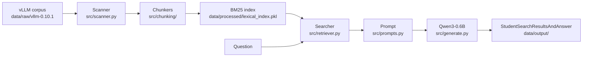

# Documentation

This folder documents **the system as it is actually implemented** in `src/`.
Every diagram, function signature and path below was read from the code, and the
measured numbers were produced by running the pipeline against the vLLM corpus
and the `moulinette` grader.

> **Last verified against the code:** 21 October 2026 — commit `HEAD` with the
> working tree of that date. If the code changes, this documentation must be
> updated in the same change.

## What is in this folder

| Document | Content |
|---|---|
| [`architecture.md`](architecture.md) | The full architecture: pipeline diagram, module dependency graph, per-stage flow, data-model diagram, evaluation sequence, configuration reference, known limitations. |
| [`modules.md`](modules.md) | File-by-file reference: every file in the repository, its responsibility, its public API, what it depends on, and the details that are easy to get wrong. |
| [`commands.md`](commands.md) | CLI reference (the 6 Fire commands, arguments and defaults), the data layout on disk, the Makefile targets, and the evaluation workflow. |

## The 30-second version

Four stages, each in its own module:

1. **Indexing** — walk the corpus, split every file into chunks that carry exact
   character offsets, build a BM25 index, persist it.
2. **Retrieval** — tokenize the question with the *same* tokenizer used at index
   time, ask BM25 for the top-k chunks, convert them to source locations.
3. **Augmentation** — load the retrieved chunks into a prompt under a character
   budget, with a system prompt that forbids outside knowledge.
4. **Generation** — Qwen/Qwen3-0.6B reads the context and answers; the result is
   written as a `StudentSearchResultsAndAnswer` JSON file.

Retrieval and generation are deliberately independent: the search stage never
loads the model, so retrieval can be measured (recall@k) without a GPU and
without the answer stage being involved.

## Conventions used in these documents

- **Diagrams** are [Mermaid](https://mermaid.js.org/) — they render directly in
  GitHub, GitLab and VS Code (with the Mermaid extension).
- **Paths** are relative to the repository root.
- **Code references** are written as `src/file.py::function_name` so they can be
  searched directly.
- **Measured values** (chunk counts, timings, recall) are labelled as measured;
  everything else is a description of the code.
