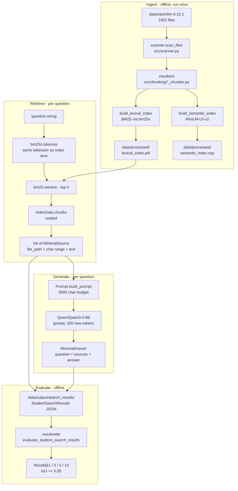
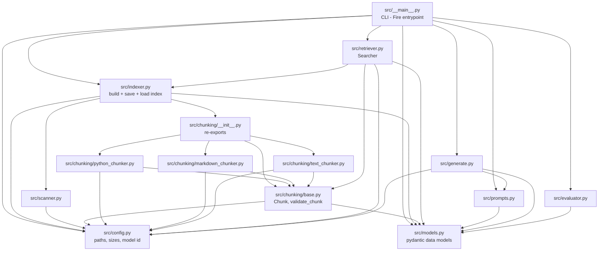
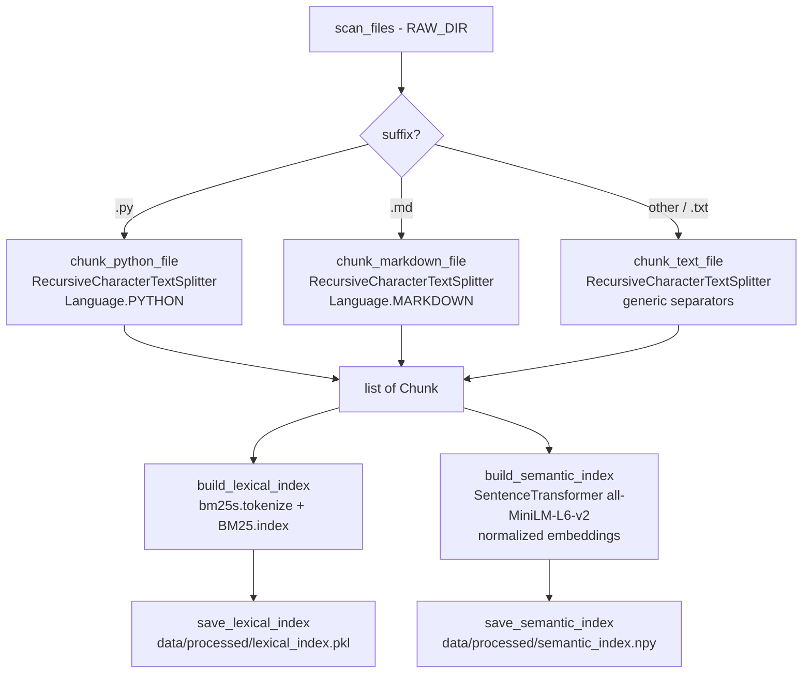
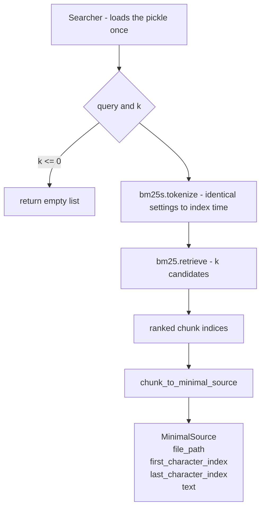
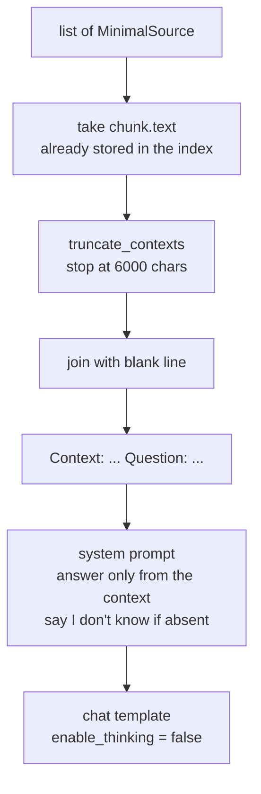
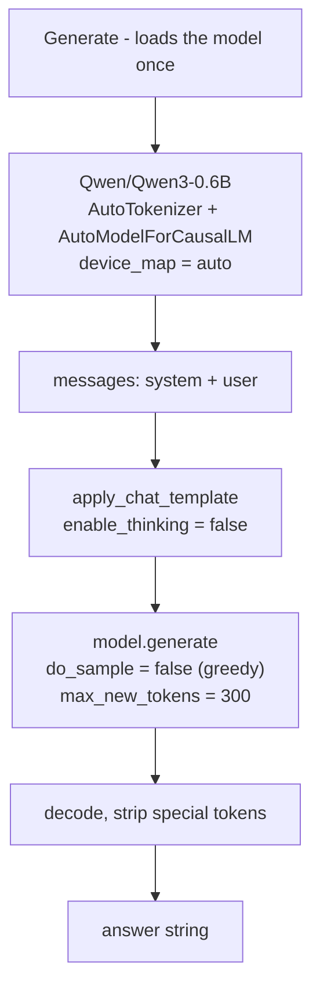
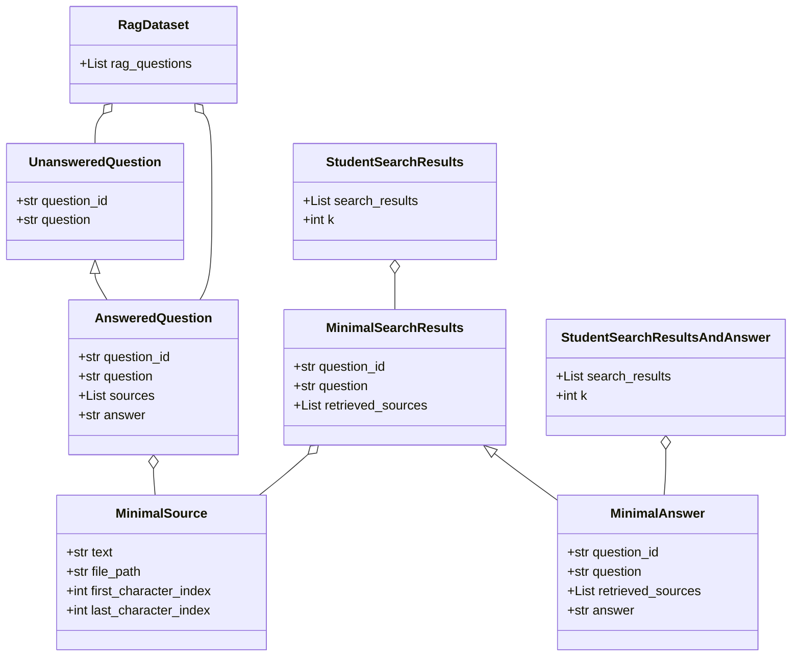
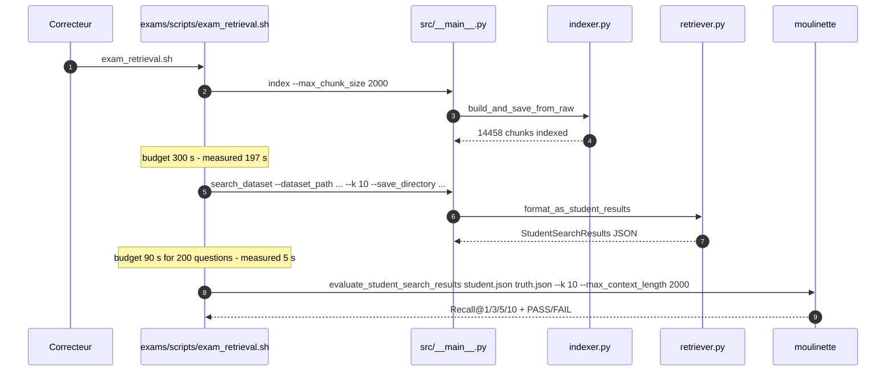

# Architecture

How this RAG system is actually built: the modules, the data that flows
between them, and the artefacts they produce on disk.

---

## 1. System overview



**Data contract between stages.** Retrieval speaks `MinimalSource`
(`file_path`, `first_character_index`, `last_character_index`, plus the chunk
`text`); the dataset layer speaks `RagDataset`; the output layer speaks
`StudentSearchResults` and `StudentSearchResultsAndAnswer`. Every one of these
is a pydantic model in `src/models.py`, so a malformed payload fails at the
boundary instead of corrupting the next stage.

---

## 2. Module dependency graph

Nothing in `src/` imports anything outside `src/` (except third-party
libraries), and there are **no circular imports**. The graph below is the
complete import relation of the package.



Two rules keep this graph clean:

- **The chunking package never imports the indexer.** Chunking knows about files
  and character offsets, nothing about BM25.
- **The retriever never imports the generator.** Retrieval can be run and
  measured on its own, which is what makes recall@k reproducible.

---

## 3. Repository layout

```text
.
├── src/                          # the whole implementation
│   ├── __init__.py               # package marker
│   ├── __main__.py               # Fire CLI: 6 commands
│   ├── config.py                 # every path, size and model constant
│   ├── models.py                 # pydantic data models
│   ├── scanner.py                # corpus discovery
│   ├── chunking/                 # 3 chunking strategies + shared Chunk type
│   │   ├── __init__.py
│   │   ├── base.py
│   │   ├── python_chunker.py
│   │   ├── markdown_chunker.py
│   │   └── text_chunker.py
│   ├── indexer.py                # build / save / load the index
│   ├── retriever.py              # BM25 search
│   ├── prompts.py                # context budget + prompt assembly
│   ├── generate.py               # Qwen3-0.6B answer generation
│   └── evaluator.py              # local recall@k (own iteration only)
├── constants.py                  # path constants (mirrors src/config.py)
├── data/
│   ├── raw/vllm-0.10.1/          # the corpus that gets indexed
│   ├── processed/                # lexical_index.pkl, semantic_index.npy
│   ├── datasets/{public,private}/ # question datasets
│   └── output/                   # search results + answers
├── docs/                         # this documentation
├── exams/scripts/                # the grader scripts (exam_retrieval.sh, ...)
├── evaluations/                  # recorded run logs
├── Makefile                      # install / run / debug / clean / lint
├── pyproject.toml                # dependencies, uv
└── uv.lock                       # pinned dependency versions
```

---

## 4. Stage 1 — Indexing



### 4.1 The `Chunk` contract

```python
@dataclass(frozen=True)
class Chunk:
    text: str                  # the chunk content
    file_path: str             # "data/raw/..." relative to the repo root
    first_character_index: int # inclusive start in the original file
    last_character_index: int  # exclusive end
```

Three invariants hold for every chunk the indexer produces, and they are what
makes the character ranges comparable with the ground truth:

| Invariant | Why it matters |
|---|---|
| `file_content[first:last] == text` | The grader re-reads the file at the reported range; a mismatch means the range points at the wrong code. |
| `last - first == len(text)` | The range describes exactly the text that was indexed. |
| `len(text) <= max_chunk_size` (2000) | The grader rejects any source wider than its `--max_context_length` of 2000. |

**Measured on the current index:** 14 458 chunks from 1952 files, largest chunk
exactly 2000 characters, and the range/text invariant verified on 3000 randomly
sampled chunks with zero mismatches.

### 4.2 How the character offsets survive splitting

LangChain's splitter reports a `start_index` in its metadata, but it strips
leading/trailing whitespace by default, so the naive `content[start:end]` can
differ from the chunk text by a few characters. Each chunker therefore repairs
the offset:

```python
start = doc.metadata["start_index"]
end = start + len(text)
if content[start:end] != text:          # whitespace was stripped
    found = content.find(text, start)    # re-anchor on the exact text
    if found != -1:
        start, end = found, found + len(text)
```

This is the reason the reported ranges line up with the corpus, and therefore
the reason recall is measured correctly.

### 4.3 The lexical index

`build_lexical_index` tokenizes every chunk with `bm25s.tokenize` and hands the
result to `bm25s.BM25`. The tokenizer settings are the library defaults —
lowercasing, the `\b\w\w+\b` pattern, English stop-word removal and no
stemming. The important property is not *which* settings were chosen but that
**the same function is used at index time and at query time**; a mismatch
between the two destroys recall silently.

The index is persisted with `pickle` (protocol 4) as a single `IndexData`
object holding the BM25 model, the ordered chunk list and the tokenized
corpus, so a warm search loads everything in one file open.

### 4.4 The semantic index

`build_semantic_index` encodes every chunk with `all-MiniLM-L6-v2`
(L2-normalized, 384 dimensions) and stores the matrix in
`data/processed/semantic_index.npy`.

> **Current status:** the vectors are **built and saved but never queried**.
> The retriever is pure BM25, so the semantic index contributes nothing to the
> results today. It is the groundwork for hybrid retrieval (bonus part), but
> it is also the most expensive part of indexing: the full `index` command
> takes **197 s** on the development machine (≈4 s for the lexical index and
> ≈193 s for the encoding), i.e. two thirds of the 300 s budget is spent on an
> artefact the retrieval does not use, and it requires downloading
> `all-MiniLM-L6-v2` at index time.

---

## 5. Stage 2 — Retrieval



`Searcher` loads `data/processed/lexical_index.pkl` **once** in its
constructor. `format_as_student_results` then loops over the dataset and calls
`search()` per question, which is what keeps a 200-question batch at a few
seconds instead of re-loading a 33 MB pickle per question.

`search()` returns `[]` for `k <= 0` and for an empty query, which is what
makes the degenerate-input cases return an empty result instead of crashing.

`chunk_to_minimal_source` is the single place where an internal `Chunk` becomes
a public `MinimalSource`.

---

## 6. Stage 3 — Augmentation (prompt assembly)



Two budgets are in play:

- `MAX_CONTEXT_CHARS = 6000` — the total size of the retrieved context that is
  pasted into the prompt. Contexts are added in retrieval order until the
  budget is reached, so the highest ranked chunks always survive.
- `QWEN_MAX_NEW_TOKENS = 300` — the answer length cap.

The context is read from `MinimalSource.text`, i.e. from the copy stored in the
index at indexing time. The file is therefore **not** re-read at query time,
which keeps answering fast and independent of the working directory.

---

## 7. Stage 4 — Generation



Generation is greedy (`do_sample=False`), so the same context always produces
the same answer — a requirement for reproducible evaluation.

`Generate.answer_dataset` walks a `StudentSearchResults` file, builds one
prompt per question and collects the answers into a
`StudentSearchResultsAndAnswer`.

---

## 8. Data models



The models are the ones required by the subject. The only extension is the
optional `text` field on `MinimalSource` (default `""`), which lets the answer
stage use the chunk content without re-reading the source file. The grader
accepts it: the `moulinette` reports `Student data is valid: True` on files
produced by the current code.

---

## 9. Evaluation flow



**How recall is computed.** A retrieved source matches a reference source when
the `file_path` is identical **and** the character ranges overlap with an
IoU of at least 0.05. Matching the exact reference span is therefore not
required — retrieving a chunk that covers the right region of the right file
is enough.

**Measured results** (100 questions per dataset, `k = 10`):

| Dataset | Recall@1 | Recall@3 | Recall@5 | Recall@10 | Threshold | Verdict |
|---|---|---|---|---|---|---|
| docs (public) | 59.0 % | 78.0 % | **81.0 %** | 89.0 % | 80 % | PASS |
| code (public) | 30.3 % | 47.5 % | **55.6 %** | 59.6 % | 50 % | PASS |
| docs (private) | 66.0 % | 81.0 % | **85.0 %** | 87.0 % | 80 % | PASS |
| code (private) | 29.0 % | 47.0 % | **50.0 %** | 57.0 % | 50 % | PASS |

The private code set sits exactly on its threshold — see
[Known limitations](#11-known-limitations).

---

## 10. Configuration

All constants live in `src/config.py` and are imported from there; nothing is
duplicated in the code.

| Constant | Value | Role |
|---|---|---|
| `RAW_DIR` | `data/raw/vllm-0.10.1` | Corpus root scanned by the indexer |
| `PROCESSED_DIR` | `data/processed` | Where the index artefacts are written |
| `INDEX_PATH` | `data/processed/lexical_index.pkl` | The BM25 index file |
| `MAX_CHUNK_SIZE` | `2000` | Maximum characters per chunk (grader limit) |
| `TOP_K` | `10` | Default number of retrieved sources |
| `DATASET_DIR` | `data/datasets/public/` | Root of the public question datasets |
| `SEARCH_DATASET_PATH` | `.../UnansweredQuestions/dataset_docs_public.json` | Default input of `search_dataset` |
| `ANSWERED_DATASET_PATH` | `.../AnsweredQuestions/dataset_docs_public.json` | Default ground truth of `evaluate` |
| `SEARCH_SAVE_DIRECTORY` | `data/output/search_results/` | Default output of `search_dataset` |
| `ANSWER_SAVE_DIRECTORY` | `data/output/search_results_and_answer/` | Default output of `answer_dataset` |
| `STUDENT_SEARCH_RESULTS_PATH` | `data/output/search_results/dataset_docs_public.json` | Default input of `answer_dataset` / `evaluate` |
| `QWEN_MODEL_ID` | `Qwen/Qwen3-0.6B` | The mandatory generation model |
| `QWEN_MAX_NEW_TOKENS` | `300` | Answer length cap |
| `QWEN_TEMPERATURE` | `0.0` | Deterministic decoding |
| `MAX_CONTEXT_CHARS` | `6000` | Context budget of the prompt (`src/prompts.py`) |

> `constants.py` at the repository root duplicates most of these values. It is
> **not imported by `src/`** — `src/config.py` is the single source of truth.

---

## 11. Known limitations

Documented honestly, because they are visible to a reviewer.

| # | Limitation | Impact |
|---|---|---|
| 1 | `Generate.answer_dataset` writes its output with `Path(student_result)` (`src/generate.py:102`) where `student_result` is a pydantic model, not a path → `TypeError`. | The single-question `answer` command works; the batch command generates the answers and then fails to save them. **Must be fixed.** |
| 2 | The semantic index is built but never queried. | 197 s of the 300 s indexing budget is spent on an artefact retrieval does not use, and it requires downloading `all-MiniLM-L6-v2` at index time. |
| 3 | Only the `index` command catches exceptions. `search_dataset`, `answer_dataset` and `evaluate` propagate a traceback on a missing file or malformed JSON. | The subject requires degenerate inputs to be handled gracefully. The automatic edge-case test currently passes only because the missing argument is rejected before the file is opened. |
| 4 | `src/indexer.py` still contains a demo block that calls an undefined `tokenize()`. | `python -m src.indexer` raises `NameError`; the module is otherwise unused. |
| 5 | `validate_chunk()` is implemented but never called by the indexer, and `split_oversized_chunk` is commented out. | The chunk invariants are correct in practice but are not verified at build time. |
| 6 | `Prompt.load_chunk_text()` is unused (the context now comes from `MinimalSource.text`). | Dead code. |
| 7 | `Evaluator.get_score()` only scores the **first** reference source of each question, and raises `KeyError` if a `question_id` is missing from the student results. | The local `evaluate` command is an approximation of the official metric; the `moulinette` is the reference. |
| 8 | Private code recall@5 is exactly 50.0 % against a 50 % threshold. | No margin: any change in tokenizer version, chunking or environment can flip a mandatory metric to FAIL. |
| 9 | `make lint` currently fails (flake8 and mypy findings). | The subject requires the project to pass flake8 and mypy. |

---

## 12. Related documents

- [`modules.md`](modules.md) — every file, its responsibility and its API.
- [`commands.md`](commands.md) — the CLI, the data layout and the Makefile.
