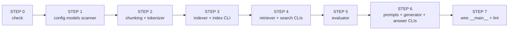

# Implementation Steps — Build `src/` File by File

> Follow in **exact order**. Do not skip. Each step creates one file, tests it, then moves on. The moulinette checks the final result, but this order catches errors early.



---

## STEP 0 — Verify Setup (before writing code)

```bash
uv sync                          # install pydantic fire tqdm rank_bm25 transformers torch
ls data/raw/ | head              # must show vLLM repo (benchmarks/ docs/ vllm/ ...)
ls data/datasets/ 2>&1           # may be empty locally — moulinette injects it during eval
make lint                        # will fail now — ok, just check it runs
```

If `data/raw/` is empty, re-extract the provided vLLM attachment there.

---

## STEP 1 — Foundation (no dependencies between them)

### 1A. Create `src/config.py`
**Inside:** only constants, no logic
```python
from __future__ import annotations
from pathlib import Path

RAW_DIR: Path = Path("data/raw")
PROCESSED_DIR: Path = Path("data/processed")
INDEX_PATH: Path = PROCESSED_DIR / "index.pkl"
DEFAULT_MAX_CHUNK_SIZE: int = 2000
BM25_K1: float = 1.5
BM25_B: float = 0.75
QWEN_MODEL_ID: str = "Qwen/Qwen3-0.6B"
QWEN_MAX_NEW_TOKENS: int = 512
QWEN_TEMPERATURE: float = 0.0
MAX_CONTEXT_CHARS: int = 6000
```
**Test:** `uv run python -c "import src.config; print(src.config.INDEX_PATH)"`

### 1B. Create `src/models.py`
**Inside:** 8 Pydantic models from PDF VI.4 exactly (see `models.md`)
- `MinimalSource`, `UnansweredQuestion`, `AnsweredQuestion`, `RagDataset`
- `MinimalSearchResults`, `MinimalAnswer`, `StudentSearchResults`, `StudentSearchResultsAndAnswer`

**Test:**
```python
uv run python -c "from src.models import MinimalSource; print(MinimalSource(file_path='data/raw/a.py', first_character_index=0, last_character_index=10).model_dump_json())"
```

### 1C. Create `src/scanner.py`
**Inside:** one function
- `scan_files(root: Path = RAW_DIR) -> list[Path]` — `rglob *.py + *.md`, `sorted`, handle missing root

**Test:**
```bash
uv run python -c "from src.scanner import scan_files; from pathlib import Path; print(len(scan_files(Path('data/raw'))))"
# expect >1000 files
```

---

## STEP 2 — Chunking + Tokenizer

### 2A. Create `src/chunking/__init__.py`
Empty (makes `chunking` a package).

### 2B. Create `src/chunking/base.py`
**Inside:**
- `@dataclass(frozen=True) class Chunk: text, file_path, first_character_index, last_character_index`
- `split_oversized_chunk(chunk: Chunk, max_chunk_size: int) -> list[Chunk]`
- `validate_chunk(chunk: Chunk, file_content: str) -> bool`
- optional `chunk_to_minimal_source`

**Test:** validate invariant `content[first:last] == text`

### 2C. Create `src/chunking/python_chunker.py`
**Inside:**
- `chunk_python_file(file_path: Path, max_chunk_size: int = 2000) -> list[Chunk]`
- helpers `_build_line_offsets`, `_lineno_to_char_index`, `_get_node_span`, `_collect_gaps`
- logic: `ast.parse` -> walk `FunctionDef|AsyncFunctionDef|ClassDef` -> `get_source_segment` -> gaps -> `split_oversized_chunk` -> sorted by `first`

**Edge:** `SyntaxError` -> fallback raw-text chunk

**Test:**
```bash
uv run python -c "from src.chunking.python_chunker import chunk_python_file; from pathlib import Path; cs=chunk_python_file(Path('data/raw/vllm/entrypoints/openai/api_server.py')); print(len(cs), all(len(c.text)<=2000 for c in cs))"
```

### 2D. Create `src/chunking/markdown_chunker.py`
**Inside:**
- `chunk_markdown_file(file_path: Path, max_chunk_size: int = 2000) -> list[Chunk]`
- `_split_by_headers`, `_split_by_paragraphs` + `re.compile(r'^#{1,6}\s', re.MULTILINE)` + cursor `find`

**Test:**
```bash
uv run python -c "from src.chunking.markdown_chunker import chunk_markdown_file; from pathlib import Path; cs=chunk_markdown_file(Path('data/raw/README.md')); print(len(cs))"
```

### 2E. Create `src/tokenizer.py`
**Inside:**
- `_TOKEN_RE = re.compile(r'[a-z0-9]+')`
- `tokenize(text: str) -> list[str]` — `lower` + `findall`

**Test:**
```bash
uv run python -c "from src.tokenizer import tokenize; print(tokenize('API_server v2.0'))"
# ['api','server','v2','0']
```

---

## STEP 3 — Indexer + `index` CLI (must be <5 min)

### 3A. Create `src/indexer.py`
**Inside:**
- `@dataclass class IndexData: bm25, chunks, tokenized_corpus`
- `build_index(chunks, k1, b) -> IndexData`
- `save_index(index, path)`, `load_index(path)`
- `build_and_save_from_raw(max_chunk_size)`, `_chunk_file(path, max_chunk_size)` dispatch by suffix

**Pattern:** one `try/except` per file — never abort whole index.

### 3B. Wire `src/__main__.py` — `index` command only (minimal)
```python
from __future__ import annotations
import fire, sys
from src.indexer import build_and_save_from_raw

class CLI:
    def index(self, max_chunk_size: int = 2000) -> None:
        try: build_and_save_from_raw(max_chunk_size)
        except Exception as e: print(f"Error: {e}", file=sys.stderr); sys.exit(1)

def main() -> None: fire.Fire(CLI)
if __name__ == "__main__": main()
```

**Test (the real one):**
```bash
uv run python -m src index --max_chunk_size 2000
# must finish <5 min, creates data/processed/index.pkl

uv run python -c "from src.indexer import load_index; idx=load_index(); print(len(idx.chunks), type(idx.bm25))"
```

---

## STEP 4 — Retriever + `search` CLIs

### 4A. Create `src/retriever.py`
**Inside:**
- `search(query: str, k: int, index: IndexData) -> list[MinimalSource]` — `tokenize` -> `get_scores` -> `argsort[::-1][:k]` -> `MinimalSource(file_path verbatim)` skip >2000
- `search_one`, `format_as_student_results`

**Edge:** `k<=0` or `tokens==[]` -> `[]`

### 4B. Add to `src/__main__.py`
- `search(self, query: str, k: int = 5)` — `load_index` -> `search` -> `print(StudentSearchResults(...).model_dump_json())`
- `search_dataset(self, dataset_path: str, k: int = 5, save_directory: str = ...)` — load `RagDataset`, tqdm loop, write `save_directory/<filename>.json` + `mkdir parents`

**Test:**
```bash
uv run python -m src search "How does vLLM handle attention?" --k 5
# check JSON has search_results[0].retrieved_sources[0].file_path == "data/raw/..."

uv run python -m src search "hello" --k 0   # must not crash -> []
uv run python -m src search "" --k 5        # must not crash -> []
```

---

## STEP 5 — Evaluator (local recall, before touching LLM)

### 5A. Create `src/evaluator.py`
**Inside:**
- `compute_iou(a0,a1,b0,b1) -> float`
- `is_match(ret, truth) -> bool` — `file_path ==` AND `IoU > 0.05`
- `recall_at_k_for_question` + `recall_at_k` -> `dict[int,float]` for k in 1,3,5,10
- `evaluate_files(student_path, dataset_path)` — print table

**Constraint:** never `import moulinette`

### 5B. Add to `src/__main__.py`
- `evaluate(self, student_search_results_path: str, dataset_path: str)`

**Test:**
```bash
uv run python -m src search_dataset --dataset_path data/datasets/UnansweredQuestions/dataset_docs_public.json --k 10 --save_directory data/output/search_results/UnansweredQuestions
uv run python -m src evaluate --student_search_results_path data/output/search_results/UnansweredQuestions/dataset_docs_public.json --dataset_path data/datasets/AnsweredQuestions/dataset_docs_public.json
# target: Recall@5 >= 80% docs / 50% code
# then official: ./moulinette evaluate_student_search_results <student> <truth> --k 10 --max_context_length 2000
```

**If below target:** tweak `BM25_K1/B` in `config.py` or chunking (header vs paragraph) then `index` again -> iterate.

---

## STEP 6 — Prompts + Generator + `answer` CLIs (only after retrieval passes)

### 6A. Create `src/prompts.py`
**Inside:**
- `SYSTEM_PROMPT`, `PROMPT_TEMPLATE`, `MAX_CONTEXT_CHARS`
- `load_chunk_text(source: MinimalSource) -> str` — `Path.read_text()[first:last]`, `try/except -> ""`
- `truncate_contexts(contexts, budget)`, `build_prompt(question, contexts)`

### 6B. Create `src/generator.py`
**Inside:**
- `_model = None; _tokenizer = None` (module globals)
- `get_model_and_tokenizer() -> tuple` — lazy singleton, `AutoTokenizer/Model.from_pretrained(QWEN_MODEL_ID, trust_remote_code=True)`, `float16` if cuda else `float32`, `.eval()`
- `generate_answer(prompt, max_new_tokens, temperature)`, `generate_batch`

**Constraint:** never load at import time

### 6C. Add to `src/__main__.py`
- `answer(self, query: str, k: int = 5)` — `search` -> `load_chunk_text` -> `build_prompt` -> `generate_answer` -> `StudentSearchResultsAndAnswer` JSON stdout
- `answer_dataset(self, student_search_results_path: str, save_directory: str)` — tqdm loop

**Test:**
```bash
uv run python -m src answer "How does vLLM handle attention?" --k 5
uv run python -m src answer_dataset --student_search_results_path data/output/search_results/UnansweredQuestions/dataset_docs_public.json --save_directory data/output/search_results_and_answer/UnansweredQuestions
```

---

## STEP 7 — Wire, Harden, Lint

### 7A. Harden `src/__main__.py`
Wrap every command in:
```python
try: ...
except FileNotFoundError as e: print(f"Error: {e}", file=sys.stderr); sys.exit(1)
except json.JSONDecodeError as e: print(f"Invalid JSON: {e}", file=sys.stderr); sys.exit(1)
except Exception as e: print(f"Error: {e}", file=sys.stderr); sys.exit(1)
```
- All paths parsed as `Path(str_arg)`
- `k` from `--k` never hardcoded
- `tqdm` on: index file loop, search_dataset loop, answer_dataset loop
- `index` checks `all(len(c.text)<=min(max_chunk_size,2000) for c in chunks)` before save

### 7B. Add Types + Lint
```bash
# every function: def f(x: str) -> list[Chunk]:  (use X | None, not Optional)
# add from __future__ import annotations to every file

make lint         # flake8 src/ + mypy src/ --warn-...  -> 0 warnings
make lint-strict  # flake8 src/ + mypy src/ --strict   -> 0 errors
make clean && make install  # full reinstall check
```

### 7C. Final End-to-End Run (exactly how defense runs)
```bash
make install
uv run python -m src index --max_chunk_size 2000
uv run python -m src search_dataset --dataset_path data/datasets/UnansweredQuestions/dataset_docs_public.json --k 10 --save_directory data/output/search_results/UnansweredQuestions
./moulinette evaluate_student_search_results data/output/search_results/UnansweredQuestions/dataset_docs_public.json data/datasets/AnsweredQuestions/dataset_docs_public.json --k 10 --max_context_length 2000
uv run python -m src answer_dataset --student_search_results_path data/output/search_results/UnansweredQuestions/dataset_docs_public.json --save_directory data/output/search_results_and_answer/UnansweredQuestions
make lint-strict
```

---

## Checklist — Tick as You Create

- [ ] `src/config.py`
- [ ] `src/models.py`
- [ ] `src/scanner.py`
- [ ] `src/chunking/__init__.py` + `base.py` + `python_chunker.py` + `markdown_chunker.py`
- [ ] `src/tokenizer.py`
- [ ] `src/indexer.py` + `__main__.py:index`
- [ ] `src/retriever.py` + `__main__.py:search, search_dataset`
- [ ] `src/evaluator.py` + `__main__.py:evaluate` — **gate: 80%/50% before next step**
- [ ] `src/prompts.py` + `src/generator.py` + `__main__.py:answer, answer_dataset`
- [ ] harden + types + `make lint-strict` passes

---

## Where Each Step Maps to Your Architecture Docs

| Step | Read first |
|------|------------|
| 1A | [config.md](config.md) |
| 1B | [models.md](models.md) |
| 1C | [scanner.md](scanner.md) |
| 2B | [chunking-base.md](chunking-base.md) |
| 2C | [chunking-python.md](chunking-python.md) |
| 2D | [chunking-markdown.md](chunking-markdown.md) |
| 2E | [tokenizer.md](tokenizer.md) |
| 3A | [indexer.md](indexer.md) |
| 4A | [retriever.md](retriever.md) |
| 5A | [evaluator.md](evaluator.md) |
| 6A | [prompts.md](prompts.md) |
| 6B | [generator.md](generator.md) |
| 6C+7 | [cli.md](cli.md) |
