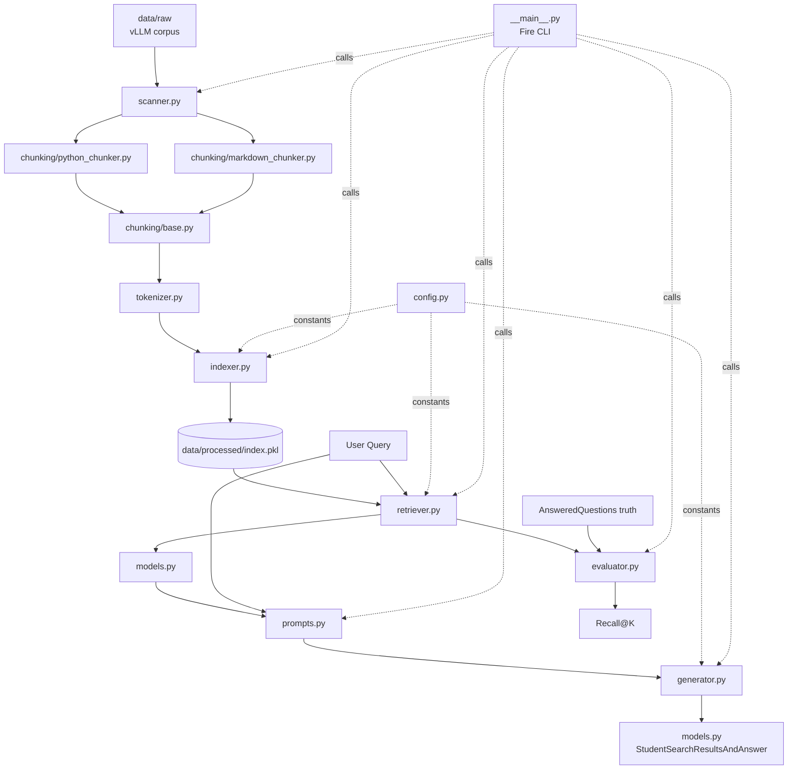
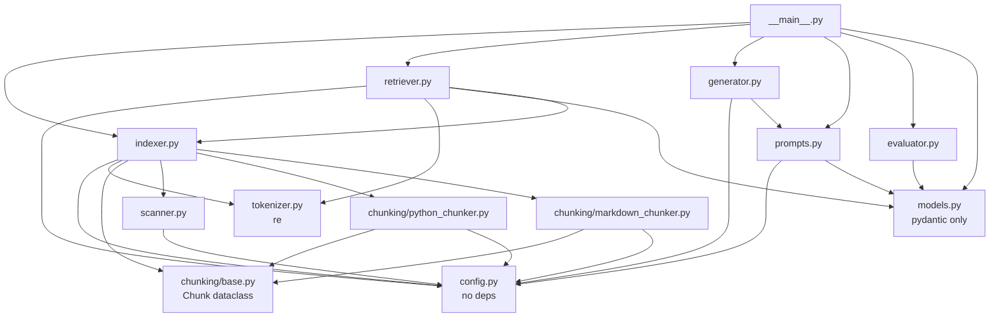
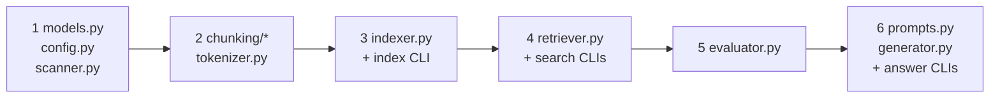

# Architecture — Main Map

> How all code files connect. Each box is one file you will create in `src/`. Click the file name to read its dedicated `.md` with full detail and relations.

## 1. System Pipeline -> Files

## 2. Dependency Graph — Who Imports Whom

## 3. Build Order

## 4. Per-File Docs — Read One per Code File

| # | Code file you will create | Doc file | What it tells you |
|---|---|---|---|
| 1 | `src/config.py` | [config.md](config.md) | All constants + which files use each constant |
| 2 | `src/models.py` | [models.md](models.md) | 8 Pydantic models (VI.4) + inheritance + JSON I/O |
| 3 | `src/scanner.py` | [scanner.md](scanner.md) | `scan_files` + how indexer calls it |
| 4 | `src/chunking/base.py` | [chunking-base.md](chunking-base.md) | `Chunk` dataclass + `split_oversized_chunk` used by both chunkers |
| 5 | `src/chunking/python_chunker.py` | [chunking-python.md](chunking-python.md) | AST chunking + fallback + relation to base/scanner/indexer |
| 6 | `src/chunking/markdown_chunker.py` | [chunking-markdown.md](chunking-markdown.md) | Header chunking + relation to base/scanner/indexer |
| 7 | `src/tokenizer.py` | [tokenizer.md](tokenizer.md) | `tokenize()` + used by indexer + retriever (must be identical) |
| 8 | `src/indexer.py` | [indexer.md](indexer.md) | `IndexData` + BM25 build/save/load + relations in/out |
| 9 | `src/retriever.py` | [retriever.md](retriever.md) | `search` + top-K + relations to indexer/tokenizer/models |
| 10 | `src/prompts.py` | [prompts.md](prompts.md) | `build_prompt` + truncate + relation to retriever/generator |
| 11 | `src/generator.py` | [generator.md](generator.md) | Qwen3-0.6B lazy singleton + relation to prompts/config |
| 12 | `src/evaluator.py` | [evaluator.md](evaluator.md) | `IoU>0.05` + `recall@k` + relation to models + not moulinette |
| 13 | `src/__main__.py` | [cli.md](cli.md) | 6 Fire commands + wiring of all files + error handling |

## 5. Build Steps — Inside Each File

Follow **in order**: [IMPLEMENTATION_STEPS.md](IMPLEMENTATION_STEPS.md) (Steps 0->7, every file inside + test after each)

## 6. Where Docs Already Exist (Do Not Duplicate)

- `docs/project_architecture_and_tasks.md` — learning roadmap + phases + checklist (823 lines, keep)
- `docs/architecture_diagrams.md` — 12 merged Mermaid diagrams (master view, keep)
- This folder `docs/architecture/` — per-file detail (what you asked for now)

if not is.user:
    return []

is the not if at and    user

----------------
"
- `docs/project_architecture_and_tasks.md` — learning roadmap + phases + checklist (823 lines, keep)
- `docs/architecture_diagrams.md` — 12 merged Mermaid diagrams (master view, keep)
- This folder `docs/architecture/` — per-file detail (what you asked for now)
"

