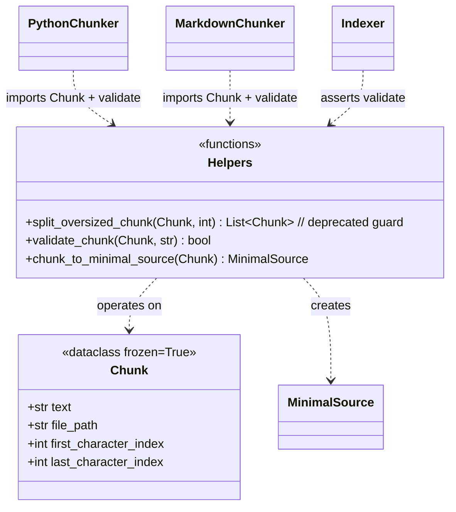

# `src/chunking/base.py` — Architecture

## Role

Shared `Chunk` dataclass + validation helpers. **No structural splitting lives here.** Both `python_chunker` and `markdown_chunker` enforce `<= max_chunk_size` themselves while building chunks (AST units for `.py`, header/paragraph units for `.md`), so every chunk has identical shape and the `<= 2000` guarantee is enforced at source. `base.py` is pure types + guards — it must not contain filetype-specific logic.

> **Option 1 design:** `split_oversized_chunk` is a deprecated compat guard, not a slicer. It exists only because tests may `from chunking.base import split_oversized_chunk`. Blind `range(0, len, max)` slicing would break Python (mid-`def` / mid-string / mid-indent) and Markdown (mid-header / mid-fence / mid-table) structure — chunkers already handle those cases internally.

## Diagram



## Dataclass

```python
from dataclasses import dataclass

@dataclass(frozen=True)
class Chunk:
    text: str
    file_path: str              # verbatim "data/raw/..." relative to repo root, forward slashes
    first_character_index: int  # inclusive start in original file content
    last_character_index: int   # exclusive end: content[start:end] == text  (invariant)
```

- `frozen=True` makes chunks hashable and prevents accidental mutation after indexing.
- `file_path` is `str` not `Path` — must match JSON `MinimalSource.file_path` verbatim.
- `last_character_index` is exclusive — `file_content[first:last] == text` and `last - first == len(text)` always.

## Functions

```python
from src.models import MinimalSource  # required only for chunk_to_minimal_source

def split_oversized_chunk(chunk: Chunk, max_chunk_size: int) -> list[Chunk]:
    """Deprecated guard — kept only for import compatibility.

    Chunkers already enforce len(text) <= max_chunk_size while building
    chunks, so this must NOT do blind range(0, len, max) slicing which
    breaks .py and .md structure.

    If len(chunk.text) <= max_chunk_size: return [chunk].
    Else raise ValueError so a bug in a chunker is caught loudly at
    index time instead of being silently masked.
    """

def validate_chunk(chunk: Chunk, file_content: str) -> bool:
    """Return True iff:
       last-first == len(text) and len(text) <= 2000
       and 0 <= first <= last <= len(file_content)
       and file_content[first:last] == text."""

def chunk_to_minimal_source(chunk: Chunk) -> MinimalSource:
    """Convert Chunk -> MinimalSource (helper for retriever/StudentSearchResults)."""
```

### What MUST NOT be in this file

- No `ast`, `re`, `pathlib` imports — filetype logic belongs in `python_chunker.py` / `markdown_chunker.py`.
- No `range(0, len(text), max_chunk_size)` slicing, no `text[offset:offset+max]` windowing.
- No header / fence / indentation / paragraph heuristics.

### What MUST be in this file

1. `Chunk` — the single source of truth for chunk shape.
2. `split_oversized_chunk` — compat guard that raises on oversized input (or trivially returns `[chunk]`).
3. `validate_chunk` — bounds + equality + `<= 2000` check; called by indexer in debug before tokenizing.
4. `chunk_to_minimal_source` — `MinimalSource(file_path, first, last)` converter; uses `from src.models import MinimalSource`.

## Relations

| Relation | Direction | Detail |
|---|---|---|
| `base -> python_chunker` | imported by | `chunk_python_file()` imports `Chunk` (and `validate_chunk` for debug asserts). `split_oversized_chunk` is NOT called in normal path — oversized logical units are split inline line-aware inside the chunker |
| `base -> markdown_chunker` | imported by | `chunk_markdown_file()` imports `Chunk`. Same — oversized sections split inline paragraph-aware |
| `base -> indexer` | imported by | `build_index()` asserts `validate_chunk` in debug before tokenizing; optionally uses `chunk_to_minimal_source` |
| `base -> tokenizer` | none | Tokenizer takes `chunk.text`, not Chunk |
| `base -> config` | none | `max_chunk_size` is passed in to chunkers, not imported here — keeps base pure |
| `base dependencies` | only | `dataclasses`, `src.models.MinimalSource` for helper |

## Depends On

- `dataclasses` (stdlib)
- `src/models.py` (`MinimalSource`) — only for `chunk_to_minimal_source`.

No other `src/` dependency. No `ast` / `re` / `pathlib`.

## Used By

- `chunking/python_chunker.py` (imports `Chunk`)
- `chunking/markdown_chunker.py` (imports `Chunk`)
- `indexer.py` (validation + conversion)

## Invariants

- `file_content[first:last] == text` must hold for every chunk — test this.
- `last - first == len(text)` always.
- `last - first <= 2000` always (and `<= max_chunk_size` when that < 2000) — enforced by chunkers, verified by `validate_chunk`.
- Chunks from a single file are contiguous and non-overlapping (`chunks[i].last == chunks[i+1].first` with no gaps/duplicates) — guaranteed by chunkers walking the file sequentially, not by `base.py`.
- `file_path` is verbatim `data/raw/...` with forward slashes — never absolute, never `Path` object.

## Why Not Split Here

`base.py` has no `file_path` type context beyond a string suffix. A generic splitter cannot know where a `FunctionDef` ends, where a ``` fence closes, or which header owns a paragraph. The only safe place to split an oversized logical unit (e.g. one 5000-char `def` or one 5000-char Markdown section) is inside the chunker that owns that structure, using `splitlines(keepends=True)` accumulation for `.py` and `\n\n` paragraph accumulation for `.md`.
