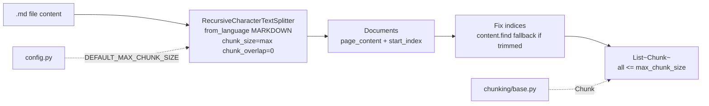

# `src/chunking/markdown_chunker.py` — Architecture

## Role

Splits `.md` files via `langchain_text_splitters` `RecursiveCharacterTextSplitter.from_language(Language.MARKDOWN)`. Uses Markdown-aware separators (`## `, `### `, `\n\n`, `\n`) to keep headers with their bodies. Guarantees `len(text) <= max_chunk_size` via `chunk_size=max_chunk_size, chunk_overlap=0, add_start_index=True`. Not `re` header regex — project decision (Option A langchain) for consistency with `python_chunker`.

## Diagram



## Functions

```python
from pathlib import Path
from langchain_text_splitters import Language, RecursiveCharacterTextSplitter
from src.chunking.base import Chunk

def chunk_markdown_file(file_path: Path, max_chunk_size: int = DEFAULT_MAX_CHUNK_SIZE) -> list[Chunk]:
    """Read file, split with Language.MARKDOWN, return chunks with len<=max and correct first/last via add_start_index."""
```

## Algorithm

```
content = file_path.read_text(encoding="utf-8", errors="ignore")
if not content.strip(): return []
splitter = RecursiveCharacterTextSplitter.from_language(language=Language.MARKDOWN, chunk_size=max, chunk_overlap=0, add_start_index=True)
documents = splitter.create_documents([content])
for doc in documents:
    text = doc.page_content; start = doc.metadata["start_index"]; end = start + len(text)
    if content[start:end] != text: start = content.find(text, start); end = start + len(text)
    chunks.append(Chunk(text, str(file_path), start, end))
```

- Keeps header with body — langchain MARKDOWN separators preserve `## Installation` with following paragraphs.
- `add_start_index` + `find(text, start)` for trimmed cases, handles duplicates by searching from `start` not `0`.
- Empty file => `[]`. `OSError`/`UnicodeError` => `[]`.
- Langchain enforces `<=max` — no inline `split_oversized_chunk` (base.py guard not called).

## Relations

| Relation | Direction | Detail |
|---|---|---|
| `markdown_chunker -> chunking/base` | imports | `Chunk` (and `validate_chunk` for debug). `split_oversized_chunk` is NOT called — langchain enforces <=max |
| `markdown_chunker -> config` | imports | `DEFAULT_MAX_CHUNK_SIZE` default |
| `markdown_chunker <- scanner` | none | Scanner never calls it — indexer wires it |
| `markdown_chunker -> indexer` | called by | `indexer._chunk_file()` dispatches `*.md` here |
| `markdown_chunker dependencies` | external | `langchain_text_splitters`, `pathlib` |

## Depends On

- `chunking/base.py`
- `config` (default)
- `langchain_text_splitters`, `pathlib`

Not `re` `^#{1,6}\s` — that was the docs template before the langchain decision. Current stack is `langchain_text_splitters>=1.1.3` with `Language.MARKDOWN`.

## Used By

- `indexer.py` (`_chunk_file` for `.md`)

## Edge Cases

- No headers => langchain falls back to `\n\n` / `\n` separators — never return `[]` for non-empty file.
- Header-only file => one chunk per header window.
- Single section/header+body > `max_chunk_size` => langchain splits that section internally.
- Duplicate section text => `find(text, start)` avoids wrong earlier match.
- Never call `base.py:split_oversized_chunk` — langchain already enforces `<=max`.

## Test

```python
from pathlib import Path
from src.chunking.markdown_chunker import chunk_markdown_file
chunks = chunk_markdown_file(Path("data/raw/README.md"))
content = Path("data/raw/README.md").read_text(encoding="utf-8", errors="ignore")
for c in chunks: assert content[c.first_character_index:c.last_character_index] == c.text
assert all(len(c.text) <= 2000 for c in chunks)
```
