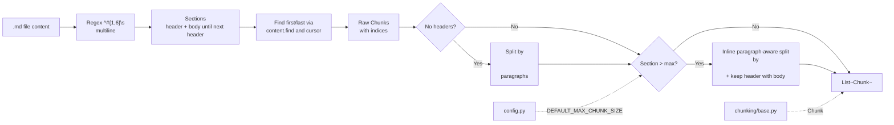

# `src/chunking/markdown_chunker.py` — Architecture

## Role

Splits `.md` files by Markdown structure. Markdown has no AST, so headers (`#`, `##`, ...) are the semantic boundaries — same idea as splitting `.py` by `def`/`class`.

## Diagram



## Functions

```python
from pathlib import Path
import re
from chunking.base import Chunk  # split_oversized_chunk is deprecated guard, not used in normal path

_HEADER_RE = re.compile(r"^#{1,6}\s", re.MULTILINE)

def chunk_markdown_file(file_path: Path, max_chunk_size: int = 2000) -> list[Chunk]:
    """Split by headers; if no headers, split by paragraphs.
    Oversized sections are split inline paragraph-aware (never via base.py)."""

def _split_by_headers(content: str) -> list[tuple[str, int, int]]:
    """Return list of (section_text, first, last) where first/last are char indices in content."""

def _split_by_paragraphs(content: str) -> list[tuple[str, int, int]]:
    """Fallback: split on \\n\\n, track indices via cursor search."""
```

## Algorithm

```
content = file_path.read_text(encoding="utf-8", errors="ignore")
matches = list(_HEADER_RE.finditer(content))
if matches:
  boundaries = [0] + [m.start() for m in matches[1:]] + [len(content)]
  for i in range(len(boundaries)-1): section = content[boundaries[i]:boundaries[i+1]]
  first = boundaries[i]; last = boundaries[i+1]
else:
  sections = _split_by_paragraphs(content)  # content.split("\n\n") with cursor find

for (text, first, last) in sections:
  if not text.strip(): continue
  if len(text) <= max_chunk_size:
    chunk = Chunk(text, str(file_path), first, last)
  else:
    # inline paragraph-aware: split text by "\n\n" (keepends), keep header line
    # with its section, accumulate paragraphs until >max then flush
    # rebuild indices sequentially from `first` (no base.py call)
# NOTE: base.py:split_oversized_chunk is NOT called — enforcement is inline.
```

- Keep the header line with its section — `## Installation` stays with its body.
- Use `content.find(section, cursor)` to handle duplicate section text correctly (increment cursor).

## Relations

| Relation | Direction | Detail |
|---|---|---|
| `markdown_chunker -> chunking/base` | imports | `Chunk` (and `validate_chunk` for debug). `split_oversized_chunk` is deprecated guard — not called; oversized sections split inline paragraph-aware |
| `markdown_chunker -> config` | imports | `DEFAULT_MAX_CHUNK_SIZE` default |
| `markdown_chunker <- scanner` | none | Scanner never calls it — indexer wires it |
| `markdown_chunker -> indexer` | called by | `indexer.build_and_save_from_raw()` dispatches `*.md` here |
| `markdown_chunker dependencies` | stdlib | `re`, `pathlib` |

## Depends On

- `chunking/base.py`
- `config` (default)
- stdlib `re`

## Used By

- `indexer.py`

## Edge Cases

- No headers => paragraph split inline, never return `[]` for non-empty file.
- Header-only file => one chunk per header section.
- Single section/header+body > `max_chunk_size` => inline paragraph-aware split (split by `\n\n`, keep header with first window, accumulate paragraphs).
- Duplicate section text => `find(..., cursor)` + cursor advance prevents wrong indices.
- Never call `base.py:split_oversized_chunk` for oversize — avoids blind fixed-window slicing mid-header/mid-fence.

## Test

```python
from chunking.markdown_chunker import chunk_markdown_file
chunks = chunk_markdown_file(Path("data/raw/README.md"))
content = Path("data/raw/README.md").read_text(encoding="utf-8", errors="ignore")
for c in chunks: assert content[c.first_character_index:c.last_character_index] == c.text
assert all(len(c.text) <= 2000 for c in chunks)
```
