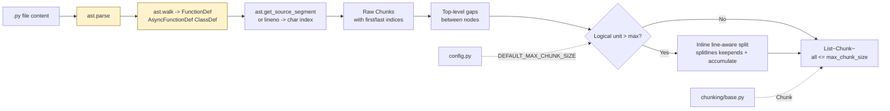

# `src/chunking/python_chunker.py` — Architecture

## Role

Splits `.py` files into logical chunks (one per function/class + top-level blocks) using `ast`. This preserves semantic units — a retriever matching `def api_server` gets the whole function, not a random 2000-char window.

## Diagram



## Functions

```python
from pathlib import Path
from chunking.base import Chunk  # split_oversized_chunk is deprecated guard, not used in normal path

def chunk_python_file(file_path: Path, max_chunk_size: int = 2000) -> list[Chunk]:
    """Read file, parse with ast, return chunks with len<=max_chunk_size.
    Oversized logical units (one def/class > max) are split inline line-aware.
    On SyntaxError: fallback to inline generic split on raw text."""

def _build_line_offsets(content: str) -> list[int]:
    """Return list where offsets[i] = char index of line i (1-indexed for ast lineno). offsets[0] unused."""

def _lineno_to_char_index(line_offsets: list[int], lineno: int, col_offset: int) -> int:
    """Convert ast lineno+col_offset to absolute char index using line_offsets."""

def _get_node_span(node: ast.AST, line_offsets: list[int], content: str) -> tuple[int, int]:
    """Return (first, last) char indices for node. Prefers ast.get_source_segment span via col_offset/end_lineno."""

def _collect_gaps(nodes: list[ast.AST], content: str, line_offsets: list[int]) -> list[tuple[int,int]]:
    """Return (start,end) ranges for top-level code between class/func nodes."""
```

## Algorithm

```
content = file_path.read_text(encoding="utf-8", errors="ignore")
try: tree = ast.parse(content)
except SyntaxError:
    return _inline_generic_split(content, str(file_path), 0, max_chunk_size)

line_offsets = _build_line_offsets(content)
nodes = [n for n in tree.body if isinstance(n, (FunctionDef, AsyncFunctionDef, ClassDef))]
# sort by lineno, extract each node's span -> Chunk via _get_node_span
# collect gaps between nodes -> Chunk per gap (strip empty)
# for each logical chunk if len(text) > max_chunk_size:
#     inline line-aware: text.splitlines(keepends=True), accumulate cur until
#     len(cur)+len(line) > max then flush cur; hard-slice any single line > max
#     rebuild indices sequentially: new_first = base + offset, offset = sum(len(prev))
# return sorted by first_character_index, contiguous non-overlapping
# NOTE: base.py:split_oversized_chunk is NOT called — enforcement is inline.
```

- `file_path` in Chunk is `str(file_path)` relative to repo root — must be `data/raw/...`.
- `ast.get_source_segment(content, node)` gives exact text when available; otherwise reconstruct from `lineno`/`end_lineno`/`col_offset` + `line_offsets`.
- Gaps handle `import` blocks and module-level constants — they are still searchable.

## Relations

| Relation | Direction | Detail |
|---|---|---|
| `python_chunker -> chunking/base` | imports | `Chunk` (and `validate_chunk` for debug). `split_oversized_chunk` is deprecated guard — not called; oversized units split inline line-aware |
| `python_chunker -> config` | imports | `DEFAULT_MAX_CHUNK_SIZE` as default param |
| `python_chunker <- scanner` | none | Scanner never calls it — indexer wires `scan_files() -> chunk_python_file()` |
| `python_chunker -> indexer` | called by | `indexer.build_and_save_from_raw()` dispatches `*.py` here |
| `python_chunker -> tokenizer` | none | Tokenizer runs later on `chunk.text` |
| `python_chunker dependencies` | stdlib | `ast`, `pathlib` |

## Depends On

- `chunking/base.py`
- `config` (optional default)
- stdlib `ast`, `pathlib`

## Used By

- `indexer.py`

## Edge Cases

- `SyntaxError` / encoding error => inline generic split on raw text (paragraph/line-aware, never blind `range` slice) — never crash.
- Empty file => `[]`.
- Single `FunctionDef`/`ClassDef` > `max_chunk_size` (e.g. 5000-char `def`) => inline line-aware split inside this chunker (try inner AST nodes first, else `splitlines(keepends=True)` accumulate; hard-slice only a single line > max).
- File larger than 2000 and no AST nodes => inline generic split.

## Test

```python
from chunking.python_chunker import chunk_python_file
chunks = chunk_python_file(Path("data/raw/vllm/entrypoints/openai/api_server.py"))
for c in chunks:
    assert c.first_character_index >= 0 and c.last_character_index <= len(content)
    assert content[c.first_character_index:c.last_character_index] == c.text
    assert len(c.text) <= 2000
```
