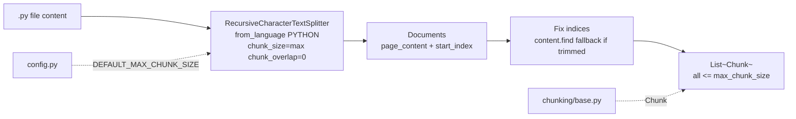

# `src/chunking/python_chunker.py` — Architecture

## Role

Splits `.py` files via `langchain_text_splitters` `RecursiveCharacterTextSplitter.from_language(Language.PYTHON)`. Uses language-aware separators (`\ndef `, `\nclass `, `\n\n`, `\n`, ` `) to keep semantic units together. Guarantees `len(text) <= max_chunk_size` via `chunk_size=max_chunk_size, chunk_overlap=0, add_start_index=True`. Not `ast` — project decision (Option A langchain) for consistency with markdown/text chunkers.

## Diagram



## Functions

```python
from pathlib import Path
from langchain_text_splitters import Language, RecursiveCharacterTextSplitter
from src.chunking.base import Chunk

def chunk_python_file(file_path: Path, max_chunk_size: int = DEFAULT_MAX_CHUNK_SIZE) -> list[Chunk]:
    """Read file, split with Language.PYTHON, return chunks with len<=max and correct first/last via add_start_index."""
```

## Algorithm

```
content = file_path.read_text(encoding="utf-8", errors="ignore")
if not content.strip(): return []
splitter = RecursiveCharacterTextSplitter.from_language(language=Language.PYTHON, chunk_size=max, chunk_overlap=0, add_start_index=True)
documents = splitter.create_documents([content])
for doc in documents:
    text = doc.page_content; start = doc.metadata["start_index"]; end = start + len(text)
    if content[start:end] != text: start = content.find(text, start); end = start + len(text)  # fallback for trimmed whitespace
    chunks.append(Chunk(text, str(file_path), start, end))
```

- `file_path` in Chunk is `str(file_path)` relative to repo root — must be `data/raw/...`.
- `add_start_index` gives exact char offset; fallback `find(text, start)` handles langchain trimming.
- Empty/whitespace-only file -> `[]`. `OSError`/`UnicodeError` on read -> `[]`.
- `langchain` already enforces `len(text) <= chunk_size` — no inline `split_oversized_chunk` needed (base.py guard not called).

## Relations

| Relation | Direction | Detail |
|---|---|---|
| `python_chunker -> chunking/base` | imports | `Chunk` (and `validate_chunk` for debug). `split_oversized_chunk` is NOT called — langchain enforces <=max |
| `python_chunker -> config` | imports | `DEFAULT_MAX_CHUNK_SIZE` as default param |
| `python_chunker <- scanner` | none | Scanner never calls it — indexer wires `scan_files() -> chunk_python_file()` |
| `python_chunker -> indexer` | called by | `indexer._chunk_file()` dispatches `*.py` here |
| `python_chunker -> tokenizer` | none | Tokenizer runs later on `chunk.text` via `tokenize` (keeps not/none) |
| `python_chunker dependencies` | external | `langchain_text_splitters`, `pathlib` |

## Depends On

- `chunking/base.py`
- `config` (default)
- `langchain_text_splitters`, `pathlib`

Not `ast` — that was the docs template before the langchain decision. Current stack is `langchain_text_splitters>=1.1.3` with `Language.PYTHON`.

## Used By

- `indexer.py` (`_chunk_file` for `.py`)

## Edge Cases

- `OSError`/`UnicodeError` on read => `[]` — never crash.
- Empty/whitespace => `[]`.
- Single function > `max_chunk_size` (e.g. 5000-char `def`) => langchain splits internally on `Language.PYTHON` separators (still `<=max`).
- Duplicate text => `find(text, start)` avoids wrong earlier match.

## Test

```python
from pathlib import Path
from src.chunking.python_chunker import chunk_python_file
chunks = chunk_python_file(Path("data/raw/vllm/entrypoints/openai/api_server.py"))
content = Path("data/raw/vllm/entrypoints/openai/api_server.py").read_text(encoding="utf-8", errors="ignore")
for c in chunks:
    assert c.first_character_index >= 0 and c.last_character_index <= len(content)
    assert content[c.first_character_index:c.last_character_index] == c.text
    assert len(c.text) <= 2000
assert all(len(c.text) <= 2000 for c in chunks)
```
