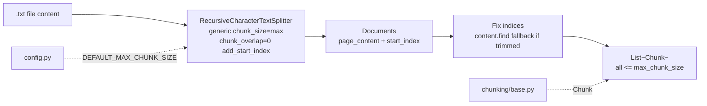

# `src/chunking/text_chunker.py` — Architecture

## Role

Splits generic text files (`.txt`, `CMakeLists.txt`, and any non-`.py`/non-`.md` suffix) via generic `RecursiveCharacterTextSplitter(chunk_size=max, chunk_overlap=0, add_start_index=True)` — no `Language` preset. Generic separators (`\n\n`, `\n`, ` `, `""`) — language-agnostic. Guarantees `len(text) <= max_chunk_size`. This is the `else` branch in `indexer._chunk_file()`.

## Diagram



## Functions

```python
from pathlib import Path
from langchain_text_splitters import RecursiveCharacterTextSplitter
from src.chunking.base import Chunk

def chunk_text_file(file_path: Path, max_chunk_size: int = DEFAULT_MAX_CHUNK_SIZE) -> list[Chunk]:
    """Read file, split with generic splitter, return chunks with len<=max and correct first/last."""
```

- No `Language.MARKDOWN` / `Language.PYTHON` — generic text uses plain `RecursiveCharacterTextSplitter(...)`.
- `add_start_index` + fallback `content.find(text, start)` for trimmed whitespace.
- Empty/whitespace => `[]`. `OSError`/`UnicodeError` => `[]`.

## Relations

| Relation | Direction | Detail |
|---|---|---|
| `text_chunker -> chunking/base` | imports | `Chunk` |
| `text_chunker -> config` | imports | `DEFAULT_MAX_CHUNK_SIZE` |
| `text_chunker -> indexer` | called by | `indexer._chunk_file()` `else` branch for non-py/md |
| `text_chunker dependencies` | external | `langchain_text_splitters`, `pathlib` |

## Depends On

- `chunking/base.py`, `config`, `langchain_text_splitters`

## Used By

- `indexer.py` (`_chunk_file` else)

## Test

```python
from pathlib import Path
from src.chunking.text_chunker import chunk_text_file
chunks = chunk_text_file(Path("data/raw/CMakeLists.txt"))
content = Path("data/raw/CMakeLists.txt").read_text(encoding="utf-8", errors="ignore")
for c in chunks: assert content[c.first_character_index:c.last_character_index] == c.text
assert all(len(c.text) <= 2000 for c in chunks)
```
