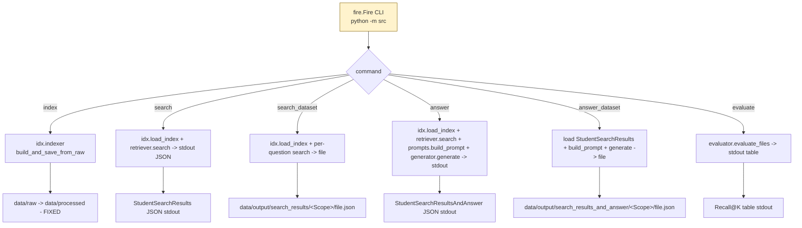

# `src/__main__.py` — Architecture

## Role

Fire CLI entrypoint: `uv run python -m src <command>`. Wires scanner/chunkers/indexer/retriever/prompts/generator/evaluator together. **Only place that touches `sys.argv` and filesystem side effects.**

## Diagram




## Exact Signatures (PDF VI.6 — never change)

```python
from __future__ import annotations
import sys
import json
import fire
from pathlib import Path
from models import StudentSearchResults, StudentSearchResultsAndAnswer
from indexer import build_and_save_from_raw, load_index
from retriever import search
from prompts import build_prompt, load_chunk_text
from generator import generate_answer
from evaluator import evaluate_files

class CLI:
    def index(self, max_chunk_size: int = 2000) -> None:
        """Ingest data/raw/ -> data/processed/. FIXED paths (only command allowed to hardcode)."""

    def search(self, query: str, k: int = 5) -> None:
        """Single query. query is POSITIONAL. Prints StudentSearchResults JSON to stdout."""

    def search_dataset(self, dataset_path: str, k: int = 5, save_directory: str = "data/output/search_results") -> None:
        """Batch search: reads RagDataset from dataset_path, writes StudentSearchResults to save_directory/<dataset_filename>. All paths CLI args."""

    def answer(self, query: str, k: int = 5) -> None:
        """Single answer: retrieve top-k, build prompt, generate with Qwen, print StudentSearchResultsAndAnswer."""

    def answer_dataset(self, student_search_results_path: str, save_directory: str = "data/output/search_results_and_answer") -> None:
        """Batch answer: reads StudentSearchResults, generates per question, writes StudentSearchResultsAndAnswer to save_directory/<filename>."""

    def evaluate(self, student_search_results_path: str, dataset_path: str) -> None:
        """Local recall@k: student_path + truth dataset_path -> prints Recall@K table."""

def main() -> None:
    fire.Fire(CLI)

if __name__ == "__main__":
    main()
```

- `query` is **positional**: `uv run python -m src search "my question" --k 5` (not `--query`).
- `index` is the **only** command with fixed `data/raw/` -> `data/processed/` (PDF VI.7.1 box).
- All others: paths are **`str` CLI args -> `Path()` inside, never hardcoded** (evaluator failure if hardcoded).

## Wiring per Command

| Command | Calls | Outputs |
|---|---|---|
| `index` | `scanner.scan_files` -> `_chunk_file` dispatch -> `indexer.build_index` -> `indexer.save_index` + `tqdm` | `data/processed/index.pkl` (FIXED) |
| `search` | `indexer.load_index` -> `tokenizer.tokenize` -> `retriever.search` -> `json.dumps(StudentSearchResults.model_dump())` | stdout JSON |
| `search_dataset` | loads `RagDataset` -> loops `retriever.search` with `tqdm` -> `StudentSearchResults` | `save_directory/<dataset_filename>.json` |
| `answer` | `retriever.search` -> `prompts.load_chunk_text` -> `prompts.build_prompt` -> `generator.generate_answer` | stdout JSON `StudentSearchResultsAndAnswer` |
| `answer_dataset` | loads `StudentSearchResults` -> per-question `build_prompt` -> `generate_answer` with `tqdm` | `save_directory/<filename>.json` |
| `evaluate` | `evaluator.evaluate_files` | stdout table `Recall@1 @3 @5 @10` |

## Relations

| Relation | Direction | Detail |
|---|---|---|
| `__main__ -> indexer` | imports | `build_and_save_from_raw`, `load_index` |
| `__main__ -> retriever` | imports | `search` |
| `__main__ -> prompts` | imports | `build_prompt`, `load_chunk_text` |
| `__main__ -> generator` | imports | `generate_answer`, `get_model_and_tokenizer` |
| `__main__ -> evaluator` | imports | `evaluate_files` |
| `__main__ -> models` | imports | `StudentSearchResults`, `StudentSearchResultsAndAnswer`, `RagDataset` |
| `__main__ -> config` | none | Passes constants through indexer/generator, not imported directly |
| `__main__ dependencies` | external | `fire`, `tqdm`, `pathlib`, `json`, `sys` |

## Depends On

- Everything except `config` directly (via transitive)
- External `fire`, `tqdm`

## Used By

- `Makefile` `run`/`debug`: `uv run python -m src $(ARGS)` and `uv run python -m pdb -m src $(ARGS)`
- Moulinette harness (automated defense): calls `index` -> `search_dataset` -> `./moulinette evaluate`

## Mandatory Behaviors

```python
# 1. Graceful degrade on every command:
try:
    ...  # main logic
except FileNotFoundError as e:
    print(f"Error: {e}", file=sys.stderr); sys.exit(1)
except json.JSONDecodeError as e:
    print(f"Invalid JSON: {e}", file=sys.stderr); sys.exit(1)
except Exception as e:
    print(f"Error: {e}", file=sys.stderr); sys.exit(1)

# 2. Never traceback on degenerate inputs: empty query, k=0, nonsense query, missing files, malformed JSON
# 3. tqdm on: index file loop, search_dataset question loop, answer_dataset question loop
# 4. Chunk cap enforcement in index: assert all chunk.last-first <= min(max_chunk_size, 2000)
```

## Tests (what evaluator does)

```bash
uv run python -m src search "hello" --k 0          # must not crash
uv run python -m src search "" --k 5               # must not crash
uv run python -m src search_dataset --dataset_path does/not/exist.json --k 5 --save_directory /tmp/out  # clear error
uv run python -m src index --max_chunk_size 2000   # <5 min, creates index.pkl
```
