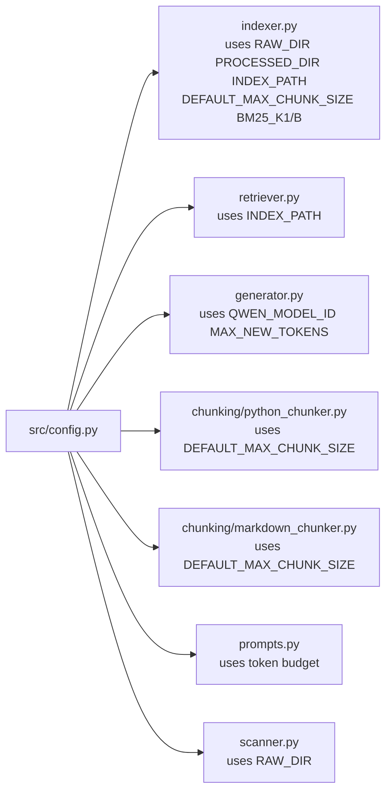

# `src/config.py` — Architecture

## Role

Single source of truth for every constant. No logic, only values. Changing a value here propagates everywhere — no hardcoded numbers in other files.

## Diagram



## Variables (exact names to create)

```python
from pathlib import Path

RAW_DIR: Path = Path("data/raw")
PROCESSED_DIR: Path = Path("data/processed")
INDEX_PATH: Path = PROCESSED_DIR / "index.pkl"

DEFAULT_MAX_CHUNK_SIZE: int = 2000   # PDF VI.1 default, never emit > this
BM25_K1: float = 1.5                 # term saturation, tweak if recall low
BM25_B: float = 0.75                 # length norm, tweak if recall low

QWEN_MODEL_ID: str = "Qwen/Qwen3-0.6B"
QWEN_MAX_NEW_TOKENS: int = 512
QWEN_TEMPERATURE: float = 0.0         # deterministic
```

## Relations

| Relation | Direction | Detail |
|---|---|---|
| `config -> indexer` | imports | `RAW_DIR`, `PROCESSED_DIR`, `INDEX_PATH`, `BM25_K1/B`, `DEFAULT_MAX_CHUNK_SIZE` |
| `config -> scanner` | imports | `RAW_DIR` for `scan_files()` default arg |
| `config -> chunkers` | imports | `DEFAULT_MAX_CHUNK_SIZE` guards `split_oversized_chunk` |
| `config -> retriever` | imports | `INDEX_PATH` default for `load_index()` |
| `config -> generator` | imports | `QWEN_MODEL_ID`, `QWEN_MAX_NEW_TOKENS` |
| `config <- __main__` | none | CLI never imports config directly — passes values through |
| `config dependencies` | none | Only `pathlib.Path`, no other `src/` import — avoids cycles |

## Depends On

Nothing in `src/`. Only stdlib `pathlib`.

## Used By

Every file except `models.py` and `evaluator.py`.

## Constraints

- Paths are `Path` objects, not strings — callers do `str(path)` for JSON `file_path`.
- `DEFAULT_MAX_CHUNK_SIZE` is both the CLI default and the hard cap checked before `save_index`.
