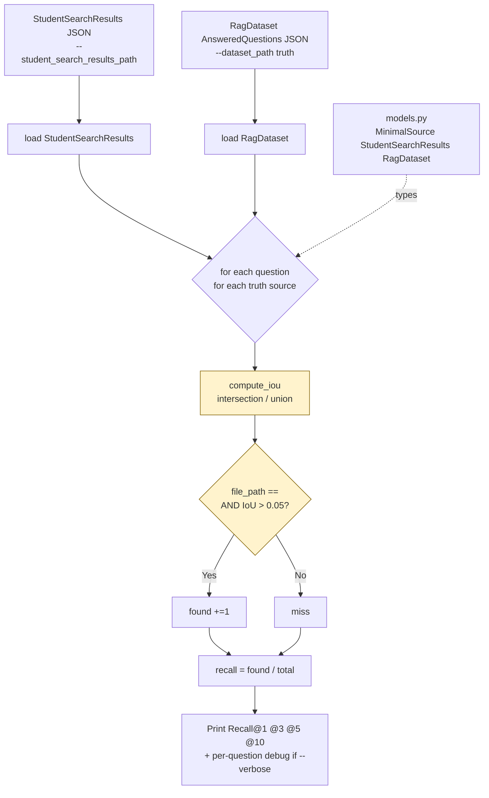

# `src/evaluator.py` — Architecture

## Role

Your **own** recall@k implementation for local iteration (CLI `evaluate`). Mirrors the external moulinette's logic: `file_path` verbatim + `IoU > 0.05`. You iterate with this; official score comes from `./moulinette evaluate_student_search_results` (never import it).

## Diagram



## Functions

```python
from pathlib import Path
from models import MinimalSource, StudentSearchResults, RagDataset

def compute_iou(a_start: int, a_end: int, b_start: int, b_end: int) -> float:
    """Intersection over Union of [a_start,a_end) and [b_start,b_end). Union = max(end)-min(start) if overlap else sum lengths."""

def is_match(retrieved: MinimalSource, truth: MinimalSource) -> bool:
    """True iff retrieved.file_path == truth.file_path AND compute_iou(...) > 0.05."""

def recall_at_k_for_question(
    retrieved: list[MinimalSource], truth_sources: list[MinimalSource], k: int
) -> float:
    """For one question: count truth sources that have at least one is_match in retrieved[:k]. Return found/total."""

def recall_at_k(
    student: StudentSearchResults, truth: RagDataset, k: int
) -> dict[int, float]:
    """Aggregate recall per k in {1,3,5,10}. Averages across questions."""

def evaluate_files(student_path: Path, dataset_path: Path) -> None:
    """Load both JSONs, compute recalls, print table. Mirrors moulinette output format."""
```

### `compute_iou` Implementation

```python
def compute_iou(a0: int, a1: int, b0: int, b1: int) -> float:
    # half-open intervals [a0,a1), [b0,b1)
    inter_start = max(a0, b0)
    inter_end = min(a1, b1)
    intersection = max(0, inter_end - inter_start)
    if intersection == 0:
        return 0.0
    # union for overlapping case: max(end) - min(start)
    # this matches moulinette's range IoU (not text-token IoU)
    union = max(a1, b1) - min(a0, b0)
    return intersection / union if union > 0 else 0.0

def is_match(ret: MinimalSource, truth: MinimalSource) -> bool:
    if ret.file_path != truth.file_path:
        return False
    return compute_iou(ret.first_character_index, ret.last_character_index, truth.first_character_index, truth.last_character_index) > 0.05
```

- `file_path` compare is **verbatim string equality** — `data/raw/vllm/docs/foo.md != vllm/docs/foo.md` (PDF VI.2).
- `0.05` is the low bar from PDF VII.1.1 — just needs the right region, not exact span.
- Different file never counts, even if IoU would be high.

## Relations

| Relation | Direction | Detail |
|---|---|---|
| `evaluator -> models` | imports | `MinimalSource`, `StudentSearchResults`, `RagDataset` |
| `evaluator -> retriever` | none | Evaluates `MinimalSource` produced by retriever, never calls it |
| `evaluator -> indexer` | none |  |
| `evaluator -> __main__` | called by | `CLI.evaluate()` |
| `evaluator dependencies` | only | `models`, stdlib `pathlib`/`json` |
| `evaluator <-> moulinette` | **never** | "Your solution must never import or call the moulinette" (PDF VI.6) |

## Depends On

- `models`

## Used By

- `__main__.py:evaluate`

## CLI Usage

```bash
uv run python -m src evaluate --student_search_results_path data/output/search_results/UnansweredQuestions/dataset_docs_public.json --dataset_path data/datasets/AnsweredQuestions/dataset_docs_public.json
# expect ~ matching: ./moulinette evaluate_student_search_results same_files --k 10 --max_context_length 2000
```

Target: **80% Recall@5 docs, 50% code** (PDF VII.1.2). Official moulinette also prints @1 @3 @10.

## Test

```python
from evaluator import compute_iou, is_match, MinimalSource
assert compute_iou(0, 100, 50, 150) == 50/150
assert is_match(MinimalSource(file_path="data/raw/a.md", first_character_index=0, last_character_index=100),
                MinimalSource(file_path="data/raw/a.md", first_character_index=90, last_character_index=200))
assert not is_match(MinimalSource(file_path="data/raw/b.md", first_character_index=0, last_character_index=100),
                    MinimalSource(file_path="data/raw/a.md", first_character_index=0, last_character_index=100))
```
