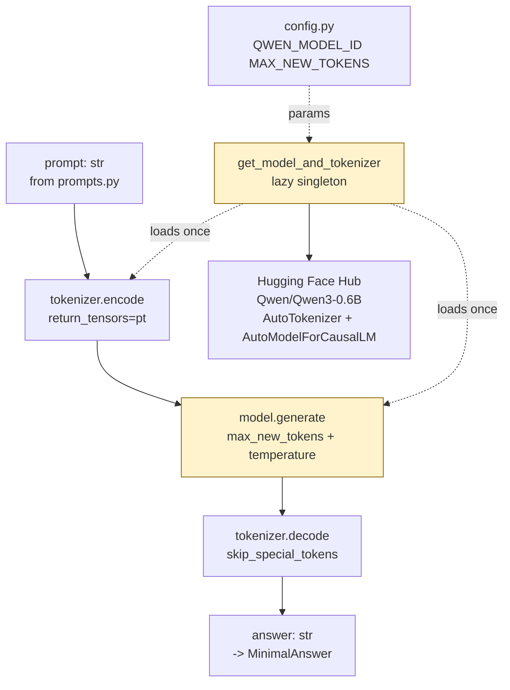

# `src/generator.py` — Architecture

## Role

Loads **Qwen/Qwen3-0.6B** locally via `transformers` once (lazy singleton) and generates answers from prompts. The mandatory model (PDF VI.3) — no API calls, runs on CPU/GPU locally.

## Diagram



## Variables + Functions

```python
from transformers import AutoTokenizer, AutoModelForCausalLM
import torch
from config import QWEN_MODEL_ID

_model: AutoModelForCausalLM | None = None
_tokenizer: AutoTokenizer | None = None

def get_model_and_tokenizer() -> tuple[AutoTokenizer, AutoModelForCausalLM]:
    """Lazy singleton: download/load once, move to device, set eval mode."""

def generate_answer(
    prompt: str,
    max_new_tokens: int = 512,
    temperature: float = 0.0,
) -> str:
    """Tokenize prompt, call model.generate, decode, strip prompt prefix from output."""

def generate_batch(prompts: list[str], max_new_tokens: int = 512) -> list[str]:
    """Loop generate_answer with tqdm — no batched inference needed for small model."""
```

### `get_model_and_tokenizer` Implementation

```python
def get_model_and_tokenizer():
    global _model, _tokenizer
    if _model is not None and _tokenizer is not None:
        return _tokenizer, _model

    _tokenizer = AutoTokenizer.from_pretrained(QWEN_MODEL_ID, trust_remote_code=True)
    dtype = torch.float16 if torch.cuda.is_available() else torch.float32
    _model = AutoModelForCausalLM.from_pretrained(QWEN_MODEL_ID, torch_dtype=dtype, trust_remote_code=True)
    _model.eval()
    if torch.cuda.is_available():
        _model = _model.to("cuda")
    return _tokenizer, _model

def generate_answer(prompt: str, max_new_tokens: int = 512, temperature: float = 0.0) -> str:
    tok, model = get_model_and_tokenizer()
    device = next(model.parameters()).device
    inputs = tok(prompt, return_tensors="pt").to(device)
    with torch.no_grad():
        out = model.generate(**inputs, max_new_tokens=max_new_tokens, temperature=temperature, do_sample=temperature > 0, pad_token_id=tok.eos_token_id)
    # decode only newly generated tokens (without prompt)
    gen_ids = out[0][inputs.input_ids.shape[1]:]
    return tok.decode(gen_ids, skip_special_tokens=True).strip()
```

## Relations

| Relation | Direction | Detail |
|---|---|---|
| `generator -> prompts` | consumes | `prompt: str` from `build_prompt()` |
| `generator -> config` | imports | `QWEN_MODEL_ID`, `QWEN_MAX_NEW_TOKENS`, `QWEN_TEMPERATURE` |
| `generator -> models` | none | Generator returns `str` answer — `__main__` wraps into `MinimalAnswer` |
| `generator -> __main__` | called by | `CLI.answer()` and `CLI.answer_dataset()` |
| `generator -> tokenizer` | none | Uses `transformers` tokenizer, not `src/tokenizer.py` |
| `generator dependencies` | external | `transformers`, `torch`, `tqdm` |

## Depends On

- `config` (model id)
- `prompts` (prompt string)
- External `transformers`, `torch`

## Used By

- `__main__.py:answer`, `__main__.py:answer_dataset`

## Constraints

- Never load model at import time — lazy `get_model_and_tokenizer()` inside function, else `index`/`search` cold start downloads model unnecessarily.
- `trust_remote_code=True` required for Qwen.
- Must work CPU-only (campus machines) — `float32` fallback.
- `pad_token_id = eos_token_id` avoids generate error for models without pad token.

## Test

```python
from generator import generate_answer
ans = generate_answer("Context: vLLM is an inference engine.\nQuestion: What is vLLM?\nAnswer:")
print(ans)
assert isinstance(ans, str) and len(ans) > 0
```
