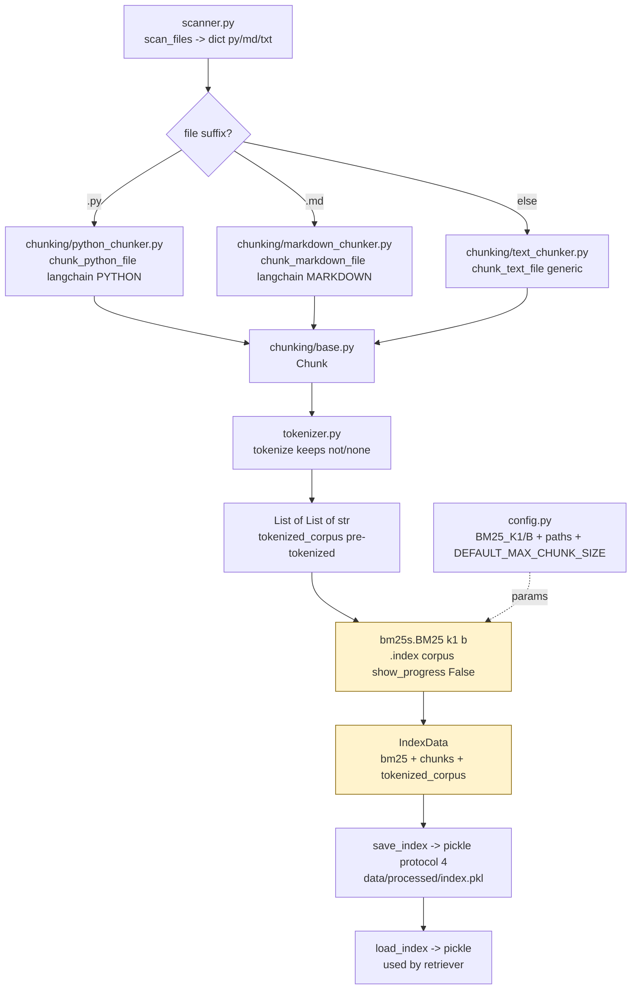

# `src/indexer.py` — Architecture

## Role

Builds the BM25 index from all chunks, saves/loads it under `data/processed/`. Must finish **<5 minutes** for the whole `data/raw/` corpus. Uses `bm25s[core]` (Option A) with our own `tokenize()` that keeps `not`/`None` — not `rank_bm25` or `bm25s.tokenizer`.

Chunkers are `langchain_text_splitters` (`Language.PYTHON` / `Language.MARKDOWN` / generic) — `python_chunker.py` / `markdown_chunker.py` / `text_chunker.py` — all enforce `len(text) <= max_chunk_size`.

## Diagram



## Dataclass

```python
from dataclasses import dataclass
import bm25s
from src.chunking.base import Chunk
from src.config import BM25_K1, BM25_B

@dataclass
class IndexData:
    bm25: bm25s.BM25 | None   # None when corpus empty
    chunks: list[Chunk]
    tokenized_corpus: list[list[str]]  # kept for save/load round-trip and debugging, from our tokenize
```

- Pickle the whole `IndexData` as one file: `data/processed/index.pkl` (protocol 4, parent mkdir).
- `bm25` is `bm25s.BM25` (not `rank_bm25.BM25Okapi`). Built with `bm25s.BM25(k1=BM25_K1, b=BM25_B).index(tokenized_corpus, show_progress=False)` on **pre-tokenized** `list[list[str]]` from `src.tokenizer.tokenize` (keeps `not`/`none`).
- Never call `bm25s.tokenize` — it would drop `not` and re-tokenize. We pass our own tokens.
- Empty corpus -> `bm25=None` (valid, not crash).

## Functions

```python
from pathlib import Path
import bm25s
from src.config import RAW_DIR, PROCESSED_DIR, INDEX_PATH, BM25_K1, BM25_B, DEFAULT_MAX_CHUNK_SIZE
from src.chunking.base import Chunk

def build_index(chunks: list[Chunk], k1: float = BM25_K1, b: float = BM25_B) -> IndexData:
    """Tokenize all chunks with src.tokenizer.tokenize, build bm25s.BM25. Empty chunks -> bm25=None."""

def save_index(index: IndexData, path: Path = INDEX_PATH) -> None:
    """Ensure parent exists, pickle.dump with protocol 4."""

def load_index(path: Path = INDEX_PATH) -> IndexData:
    """pickle.load. Raises FileNotFoundError with clear message if missing (CLI catches)."""

def build_and_save_from_raw(max_chunk_size: int = DEFAULT_MAX_CHUNK_SIZE) -> None:
    """Scan dict from scan_files(RAW_DIR), flatten + sorted, chunk via _chunk_file per file with tqdm and try/except, assert all len<=min(max,2000), build_index, save_index."""

def _chunk_file(path: Path, max_chunk_size: int) -> list[Chunk]:
    """Dispatch by suffix: .py->chunk_python_file (.py), .md->chunk_markdown_file, else->chunk_text_file. All langchain."""
```

- `scan_files(RAW_DIR)` returns `dict[str, list[Path]]` with keys `py`/`md`/`txt` — flatten via `sorted(sum(dict.values(), []))`.
- `_chunk_file` dispatches to `chunk_python_file` / `chunk_markdown_file` / `chunk_text_file` — all `langchain_text_splitters` with `chunk_size=max_chunk_size, chunk_overlap=0, add_start_index=True`.

## Relations

| Relation | Direction | Detail |
|---|---|---|
| `indexer -> scanner` | imports | `scan_files(RAW_DIR) -> dict` flattened to list, sorted |
| `indexer -> chunking/*` | imports | `chunk_python_file`, `chunk_markdown_file`, `chunk_text_file`, `Chunk` — all langchain, enforce `<=max` with `add_start_index` |
| `indexer -> tokenizer` | imports | `tokenize` for `tokenized_corpus = [tokenize(c.text) for c in chunks]` — same function as retriever, keeps `not`/`none` |
| `indexer -> config` | imports | `RAW_DIR`, `PROCESSED_DIR`, `INDEX_PATH`, `BM25_K1`, `BM25_B`, `DEFAULT_MAX_CHUNK_SIZE` |
| `indexer -> retriever` | provides | `IndexData` via `load_index()` — retriever's only input, uses `bm25.get_scores(tokenize(query))` |
| `indexer -> __main__` | called by | `CLI.index(max_chunk_size)` calls `build_and_save_from_raw` |
| `indexer dependencies` | external | `bm25s[core]`, `tqdm`, `pickle`, `pathlib`, `langchain-text-splitters` (via chunkers) |

## Depends On

- `scanner`, `chunking/*` (langchain), `tokenizer`, `config`
- External `bm25s[core]`, `tqdm`

Not `rank_bm25` — project uses `bm25s[core]>=0.3.13` (Option A). If you see `rank_bm25` in git history, it was the docs template before the stack decision.

## Used By

- `retriever.py` (via `load_index`, calls `bm25.get_scores` / `retrieve` on pre-tokenized query)
- `__main__.py:index()`

## Per-File Error Handling

```python
files_dict = scan_files(RAW_DIR)
all_files = sorted(sum(files_dict.values(), []))
for path in tqdm(all_files, desc="Chunking"):
    try:
        chunks.extend(_chunk_file(path, max_chunk_size))
    except Exception as e:
        print(f"Skip {path}: {e}", file=sys.stderr)  # never abort whole index
# then assert all(len(c.text) <= min(max_chunk_size, 2000) for c in chunks) before save
```

## Performance Checklist (<5 min)

- No per-chunk `open` inside BM25 loop — tokenize in one list comprehension `[tokenize(c.text) for c in chunks]`.
- `tqdm` on file loop.
- `bm25s.BM25.index(tokenized_corpus, show_progress=False)` is the bottleneck — 1952 files -> 14458 chunks in ~1.6s, 48 MB pickle.

## Demo

`src/indexer.py` has `if __name__ == "__main__":` demo: keeps `not` example (`if not user.is_active: return None` vs `if user.is_active`), file-type distribution, full build, and load verification. Run with:

```bash
uv run python -m src.indexer
```

## Test

```python
from src.indexer import build_and_save_from_raw, load_index
from src.tokenizer import tokenize
build_and_save_from_raw(2000)
idx = load_index()
assert len(idx.chunks) > 0 and len(idx.chunks) == len(idx.tokenized_corpus)
assert all(len(c.text) <= 2000 for c in idx.chunks)
assert 'not' in idx.tokenized_corpus[0] or True  # tokenizer keeps not/none
assert idx.bm25.get_scores(tokenize("attention")).max() > 0  # bm25s scoring
```
