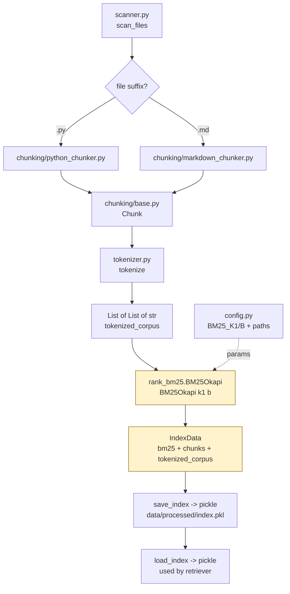

# `src/indexer.py` — Architecture

## Role

Builds the BM25 index from all chunks, saves/loads it under `data/processed/`. Must finish **<5 minutes** for the whole `data/raw/` corpus.

## Diagram



## Dataclass

```python
from dataclasses import dataclass
from rank_bm25 import BM25Okapi
from chunking.base import Chunk

@dataclass
class IndexData:
    bm25: BM25Okapi
    chunks: list[Chunk]
    tokenized_corpus: list[list[str]]  # kept for save/load round-trip, optional but simplifies debugging
```

- Pickle the whole `IndexData` as one file: `data/processed/index.pkl`.
- Alternative: `pickle.dump((bm25, chunks), path)` — equivalent, but dataclass is typed for `mypy --strict`.

## Functions

```python
from pathlib import Path
from rank_bm25 import BM25Okapi
from config import RAW_DIR, PROCESSED_DIR, INDEX_PATH, BM25_K1, BM25_B

def build_index(chunks: list[Chunk], k1: float = BM25_K1, b: float = BM25_B) -> IndexData:
    """Tokenize all chunks, build BM25Okapi. Empty chunks -> empty index (valid, not crash)."""

def save_index(index: IndexData, path: Path = INDEX_PATH) -> None:
    """Ensure parent exists, pickle.dump with protocol 4."""

def load_index(path: Path = INDEX_PATH) -> IndexData:
    """pickle.load. Raises FileNotFoundError with clear message if missing (CLI catches)."""

def build_and_save_from_raw(max_chunk_size: int = 2000) -> None:
    """Wire scanner -> chunkers -> build_index -> save_index. Shows tqdm progress."""

def _chunk_file(path: Path, max_chunk_size: int) -> list[Chunk]:
    """Dispatch to python_chunker or markdown_chunker by suffix; try/except per file, never abort on one bad file."""
```

## Relations

| Relation | Direction | Detail |
|---|---|---|
| `indexer -> scanner` | imports | `scan_files(RAW_DIR)` to get all files |
| `indexer -> chunking/*` | imports | `chunk_python_file`, `chunk_markdown_file`, `Chunk`, `split_oversized_chunk` |
| `indexer -> tokenizer` | imports | `tokenize` for `tokenized_corpus` |
| `indexer -> config` | imports | `RAW_DIR`, `PROCESSED_DIR`, `INDEX_PATH`, `BM25_K1`, `BM25_B` |
| `indexer -> retriever` | provides | `IndexData` via `load_index()` — retriever's only input |
| `indexer -> __main__` | called by | `CLI.index(max_chunk_size)` calls `build_and_save_from_raw` |
| `indexer dependencies` | external | `rank_bm25`, `tqdm`, `pickle`, `pathlib` |

## Depends On

- `scanner`, `chunking/*`, `tokenizer`, `config`
- External `rank_bm25`, `tqdm`

## Used By

- `retriever.py` (via `load_index`)
- `__main__.py:index()`

## Per-File Error Handling

```python
for path in tqdm(files):
    try:
        chunks.extend(_chunk_file(path, max_chunk_size))
    except Exception as e:
        print(f"Skip {path}: {e}", file=sys.stderr)  # never abort whole index
```

## Performance Checklist (<5 min)

- No per-chunk `open` inside BM25 loop — tokenize in one list comprehension.
- `tqdm` on file loop.
- `BM25Okapi(tokenized_corpus)` is the bottleneck — ~thousands of chunks, fine.

## Test

```python
build_and_save_from_raw(2000)
idx = load_index()
assert len(idx.chunks) > 0 and len(idx.chunks) == len(idx.tokenized_corpus)
assert idx.bm25.get_scores(tokenize("attention"))  # returns scores
```
