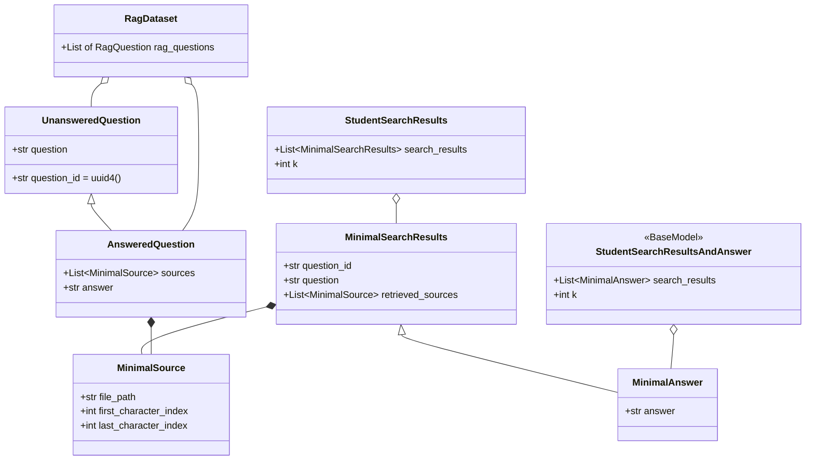

# `src/models.py` — Architecture

## Role

Pydantic models from PDF VI.4. They are the **contract** between every stage. Every JSON file read/written is validated through them. Never rename a field — moulinette validates verbatim.

## Diagram



## Classes to Implement (exact names + fields)

```python
from pydantic import BaseModel, Field
import uuid

class MinimalSource(BaseModel):
    file_path: str
    first_character_index: int
    last_character_index: int

class UnansweredQuestion(BaseModel):
    question_id: str = Field(default_factory=lambda: str(uuid.uuid4()))
    question: str

class AnsweredQuestion(UnansweredQuestion):
    sources: list[MinimalSource]
    answer: str

class RagDataset(BaseModel):
    rag_questions: list[AnsweredQuestion | UnansweredQuestion]

class MinimalSearchResults(BaseModel):
    question_id: str
    question: str
    retrieved_sources: list[MinimalSource]

class MinimalAnswer(MinimalSearchResults):
    answer: str

class StudentSearchResults(BaseModel):
    search_results: list[MinimalSearchResults]
    k: int

class StudentSearchResultsAndAnswer(BaseModel):
    search_results: list[MinimalAnswer]
    k: int
```

## Relations

| Relation | Direction | Detail |
|---|---|---|
| `models -> retriever` | imported by | `search()` returns `MinimalSource`; `format_as_student_results()` returns `StudentSearchResults` |
| `models -> evaluator` | imported by | `recall_at_k()` takes `StudentSearchResults` + `RagDataset` |
| `models -> generator/prompts` | imported by | `MinimalAnswer` built per question |
| `models -> __main__` | imported by | `search_dataset` and `answer_dataset` serialize via `.model_dump_json()` |
| `models <- config` | none | Models have no dependency on config |
| `models dependencies` | only | `pydantic`, `uuid` — never import other `src/` files |

## I/O Helpers (you may add, not required)

```python
def load_rag_dataset(path: Path) -> RagDataset: ...
def save_student_results(results: StudentSearchResults, path: Path) -> None: ...
```

## Constraints

- Use `X | Y` syntax (Python 3.10+), not `Union`/`Optional` — required for `mypy --strict`.
- `file_path` is `str` (not `Path`) — must be exactly `data/raw/...` with `/`.
- You may add fields, never remove or rename (PDF VI.4: "you can expand... if required").
