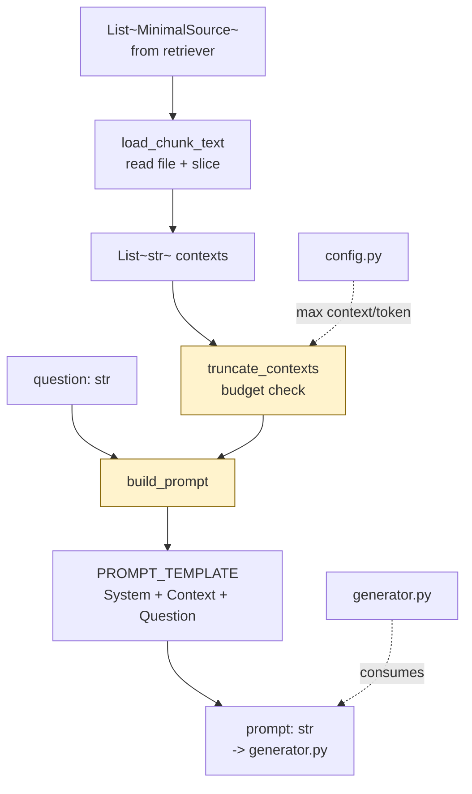

# `src/prompts.py` — Architecture

## Role

Turns `question + retrieved chunks` into one prompt string for Qwen3-0.6B. Must tell the model to answer **only from provided context** and be truncated to fit the model's token budget.

## Diagram



## Constants + Functions

```python
from pathlib import Path
from models import MinimalSource

SYSTEM_PROMPT: str = (
    "You are a helpful assistant. Answer the following question using ONLY the provided context. "
    "If the answer is not in the context, say you don't know."
)

PROMPT_TEMPLATE: str = """{system}

Context:
{context_block}

Question: {question}
Answer:"""

# Budget: keep total prompt < 3000 chars of context to leave room for question + generation
# Qwen3-0.6B context window is larger, but verbose context drowns small model.
MAX_CONTEXT_CHARS: int = 6000

def load_chunk_text(source: MinimalSource) -> str:
    """Open source.file_path, return content[first:last]. On missing file: return ''."""

def truncate_contexts(contexts: list[str], budget: int = MAX_CONTEXT_CHARS) -> list[str]:
    """Keep contexts in rank order until budget exhausted; drop remainder."""

def build_prompt(question: str, contexts: list[str]) -> str:
    """Truncate then format via PROMPT_TEMPLATE."""
```

### `build_prompt` Implementation

```python
def build_prompt(question: str, contexts: list[str]) -> str:
    contexts = truncate_contexts(contexts, MAX_CONTEXT_CHARS)
    # number contexts for the model
    context_block = "\n\n".join(f"[{i+1}] {c}" for i, c in enumerate(contexts))
    return PROMPT_TEMPLATE.format(system=SYSTEM_PROMPT, context_block=context_block, question=question)

def load_chunk_text(source: MinimalSource) -> str:
    try:
        content = Path(source.file_path).read_text(encoding="utf-8", errors="ignore")
        return content[source.first_character_index:source.last_character_index]
    except Exception:
        return ""
```

## Relations

| Relation | Direction | Detail |
|---|---|---|
| `prompts -> retriever` | consumes | `MinimalSource` -> `load_chunk_text` resolves to context strings |
| `prompts -> generator` | produces | `prompt: str` -> `generator.generate_answer(prompt)` |
| `prompts -> config` | imports | Optional token/context budget |
| `prompts -> models` | imports | `MinimalSource` type for `load_chunk_text` |
| `prompts -> __main__` | called by | `CLI.answer()` and `CLI.answer_dataset()` call `build_prompt` per question |
| `prompts dependencies` | only | `pathlib` |

## Depends On

- `models` (type)
- `config` (optional budget)

## Used By

- `generator.py` (receives prompt string)
- `__main__.py:answer`, `__main__.py:answer_dataset`

## Constraints

- `build_prompt` never imports `transformers` — purely string formatting, cheap to test.
- `truncate_contexts` keeps rank order — highest BM25 score first (retriever already sorted).
- If context empty (e.g. `k=0`) => prompt still contains question + instruction to say don't know.

## Test

```python
from prompts import build_prompt, load_chunk_text, MinimalSource
sources = search("attention", k=3, index=load_index())
contexts = [load_chunk_text(s) for s in sources]
prompt = build_prompt("How does vLLM handle attention?", contexts)
print(prompt[:1000])
assert "Context:" in prompt and "Question:" in prompt
```
