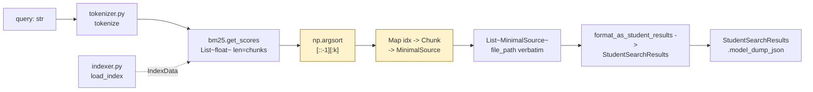

# `src/retriever.py` — Architecture

## Role

Scores query against BM25 index, returns top-K `MinimalSource` with **verbatim `file_path`** and correct char indices. Output feeds directly into `StudentSearchResults` (VI.5) and the moulinette checks `file_path ==` + `IoU>0.05`.

## Diagram




## Functions

```python
from pathlib import Path
import numpy as np
from config import INDEX_PATH
from models import MinimalSource, MinimalSearchResults, StudentSearchResults, UnansweredQuestion

def search(query: str, k: int, index: IndexData) -> list[MinimalSource]:
    """Tokenize query, score all chunks, take top-k. Returns [] if k<=0 or query empty after tokenize."""

def search_one(query: str, index_path: Path = INDEX_PATH, k: int = 5) -> list[MinimalSource]:
    """Load index from disk then search — used by CLI single-query path."""

def format_as_student_results(
    questions: list[UnansweredQuestion], k: int, index: IndexData
) -> StudentSearchResults:
    """Run search per question, build MinimalSearchResults preserving question_id."""
```

### `search` Implementation

```python
def search(query: str, k: int, index: IndexData) -> list[MinimalSource]:
    if k <= 0:
        return []
    tokens = tokenize(query)
    if not tokens:
        return []
    scores = index.bm25.get_scores(tokens)  # np array
    # argsort descending, take k
    top_k_idx = np.argsort(scores)[::-1][:k]
    result: list[MinimalSource] = []
    for idx in top_k_idx:
        c = index.chunks[int(idx)]
        # keep only if last-first <= 2000 (moulinette max_context_length)
        if c.last_character_index - c.first_character_index > 2000:
            continue
        result.append(MinimalSource(file_path=c.file_path, first_character_index=c.first_character_index, last_character_index=c.last_character_index))
    return result
```

- `file_path` is already `str` like `data/raw/vllm-.../docs/...` — never modify, grader compares verbatim (PDF VI.2 box).
- `k` is from CLI `--k`, never hardcoded.

## Relations

| Relation | Direction | Detail |
|---|---|---|
| `retriever -> indexer` | imports | `load_index()`, `IndexData` |
| `retriever -> tokenizer` | imports | `tokenize` (same function as indexer) |
| `retriever -> models` | imports | `MinimalSource`, `StudentSearchResults` for output |
| `retriever -> config` | imports | `INDEX_PATH` default |
| `retriever -> __main__` | called by | `CLI.search()` and `CLI.search_dataset()` |
| `retriever -> prompts` | provides | `List[MinimalSource]` -> `prompts.load_chunk_text` |
| `retriever -> evaluator` | none | Evaluator compares `MinimalSource` but doesn't call retriever |
| `retriever dependencies` | external | `rank_bm25`, `numpy` (via BM25) |

## Depends On

- `indexer`, `tokenizer`, `models`, `config`
- `numpy` (transitive via `rank_bm25`)

## Used By

- `__main__.py:search`, `__main__.py:search_dataset`
- `generator.py` indirectly via `__main__.py:answer`

## Edge Cases (must not crash)

| Input | Behavior |
|---|---|
| `query=""` | `tokenize("")==[]` -> `[]` |
| `query="!!!"` | tokens empty -> `[]` |
| `k=0` | `[]` |
| `k>len(chunks)` | clamp to `len(chunks)` via slice |
| missing `index.pkl` | `load_index` raises -> CLI catches + `print` + `sys.exit(1)` |
| chunk >2000 | skip that chunk (never include) |

## Test

```python
from retriever import search
sources = search("How does vLLM handle attention?", k=5, index=load_index())
assert len(sources) <= 5
for s in sources: assert s.last_character_index - s.first_character_index <= 2000
```
