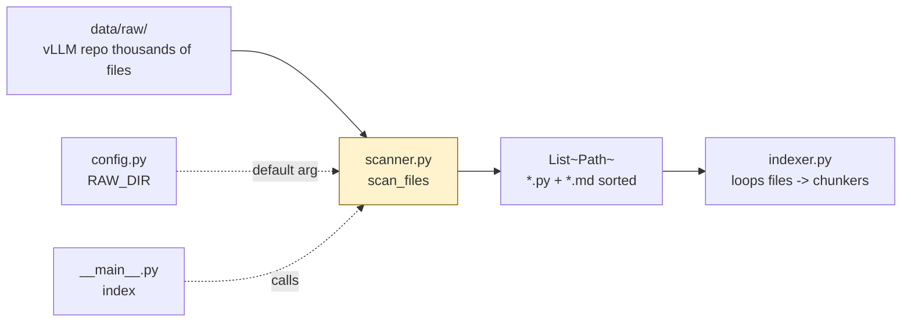

# `src/scanner.py` — Architecture

## Role

Walks `data/raw/` and returns every `.py` and `.md` file path. First step of indexing — if it misses files, retrieval never finds them.

## Diagram



## Functions

```python
from pathlib import Path
from config import RAW_DIR

def scan_files(root: Path = RAW_DIR) -> list[Path]:
    """Return sorted list of all .py and .md files under root.
    Handles missing root gracefully: returns [] and logs warning."""
```

### Implementation

```python
def scan_files(root: Path = RAW_DIR) -> list[Path]:
    if not root.exists():
        print(f"Warning: {root} does not exist", file=sys.stderr)
        return []
    py = list(root.rglob("*.py"))
    md = list(root.rglob("*.md"))
    files = [p for p in py + md if p.is_file()]
    return sorted(files)
```

- Use `Path.rglob`, not `os.walk` — simpler, already sorted-friendly.
- `sorted()` ensures deterministic indexing (reproducible recall).

## Relations

| Relation | Direction | Detail |
|---|---|---|
| `scanner -> config` | imports | `RAW_DIR` as default `root` |
| `scanner -> indexer` | called by | `indexer.build_and_save_from_raw()` loops `scan_files()` -> chunkers |
| `scanner -> __main__` | called by | `CLI.index()` calls `scan_files()` directly with tqdm |
| `scanner -> chunkers` | none | Scanner never imports chunkers — indexer wires them |
| `scanner dependencies` | only | `pathlib`, `config` |

## Depends On

- `config.RAW_DIR` (default)
- stdlib `pathlib`

## Used By

- `indexer.py` (pipeline wiring)
- `__main__.py:index()` (CLI entry)

## Edge Cases

- Missing `data/raw/` => `[]` + stderr, no traceback.
- Permission errors on subdir => skip, log.
- Empty repo => `[]` => indexer saves empty `IndexData` (valid, not crash).

## Test

```python
files = scan_files(Path("data/raw"))
assert any(p.suffix == ".py" for p in files)
assert any(p.suffix == ".md" for p in files)
print(f"found {len(files)} files")
```
