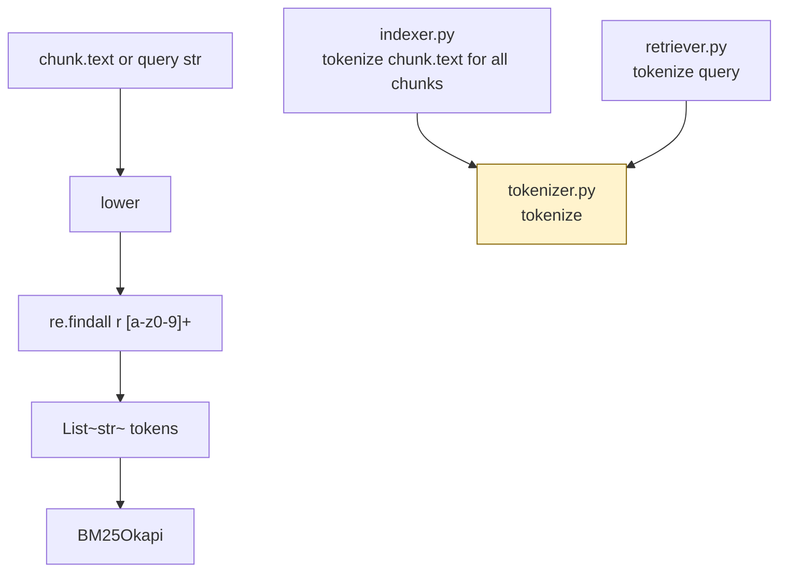

# `src/tokenizer.py` — Architecture

## Role

Turns text into tokens for BM25. **The same `tokenize()` must be used at index time and at query time** — any mismatch destroys recall. Keeps it simple: lowercase + alphanumeric.

## Diagram



## Function

```python
import re

_TOKEN_RE = re.compile(r"[a-z0-9]+")

def tokenize(text: str) -> list[str]:
    """Lowercase then extract alphanumeric tokens. Example: 'API_server v2.0' -> ['api','server','v2','0']."""
    return _TOKEN_RE.findall(text.lower())
```

- `api_server` -> `["api","server"]` — BM25 still matches queries with either token.
- No stemming — `rank_bm25` is lexical; add stemming here if recall low (e.g. `running` -> `run`).

## Relations

| Relation | Direction | Detail |
|---|---|---|
| `tokenizer -> indexer` | imported by | `build_index()` does `[tokenize(c.text) for c in chunks]` |
| `tokenizer -> retriever` | imported by | `search()` does `tokenize(query)` before `get_scores` |
| `tokenizer -> chunkers` | none | Chunkers never tokenize — they only produce `Chunk.text` |
| `tokenizer dependencies` | only | stdlib `re` |
| `tokenizer <- config` | none | No config needed |
| **Critical invariant** | both callers | `tokenize` must be identical function — import, never copy |

## Depends On

- stdlib `re`

## Used By

- `indexer.py` (index build)
- `retriever.py` (query search)

## Why This Matters

> PDF VI.1: "Questions and source code rarely use the same words... What you keep at indexing time decides which of the two you can still match."

If you split `vLLM` differently at index vs query, you miss it. One function, imported twice.

## Tuning

- If Recall@5 low on paraphrased questions: consider adding `nltk.stem.PorterStemmer` inside `tokenize()` (but re-index required).
- If code identifiers fail: try keeping `_` inside token regex: `r"[a-z0-9_]+"` (requires A/B testing).
