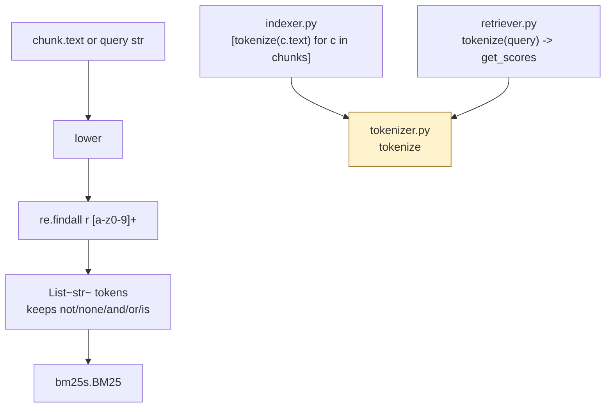

# `src/tokenizer.py` — Architecture

## Role

Turns text into tokens for BM25. **The same `tokenize()` must be used at index time and at query time** — any mismatch destroys recall. Keeps it simple: `lower()` + `re.findall(r"[a-z0-9]+")` — no stopwords, no stemming in v1.

This project uses `bm25s` (`bm25s[core]>=0.3.13`) as the BM25 engine, but **does NOT use `bm25s.tokenizer`** — we feed our own `tokenize()` output to `bm25s.BM25().index(tokenized_corpus)`. This keeps `not`/`None`/logic words and avoids double tokenization.

Chunkers (`chunk_python_file` / `chunk_markdown_file` / `chunk_text_file`) all use `langchain_text_splitters` and never tokenize — tokenizer is the single chokepoint.

## Diagram



## Function

```python
import re

_TOKEN_RE = re.compile(r"[a-z0-9]+")

def tokenize(text: str) -> list[str]:
    """Lowercase then extract alphanumeric tokens. Example: 'API_server v2.0' -> ['api','server','v2','0']."""
    return _TOKEN_RE.findall(text.lower())
```

- `api_server` -> `["api","server"]` — BM25 still matches queries with either token.
- `user.is_active` -> `["user","is","active"]` — dot/underscore are split, consistent with query `"user is active"`.

## Design Decision: Why No Stopwords / No Stemming (v1)

### Code sensitivity — `not` / `None` change meaning

```python
if not user.is_active:
    return None
```

Tokens with current tokenizer: `["if","not","user","is","active","return","none"]`

Query `"what happens when user is not active?"` -> `["what","happens","when","user","is","not","active"]`

We keep `not` and `none` — removing `not` makes `if user.is_active` and `if not user.is_active` score identically, losing the ability to distinguish the condition. Standard `nltk` English stopwords list **includes** `not`, `no`, `nor`, `don`, `is`, `are`, `in`, `and`, `or` — all are Python keywords (`and`/`or`/`is`/`in`/`not`/`None`). Same for `bm25s.tokenizer` defaults (stopword + stemming) — calling it would silently drop `not`.

For natural language this matters less; for code RAG it is critical: lexical BM25 only matches exact tokens.

| Word | Docs effect | Code effect | Decision |
|---|---|---|---|
| `the`, `a`, `an` | noise | never in code | Keep — BM25 IDF already downweights them to ~0; simpler to keep all |
| `not`, `no`, `none`, `nor` | negation | `not`, `None` | **KEEP** |
| `and`, `or`, `is`, `in`, `if`, `return`, `def`, `class` | common | keywords | **KEEP** |

**Rule: build tokenizer for code, docs will still work. Build it for docs (`nltk` stoplist), code breaks.**

Stemming same: `running` -> `run` helps docs but conflates `is_active` vs `is_activated` in code. No stemming in v1.

### Uniform tokenizer across chunk types

One BM25 index mixes `.py` + `.md` + `.txt` chunks (`IndexData(bm25, chunks, tokenized_corpus)`). A query token is scored against the single corpus. If `.py` were tokenized differently from `.md` (e.g. `r"[a-z0-9_]+"` vs `r"[a-z0-9]+"` + stemmer), scoring becomes inconsistent. `tokenize(text: str)` does not know `file_path` type — it is intentionally type-agnostic. All chunkers feed the same function.

Do not branch on suffix inside `tokenizer.py`.

## Relations

| Relation | Direction | Detail |
|---|---|---|
| `tokenizer -> indexer` | imported by | `build_index()` does `[tokenize(c.text) for c in chunks]` in one list-comp, then `bm25s.BM25(k1=BM25_K1,b=BM25_B).index(tokenized_corpus)` |
| `tokenizer -> retriever` | imported by | `search()` does `tokenize(query)` before `bm25.get_scores` / `bm25.retrieve` |
| `tokenizer -> chunkers` | none | Chunkers never tokenize — they only produce `Chunk.text` via langchain |
| `tokenizer dependencies` | only | stdlib `re` — no `bm25s` import in this file, no `nltk` |
| `tokenizer <- config` | none | `BM25_K1/B` are used in `indexer.py` when constructing `bm25s.BM25`, not here |
| **Critical invariant** | both callers | `tokenize` must be identical function — import, never copy/paste |

## Depends On

- stdlib `re`

No `bm25s`, no `nltk`, no `rank_bm25`.

## Used By

- `indexer.py` (index build — tokenizes every chunk once)
- `retriever.py` (query search — tokenizes query the same way)

## Why This Matters

> PDF VI.1: "Questions and source code rarely use the same words... What you keep at indexing time decides which of the two you can still match."

If you split `vLLM` differently at index vs query, you miss it. One function, imported twice. And for `if not user.is_active: return None`, what you *remove* (`not`/`None`) decides whether you can still distinguish negated conditions.

## What We Do Now (v1) vs What We Will Do

**Now (shipped):**
- `tokenize = lower + re.findall(r"[a-z0-9]+")` — keeps all logic words, splits on `_`/`.`/`/`.
- No stoplist, no stemming. `bm25s.BM25` receives pre-tokenized `list[list[str]]`.
- Same function for all chunk types.

**Later — only if `Recall@5 < 80% docs / 50% code` after `uv run python -m src index --max_chunk_size 2000` + `./moulinette evaluate`:**

| Symptom | Change (applied globally to index AND query, then re-index) |
|---|---|
| Paraphrased docs fail (`handling` vs `handled` vs `handle`) | Add `PorterStemmer` inside `tokenize()` — add `nltk` to `pyproject.toml`, `[_STEM.stem(t) for t in toks]` |
| Stopwords dominate but IDF not enough | Add minimal stoplist `{"the","a","an"}` ONLY — never add `not`/`no`/`none`/`and`/`or`/`is`/`in`/`nor` |
| Code identifiers fail (`api_server` kept as one token desired) | Try `r"[a-z0-9_]+"` — but then `"api server"` query (split) misses `api_server` doc. Requires A/B test — current `r"[a-z0-9]+"` is safer for natural language queries |

Do not use `bm25s.tokenizer` or `rank_bm25` — project is on `bm25s[core]` with `BM25_K1=1.5 / BM25_B=0.75` from `config.py`.
