# RAG Against the Machine — Architecture Diagrams as Code

> All diagrams are Mermaid. Paste any block into https://mermaid.live to render/export.

---

## 1. System Architecture — Main Pipeline

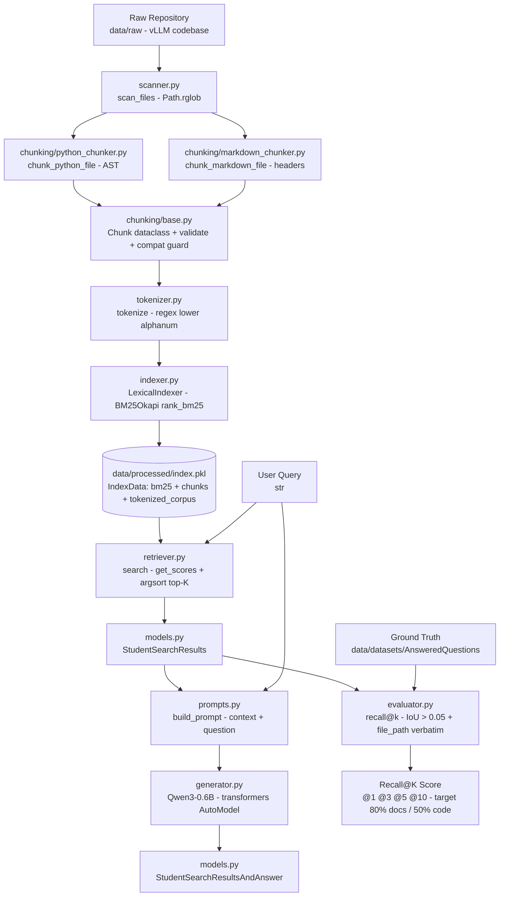

## 2. Evaluation Flow (Isolated)

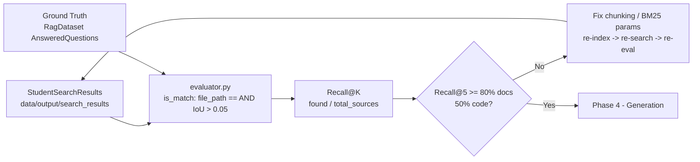

## 3. Retrieval vs Generation Separation (Key Principle)

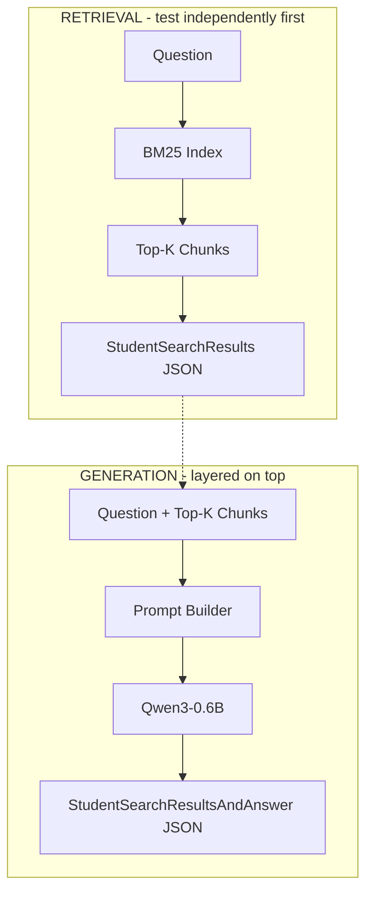

## 4. File Tree -> Architecture Component Mapping

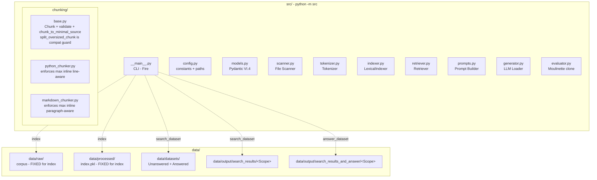

## 5. Detailed Class / Module Diagram — Variables + Functions per File

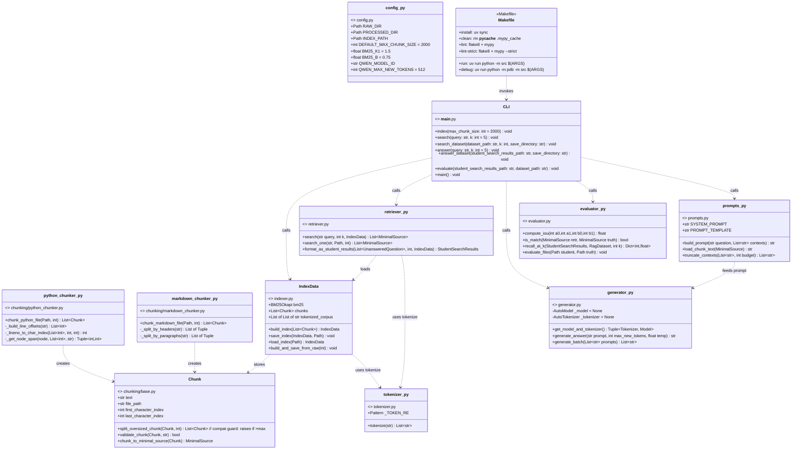

## 6. Pydantic Data Models (PDF VI.4 — exact, do not rename)

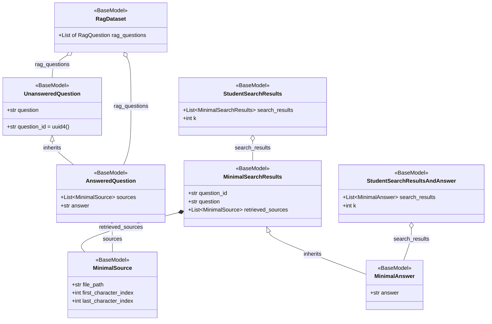

## 7. Sequence — Indexing

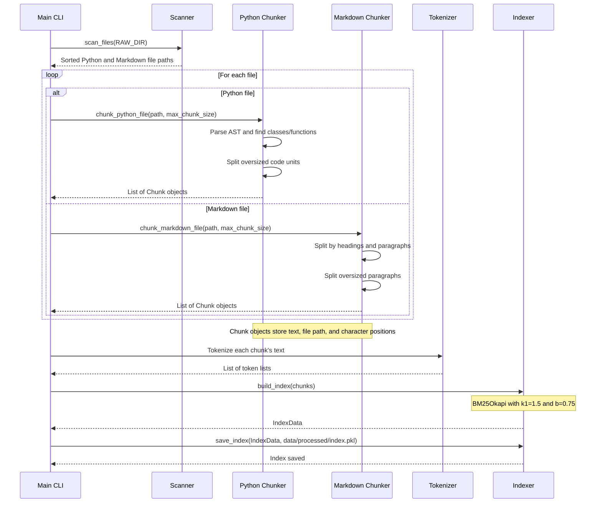

## 8. Sequence — Retrieval (search / search_dataset)

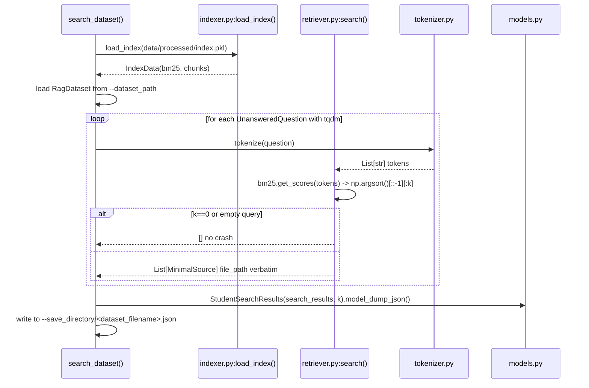

## 9. Sequence — Generation (answer / answer_dataset)

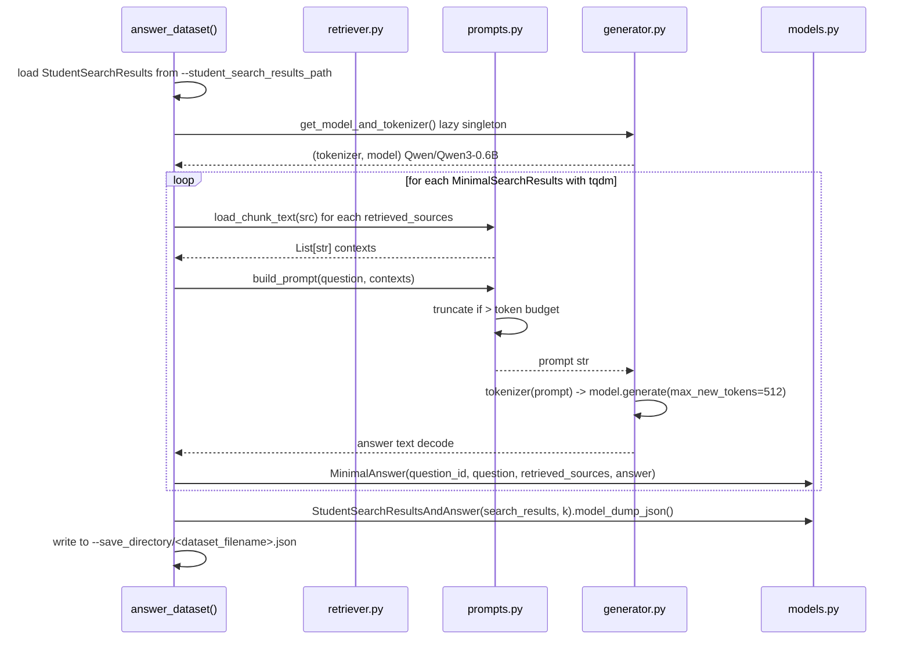

## 10. Sequence — Evaluation (your own iterate)

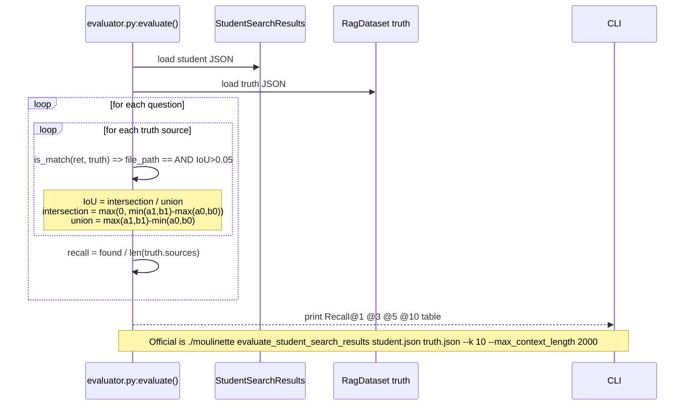

## 11. CLI Command Map

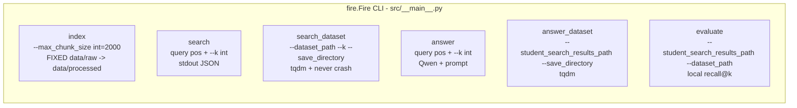

## 12. Implementation Order (Dependency Graph)

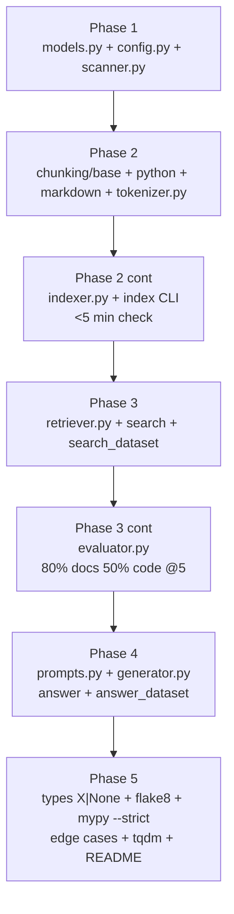
