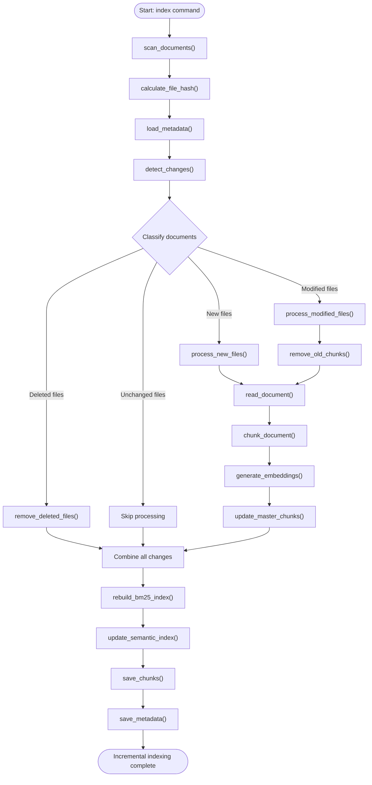

# Incremental Indexing Workflow

This diagram shows how the RAG system detects and processes changes in documents.

## Incremental Indexing Workflow

Incremental indexing allows the RAG system to process only new or modified documents instead of indexing all documents every time.

It uses SHA-256 hashing to detect changes and keeps the BM25 and semantic indexes synchronized with the current documents.

### 1. Document Discovery and Change Detection

| Function | Responsibility | How it works |
|---|---|---|
| `scan_documents()` | Discover documents | Scans the `data/raw` directory recursively and collects the paths of supported files. |
| `calculate_file_hash()` | Identify file content | Calculates a SHA-256 hash for each file by reading its content in binary mode. |
| `load_metadata()` | Load previous indexing information | Reads the previously saved metadata containing file paths and their hashes. |
| `detect_changes()` | Detect document changes | Compares current file paths and hashes with previous metadata to classify files as new, modified, unchanged, or deleted. |

**Change detection results:**

- **New:** The file exists now but was not indexed before.
- **Modified:** The file exists in both scans, but its hash has changed.
- **Unchanged:** The file exists in both scans and its hash is identical.
- **Deleted:** The file existed before but no longer exists in the current scan.

### 2. Document Processing

| Function | Responsibility | How it works |
|---|---|---|
| `process_new_files()` | Process new documents | Reads new files, creates chunks, and generates their embeddings. |
| `process_modified_files()` | Re-process modified documents | Removes outdated chunks and embeddings, then processes the updated document. |
| `remove_old_chunks()` | Remove outdated chunks | Finds and removes all chunks belonging to a modified file using its `file_path` or chunk IDs. |
| `remove_deleted_files()` | Remove deleted documents | Removes chunks and embeddings belonging to files that no longer exist. |
| `read_document()` | Read document content | Opens a file and returns its content as text. |
| `chunk_document()` | Split documents | Divides document content into smaller chunks while preserving file paths and character positions. |
| `generate_embeddings()` | Generate vector representations | Uses the embedding model to convert new chunks into numerical vectors. |

### 3. Index Management

| Function | Responsibility | How it works |
|---|---|---|
| `update_master_chunks()` | Maintain the main chunk collection | Combines unchanged chunks with new and replacement chunks, ensuring outdated chunks are excluded. |
| `rebuild_bm25_index()` | Update keyword retrieval | Rebuilds the BM25 index using all current master chunks because collection-level statistics may change. |
| `update_semantic_index()` | Update semantic retrieval | Removes outdated embeddings and adds new embeddings while keeping chunk IDs aligned with embedding vectors. |

**Important:** Unchanged documents do not need to be read, chunked, or embedded again. Their existing chunks and embeddings can be reused.

The BM25 index may still need a full rebuild, while the semantic embeddings can be updated using cached vectors.

### 4. Persistence

| Function | Responsibility | How it works |
|---|---|---|
| `save_chunks()` | Save the master chunks | Stores the updated chunk collection in persistent storage, such as `chunks.pkl`. |
| `save_metadata()` | Save indexing metadata | Saves the latest file paths and SHA-256 hashes so they can be compared during the next indexing run. |

**Important:** Save metadata only after all updated index artifacts have been saved successfully. This prevents the system from marking documents as indexed when an indexing operation has failed.

### 5. Incremental Indexing Process

1. Scan the raw documents directory.
2. Calculate the SHA-256 hash of each discovered file.
3. Load the previous indexing metadata.
4. Detect new, modified, unchanged, and deleted documents.
5. Process new and modified documents.
6. Remove outdated chunks and deleted documents.
7. Update the master chunk collection.
8. Rebuild the BM25 index.
9. Update the semantic index.
10. Save the updated chunks and metadata.

### Main Architecture

- **Metadata:** Tracks document paths and hashes.
- **Master Chunks:** The main source of truth for the current document chunks.
- **BM25 Index:** Supports keyword-based retrieval.
- **Semantic Index:** Supports meaning-based retrieval.

The goal is to avoid unnecessary document processing and embedding generation while keeping both retrieval systems synchronized with the latest source documents.

