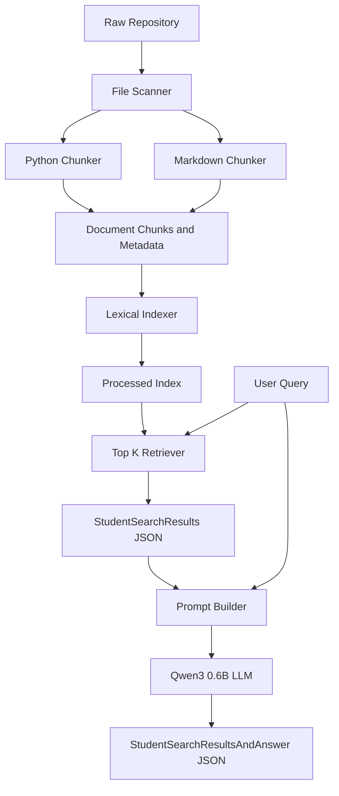
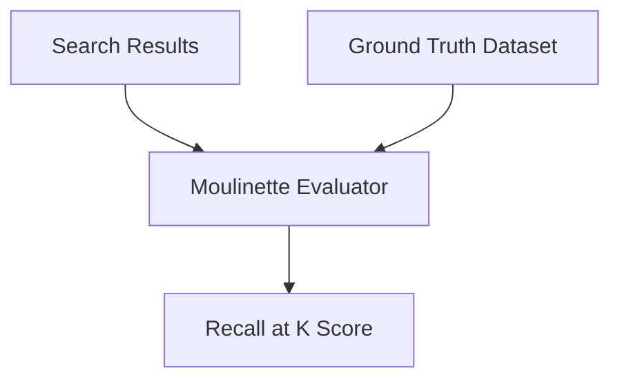

# RAG Against the Machine — Project Guide

> This document is your complete reference for understanding, learning, and building the RAG project.
> It covers architecture, concepts, tasks, and testing — in the order you should tackle them.

---

## 1. System Architecture Diagram

### Main Pipeline



### Evaluation Flow



### Key Principle: Retrieval and Generation Are Separate

```text
RETRIEVAL (test this independently first):
  Question --> BM25 Index --> Top-K Chunks --> StudentSearchResults JSON

GENERATION (add this only after retrieval works):
  Question + Top-K Chunks --> Prompt --> Qwen3-0.6B --> StudentSearchResultsAndAnswer JSON
```

You must be able to run and evaluate retrieval **without** the LLM.
Generation is layered on top of working retrieval.

---

## 2. Explanation of Each Architecture Component

| Component | Role | Input | Output |
|---|---|---|---|
| **File Scanner** | Walks `data/raw/` and discovers all `.py` and `.md` files | Directory path | List of file paths |
| **Python Chunker** | Splits Python source files into logical chunks (functions, classes, top-level code) with character position metadata | `.py` file content | List of chunks with `first_character_index`, `last_character_index`, file path |
| **Markdown Chunker** | Splits Markdown files by headers or paragraphs with character position metadata | `.md` file content | List of chunks with the same metadata format |
| **Lexical Indexer** | Builds a searchable index from all chunks using TF-IDF or BM25 scoring | All document chunks | Serialized index file saved to `data/processed/` |
| **Retriever** | Loads the index, scores chunks against a query, returns top K results | Query string + index | Ranked list of chunks |
| **Prompt Builder** | Constructs a prompt containing the question and retrieved chunks as context | Question + top-K chunks | Formatted prompt string |
| **Qwen3-0.6B** | Local language model that generates an answer from the prompt | Prompt string | Answer text |
| **Moulinette** | Evaluation tool that compares your search results against ground truth | StudentSearchResults + AnsweredQuestions | Recall@K scores |

> **⚠️ Evaluation layout (RAG.pdf VI.7.1) — must be respected or automated checks fail:**
> `src/` as `python -m src`, `pyproject.toml`+`uv.lock` at repo root, `README.md` at root,
> `data/raw/` (corpus), `data/processed/` (index), `data/datasets/UnansweredQuestions/` + `AnsweredQuestions/`,
> `data/output/search_results/<DatasetScope>/` and `data/output/search_results_and_answer/<DatasetScope>/`.
> All paths except the fixed `data/raw/`→`data/processed/` for `index` must be configurable CLI args.

---

## 3. Learning Roadmap

Learn each topic **before** you implement the related component. Follow this exact order.

### 3.1 — RAG Fundamentals

**What to understand:**
- RAG = Retrieval-Augmented Generation. Instead of asking an LLM to answer from memory, you first **retrieve** relevant documents, then **augment** the prompt with those documents, then **generate** an answer.
- The three stages: **Index → Retrieve → Generate**.
- Why RAG exists: LLMs hallucinate. RAG grounds answers in real documents.

**Resources:** Search for "RAG explained simply" or read the original RAG paper abstract.

---

### 3.2 — Document Processing

**What to understand:**
- How to walk a directory tree in Python (`os.walk` or `pathlib`).
- How to read file contents and track file paths.
- The difference between processing `.py` files and `.md` files.

**Connects to:** File Scanner component.

---

### 3.3 — Tokenization

**What to understand:**
- Tokenization = splitting text into individual words or tokens.
- Why it matters: search algorithms compare documents at the token level.
- Simple approaches: splitting on whitespace, lowercasing, removing punctuation.
- More advanced: stemming (reducing words to their root form).

**Connects to:** Input preparation for TF-IDF and BM25.

---

### 3.4 — Chunking

**What to understand:**
- Why you chunk: a full file is too large to be a useful search result. You need smaller, meaningful pieces.
- **Python chunking:** use the `ast` module to parse Python source code into its Abstract Syntax Tree. Each function definition, class definition, or top-level block becomes a chunk. The `ast` module gives you line numbers, which you convert to character positions.
- **Markdown chunking:** split by headers (`#`, `##`, `###`) or by paragraphs. Each section becomes a chunk.
- **Max chunk size:** 2000 characters. If a chunk exceeds this, you must split it further.
- **Metadata:** every chunk must track `first_character_index`, `last_character_index`, and the source file path.

**Connects to:** Python Chunker and Markdown Chunker components.

---

### 3.5 — TF-IDF (Learn This First)

**What to understand:**
- **TF (Term Frequency):** How often a word appears in a document. More occurrences = higher score.
- **IDF (Inverse Document Frequency):** How rare a word is across all documents. Rare words are more important than common ones.
- **TF-IDF score** = TF × IDF. A word that appears frequently in one document but rarely in others gets a high score.
- This is the foundation of lexical search. Understand it deeply before moving to BM25.

**Why learn this first:** TF-IDF is simpler. Once you understand it, BM25 is just an improvement on the same idea.

---

### 3.6 — BM25 (Learn This Second)

**What to understand:**
- BM25 = Best Match 25. It is an improved version of TF-IDF.
- Key improvements over TF-IDF:
  - **Term frequency saturation:** In TF-IDF, a word appearing 100 times scores 10x more than one appearing 10 times. In BM25, the benefit of additional occurrences diminishes (logarithmic saturation). Parameters `k1` controls this.
  - **Document length normalization:** Short documents get a boost. A word appearing 5 times in a 50-word document is more significant than 5 times in a 5000-word document. Parameter `b` controls this.
- BM25 typically gives better retrieval results than TF-IDF.

**Learning path:**

```text
Understand TF-IDF
       |
       v
Understand why TF-IDF has limitations
       |
       v
Learn how BM25 fixes those limitations
       |
       v
Implement or use a BM25 library (e.g., rank_bm25)
       |
       v
Compare results against TF-IDF to see improvement
```

**Connects to:** Lexical Indexer component.

---

### 3.7 — Indexing

**What to understand:**
- Indexing = building a data structure that allows fast search later.
- You take all your chunks, compute their BM25/TF-IDF representations, and save the result to disk.
- The index must be serializable (save/load with `pickle` or `json`) so you do not have to rebuild it every time.
- Index is stored in `data/processed/`.

**Connects to:** Lexical Indexer component and the `index` CLI command.

---

### 3.8 — Retrieval and Top-K

**What to understand:**
- Given a query, you score every chunk in the index against that query.
- You return the top `K` chunks with the highest scores.
- K is typically 5 (Recall@5) but your CLI should accept it as a parameter.
- The output must match the `StudentSearchResults` Pydantic model exactly.

**Connects to:** Retriever component and the `search` / `search_dataset` CLI commands.

---

### 3.9 — Recall at K

**What to understand:**
- Recall@K measures: "Of the correct sources, how many did your retriever find in the top K results?"
- Formula: `Recall@K = (number of correct sources FOUND in top K) / (total number of correct sources)`
- A correct source counts as FOUND only if: **same file_path verbatim** (e.g. `data/raw/vllm-0.10.1/docs/...` — different prefix = never matches) **AND** character-range overlap `IoU > 0.05` (low bar — you don't need exact span, just the right region of the right file).
- Example: if a question has 3 correct sources and your top 5 contains 2 with matching file + overlapping span, Recall@5 = 2/3 = 66.7%.
- **Target scores (official moulinette, --k 10 --max_context_length 2000):** 80% Recall@5 on docs, 50% on code. Moulinette also reports Recall@1, @3, @10.
- Your own `evaluate` command should reproduce this logic for local iteration; official score is from the external moulinette binary.

**Connects to:** Moulinette evaluation and your testing strategy.

---

### 3.10 — Pydantic

**What to understand:**
- Pydantic = data validation library for Python. You define classes that describe the shape of your data.
- It automatically validates types, raises errors on invalid data, and provides `.model_dump_json()` for serialization.
- You must implement the exact models from the project specification: `MinimalSource`, `StudentSearchResults`, `StudentSearchResultsAndAnswer`, etc.

**Connects to:** All JSON input/output in the project.

---

### 3.11 — CLI with Fire

**What to understand:**
- Python `fire` library turns any Python function or class into a CLI automatically. `fire.Fire()` maps function signatures to CLI flags/positionals.
- Your module must be runnable as `uv run python -m src <command> [options]` (i.e. `src/__main__.py` or `src/__init__.py` exposing Fire).
- Required commands and EXACT signatures (from RAG.pdf VI.6):
  - `index --max_chunk_size <int>`  (default 2000, reads data/raw/ -> data/processed/)
  - `search <query> --k <int>`  (query is positional)
  - `search_dataset --dataset_path <path> --k <int> --save_directory <dir>`
  - `answer <query> --k <int>`
  - `answer_dataset --student_search_results_path <path> --save_directory <dir>`
  - `evaluate --student_search_results_path <path> --dataset_path <path>`
- All input/output paths must be configurable CLI args and never hardcoded (evaluator points them at different datasets/dirs).
- Must handle degenerate inputs gracefully: empty query, k=0, nonsense query, missing files, malformed JSON — never crash with an unhandled traceback.

**Connects to:** The `Makefile` `run` and `debug` targets.

---

### 3.12 — Qwen and Transformers

**What to understand:**
- `Qwen/Qwen3-0.6B` is a small local language model.
- You load it using the `transformers` library from Hugging Face.
- Key concepts: tokenizer (converts text to model input), model (generates output), `model.generate()` method.
- The model runs locally — no API calls, no internet needed.

**Connects to:** Generation component. Learn this only after retrieval is working.

---

### 3.13 — Prompt Construction

**What to understand:**
- A prompt template combines the user question with retrieved context chunks.
- The prompt must instruct the model to answer **only** based on the provided context.
- Good prompts are specific: "Answer the following question using only the provided context. If the answer is not in the context, say you don't know."
- You need to handle token limits — if the context is too long, truncate or select fewer chunks.

**Connects to:** Prompt Builder component.

---

### 3.14 — Generation

**What to understand:**
- Generation = feeding the constructed prompt to Qwen and capturing the output.
- You combine the search results (from retrieval) with the generated answer into the `StudentSearchResultsAndAnswer` model.
- Generation quality depends heavily on retrieval quality. Fix retrieval first.

**Connects to:** The `answer` / `answer_dataset` CLI commands.

---

### 3.15 — Evaluation

**What to understand:**
- Use the provided `moulinette` tool to evaluate your search results against ground truth.
- The function is `evaluate_student_search_results()`.
- Run it after every change to your chunking or indexing logic to track improvement.
- Evaluation only measures **retrieval** (Recall@K), not generation quality.

**Connects to:** Your iterative improvement loop.

---

### 3.16 — Testing, Linting, and Documentation

**What to understand:**
- **flake8:** Python style checker. Enforces PEP 8 formatting rules.
- **mypy:** Static type checker. Ensures all your type hints are correct and consistent.
- **Makefile:** Must include targets `install`, `run`, `debug`, `clean`, `lint`, `lint-strict`.
- **README.md:** Must follow the exact format specified in the project PDF (italicized first line, architecture section, chunking strategy, retrieval method, performance analysis).

**Connects to:** Phase 5 and final submission.

---

## 4. Step-by-Step Implementation Phases

### Phase 1: Project Setup

#### Task 1.1 — Initialize the Project

```text
Learn:
- How uv works (uv init, uv add, uv run)
- pyproject.toml structure
- Python virtual environments

Build:
- Run uv init to create pyproject.toml and uv.lock
- Add dependencies: pydantic, fire, tqdm, rank_bm25, transformers, torch
- Create the directory structure: src/, data/raw/, data/processed/, docs/

Test:
- uv run python --version works
- uv run python -c "import pydantic; print(pydantic.__version__)" works
```

#### Task 1.2 — Create the Makefile

```text
Learn:
- Makefile syntax (targets, recipes, .PHONY)
- How to wrap uv run commands in Make targets

Build:
- Makefile with targets: install, run, debug, clean, lint, lint-strict
- install: uv sync
- run: uv run python -m src <command> [options]  (e.g. `uv run python -m src index --max_chunk_size 2000`)
- debug: uv run python -m pdb -m src <command> [options]
- lint: flake8 .  and  mypy . --warn-return-any --warn-unused-ignores --ignore-missing-imports --disallow-untyped-defs --check-untyped-defs
- lint-strict: flake8 .  and  mypy . --strict

Test:
- make install completes without errors
- make lint runs flake8
- make lint-strict runs mypy
```

#### Task 1.3 — Define Pydantic Data Models

```text
Learn:
- Pydantic BaseModel
- Field types, validation, serialization
- model_dump_json() and model_validate_json()

Build:
- src/models.py with the exact models from the project spec:
  MinimalSource, StudentSearchResults, StudentSearchResultsAndAnswer,
  and any other models required by the PDF

Test:
- Create sample instances and serialize them to JSON
- Validate that invalid data raises ValidationError
- Round-trip test: serialize to JSON and deserialize back
```

---

### Phase 2: Indexing Pipeline

#### Task 2.1 — File Scanner

```text
Learn:
- os.walk() or pathlib.Path.rglob()
- Filtering files by extension

Build:
- A function that takes a directory path and returns
  a list of all .py and .md file paths

Test:
- Run it on data/raw/
- Verify it finds .py files in subdirectories
- Verify it finds .md files like README.md
- Print the count of each file type
```

#### Task 2.2 — Python Chunker

```text
Learn:
- Python ast module (ast.parse, ast.walk)
- AST node types: FunctionDef, AsyncFunctionDef, ClassDef
- ast.get_source_segment() or line-to-character-index conversion
- How to compute first_character_index and last_character_index

Build:
- A function that takes a .py file path, parses it with ast,
  and returns a list of chunks
- Each chunk has: text content, first_character_index,
  last_character_index, source file path
- If a chunk exceeds 2000 characters, split it further

Test:
- Pick a .py file from data/raw/vllm/
- Print all chunks and their character indices
- Verify: file_content[first_char_index:last_char_index] == chunk_text
- Verify: no chunk exceeds 2000 characters
- Verify: chunks cover the entire file without gaps
```

#### Task 2.3 — Markdown Chunker

```text
Learn:
- Markdown structure: headers, paragraphs, code blocks
- Regex or line-by-line parsing to detect header boundaries
- Character index tracking in plain text

Build:
- A function that takes a .md file path and returns
  a list of chunks split by headers
- Same metadata as the Python chunker

Test:
- Pick a .md file like data/raw/README.md
- Print all chunks with their indices
- Verify: character indices are correct
- Verify: no chunk exceeds 2000 characters
```

#### Task 2.4 — Lexical Indexer

```text
Learn:
- TF-IDF: understand term frequency, inverse document frequency,
  and how scores are computed (learn this FIRST)
- BM25: understand how it improves on TF-IDF with
  term frequency saturation and document length normalization
- How to serialize/save an index to disk (pickle or json)

Build:
- A function that takes all chunks and builds a BM25 index
  (you can use the rank_bm25 library)
- A function that saves the index + chunk metadata to data/processed/
- A function that loads the index from data/processed/

Test:
- Build the index from data/raw/
- Verify it completes in under 5 minutes
- Save and reload the index — verify it works after reload
- Run a simple test query and check that results make sense
```

#### Task 2.5 — Index CLI Command

```text
Learn:
- Python fire: fire.Fire() and how it maps functions to CLI commands

Build:
- An "index" command with signature: `index --max_chunk_size <int>` (default 2000)
  - Always reads from `data/raw/` and writes to `data/processed/` — these paths are FIXED for this command per the PDF, but all other commands' paths must be configurable CLI args, never hardcoded
- Wires together: File Scanner -> Chunkers -> Indexer -> Save
- Add tqdm progress bars for file processing
- Must enforce max_chunk_size: never emit a chunk > max_chunk_size and never > 2000 (moulinette rejects any source > 2000 chars and the whole output becomes invalid)

Test:
- uv run python -m src index --max_chunk_size 2000
- Verify data/processed/ contains the saved index
- Verify the command finishes in under 5 minutes
```

---

### Phase 3: Retrieval Pipeline

> **Important:** Complete and test this phase fully before starting Phase 4.
> Retrieval must work independently without the LLM.

#### Task 3.1 — Search Logic

```text
Learn:
- How to query a BM25 index
- Top-K selection: sorting scores and taking the K highest
- How to map index results back to chunk metadata

Build:
- A function that takes a query string and K, loads the index, and returns the top K chunks
- Output formatted as StudentSearchResults (Pydantic model)
- CLI: `search <query> --k <int>`  — query is a POSITIONAL argument, k is configurable (not hardcoded)
- Must return MinimalSource with exact file_path verbatim (e.g. `data/raw/vllm-0.10.1/docs/...`) and correct first/last_character_index (IoU > 0.05 is enough, but wrong file_path never matches)

Test:
- uv run python -m src search "How does vLLM handle attention?" --k 5
- Inspect the top 5 results — do they seem relevant?
- Verify the JSON output matches the StudentSearchResults schema
```

#### Task 3.2 — Batch Search (search_dataset)

```text
Learn:
- The UnansweredQuestions JSON format from the project spec
- How to iterate over a dataset and save results

Build:
- A "search_dataset" command with signature: `search_dataset --dataset_path <path> --k <int> --save_directory <dir>`
  - Reads a RagDataset/UnansweredQuestions JSON from --dataset_path
  - Runs search for each question and writes a StudentSearchResults JSON to --save_directory (scoped by dataset, e.g. data/output/search_results/UnansweredQuestions/)
  - All paths must be configurable CLI args, never hardcoded
- Add tqdm progress bar
- Handle edge cases gracefully: empty query, k=0, missing files, malformed JSON — never crash with unhandled traceback

Test:
- uv run python -m src search_dataset --dataset_path data/datasets/UnansweredQuestions/dataset_docs_public.json --k 10 --save_directory data/output/search_results/UnansweredQuestions
- Verify output file is valid JSON and matches StudentSearchResults schema
- Verify every retrieved_sources entry has last-first <= 2000
```

#### Task 3.3 — Evaluate Retrieval

```text
Learn:
- How the moulinette works
- How to interpret Recall@K scores
- What to change if scores are too low

Build:
- An `evaluate` CLI command with signature: `evaluate --student_search_results_path <path> --dataset_path <path>` that reports YOUR OWN recall@k against a ground-truth dataset (for local iteration only)
- ⚠️ NEVER import or call the moulinette binary from your code. Official scoring is done externally: `./moulinette evaluate_student_search_results <student_json> <ground_truth_json> --k 10 --max_context_length 2000`. Your evaluate command must be a separate, independent implementation.
- Define recall@k correctly: a correct source counts as FOUND only if same file_path (verbatim) AND character-range overlap IoU > 0.05. Different file = never counts.

Test:
- uv run python -m src evaluate --student_search_results_path data/output/search_results/UnansweredQuestions/dataset_docs_public.json --dataset_path data/datasets/AnsweredQuestions/dataset_docs_public.json
- Also verify with the real moulinette binary (rename moulinette-ubuntu/-fedora to moulinette): `./moulinette evaluate_student_search_results <student> <truth> --k 10 --max_context_length 2000`
- Target: Recall@5 >= 80% for docs, >= 50% for code
- If below target: adjust chunking strategy, chunk sizes, or BM25 params, then re-index and re-evaluate
```

---

### Phase 4: Generation Pipeline

> **Prerequisite:** Retrieval (Phase 3) must be working and evaluated before starting this phase.

#### Task 4.1 — Load the Local LLM

```text
Learn:
- Hugging Face transformers library: AutoTokenizer, AutoModelForCausalLM
- How to load Qwen/Qwen3-0.6B locally
- GPU vs CPU inference, torch.float16 for efficiency
- model.generate() parameters: max_new_tokens, temperature

Build:
- A module that loads the model and tokenizer once
- A function that takes a prompt string and returns generated text

Test:
- Load the model and run a simple test prompt
- Verify it produces coherent text
- Measure generation time for a single prompt
```

#### Task 4.2 — Prompt Construction

```text
Learn:
- Prompt engineering basics
- How to structure context + question prompts
- Token limits and how to handle long contexts

Build:
- A prompt template function that takes a question and
  a list of retrieved chunks, and returns a formatted prompt
- The prompt must instruct the model to answer ONLY
  from the provided context

Test:
- Print the constructed prompt for a sample question
- Verify it includes the question and context chunks
- Verify it fits within the model's token limit
```

#### Task 4.3 — Answer Commands

```text
Learn:
- How to combine retrieval results with generated answers
- The StudentSearchResultsAndAnswer Pydantic model

Build:
- An "answer" command with signature: `answer <query> --k <int>` — query is positional, k configurable. Loads index from data/processed/, retrieves top-k, builds prompt, generates with Qwen/Qwen3-0.6B, returns StudentSearchResultsAndAnswer.
- An "answer_dataset" command with signature: `answer_dataset --student_search_results_path <path> --save_directory <dir>` — reads a StudentSearchResults JSON, generates an answer per question, writes StudentSearchResultsAndAnswer JSON to --save_directory (e.g. data/output/search_results_and_answer/UnansweredQuestions/). Paths configurable, never hardcoded.
- Must fit context within Qwen token budget (truncate/select fewer chunks if needed)
- Add tqdm progress bars

Test:
- uv run python -m src answer "How does vLLM handle attention?" --k 5
- uv run python -m src answer_dataset --student_search_results_path data/output/search_results/UnansweredQuestions/dataset_docs_public.json --save_directory data/output/search_results_and_answer/UnansweredQuestions
- Verify JSON matches StudentSearchResultsAndAnswer schema
```

---

### Phase 5: Polish and Documentation

#### Task 5.1 — Code Quality

```text
Learn:
- flake8 rules (PEP 8 style)
- mypy strict mode type annotations
- Python 3.10+ type hint syntax (X | None instead of Optional[X])

Build:
- Add type hints to every function
- Fix all flake8 warnings
- Fix all mypy errors in strict mode

Test:
- make lint passes with zero warnings
- make lint-strict passes with zero errors
```

#### Task 5.2 — Error Handling and Edge Cases

```text
Learn:
- Python exception handling (try/except)
- Common edge cases: empty files, binary files,
  missing directories, empty queries

Build:
- Add try/except blocks around file reading, index loading,
  and model inference
- Log meaningful error messages

Test:
- Pass an empty query to search — should not crash
- Pass a nonexistent directory to index — should show a clear error
- Pass a corrupted index file to search — should show a clear error
```

#### Task 5.3 — README.md

```text
Learn:
- The exact README format required by the project PDF
- Mandatory first line (italicized)
- Required sections

Build:
- README.md with:
  - Italicized first line (as specified)
  - System architecture description
  - Chunking strategy explanation
  - Retrieval method explanation
  - Performance analysis with your Recall@K scores
  - How to install and run the project

Test:
- Read it as a stranger — can you understand the project?
- Verify all required sections are present
- Verify make install and make run instructions work
```

---

## 5. Task Checklist

### Phase 1: Setup
- [ ] `uv init` and add all dependencies
- [ ] Create directory structure: `src/`, `data/raw/`, `data/processed/`, `docs/`
- [ ] Create `Makefile` with all required targets
- [ ] Create `src/models.py` with all Pydantic models
- [ ] Verify `make lint` and `make lint-strict` run (they can have errors for now)

### Phase 2: Indexing
- [ ] File Scanner: discover all `.py` and `.md` files
- [ ] Python Chunker: AST-based chunking with character indices
- [ ] Markdown Chunker: header-based chunking with character indices
- [ ] Verify all chunks are under 2000 characters
- [ ] Verify character indices are correct
- [ ] Implement BM25 index (after understanding TF-IDF first)
- [ ] Save/load index to `data/processed/`
- [ ] Create `index` CLI command with `fire`
- [ ] Verify indexing completes in under 5 minutes

### Phase 3: Retrieval
- [ ] Implement `search` function returning `StudentSearchResults`
- [ ] Implement `search_dataset` batch command
- [ ] Run moulinette evaluation
- [ ] Achieve Recall@5 >= 80% on docs
- [ ] Achieve Recall@5 >= 50% on code
- [ ] Iterate on chunking/indexing if targets not met

### Phase 4: Generation
- [ ] Load Qwen3-0.6B model locally
- [ ] Create prompt template
- [ ] Implement `answer` command
- [ ] Implement `answer_dataset` batch command
- [ ] Verify output matches `StudentSearchResultsAndAnswer` schema

### Phase 5: Polish
- [ ] All functions have type hints
- [ ] `make lint` passes with zero warnings
- [ ] `make lint-strict` passes with zero errors
- [ ] Error handling for edge cases
- [ ] `tqdm` progress bars on all batch operations
- [ ] `README.md` with all required sections
- [ ] All CLI paths are configurable (no hardcoded paths)

---

## 6. Testing and Evaluation Strategy

### Unit Testing (Per Component)

| Component | Test |
|---|---|
| File Scanner | Finds correct number of `.py` and `.md` files |
| Python Chunker | Chunks are valid, under 2000 chars, correct indices |
| Markdown Chunker | Chunks are valid, under 2000 chars, correct indices |
| Indexer | Builds in under 5 min, saves/loads correctly |
| Retriever | Returns valid `StudentSearchResults` JSON |
| Generator | Returns valid `StudentSearchResultsAndAnswer` JSON |

### Integration Testing (End-to-End)

```text
1. uv run python -m src index --max_chunk_size 2000
   -> Index saved to data/processed/ (must finish in <5 min)

2. uv run python -m src search "How does vLLM handle attention?" --k 5
   -> Valid StudentSearchResults JSON printed

3. uv run python -m src search_dataset --dataset_path data/datasets/UnansweredQuestions/dataset_docs_public.json --k 10 --save_directory data/output/search_results/UnansweredQuestions
   -> StudentSearchResults JSON saved (scoped by dataset — don't overwrite other scopes)

4. uv run python -m src evaluate --student_search_results_path data/output/search_results/UnansweredQuestions/dataset_docs_public.json --dataset_path data/datasets/AnsweredQuestions/dataset_docs_public.json
   -> Your own Recall@K (for iteration)
   ./moulinette evaluate_student_search_results data/output/search_results/UnansweredQuestions/dataset_docs_public.json data/datasets/AnsweredQuestions/dataset_docs_public.json --k 10 --max_context_length 2000
   -> Official Recall@K — must be >= 80% docs, >= 50% code at k=5

5. uv run python -m src answer "How does vLLM handle attention?" --k 5
   -> Valid StudentSearchResultsAndAnswer JSON printed

6. uv run python -m src answer_dataset --student_search_results_path data/output/search_results/UnansweredQuestions/dataset_docs_public.json --save_directory data/output/search_results_and_answer/UnansweredQuestions
   -> StudentSearchResultsAndAnswer JSON saved (scoped)
```

### Iterative Improvement Loop

```text
Change chunking/indexing
        |
        v
  Re-run index
        |
        v
  Re-run search_dataset
        |
        v
  Run moulinette
        |
        v
  Check Recall@K
        |
        v
  Scores improved? --No--> Go back to top
        |
       Yes
        |
        v
  Move to next phase
```

---

## 7. Final Project Workflow

When everything is complete, the full workflow looks like this:

```text
Step 1: Install
  make install        # runs uv sync

Step 2: Index the repository (once)
  uv run python -m src index --max_chunk_size 2000
  # -> data/processed/  (must finish in <5 min)

Step 3: Search (single question)
  uv run python -m src search "How does vLLM handle attention?" --k 5

Step 4: Search (batch) — ALWAYS scope --save_directory by dataset!
  uv run python -m src search_dataset --dataset_path data/datasets/UnansweredQuestions/dataset_docs_public.json --k 10 --save_directory data/output/search_results/UnansweredQuestions
  uv run python -m src search_dataset --dataset_path data/datasets/AnsweredQuestions/dataset_docs_public.json --k 10 --save_directory data/output/search_results/AnsweredQuestions

Step 5: Evaluate (your own, for iteration)
  uv run python -m src evaluate --student_search_results_path data/output/search_results/UnansweredQuestions/dataset_docs_public.json --dataset_path data/datasets/AnsweredQuestions/dataset_docs_public.json
  # Official scoring (external binary, rename moulinette-ubuntu/-fedora to moulinette first):
  ./moulinette evaluate_student_search_results data/output/search_results/UnansweredQuestions/dataset_docs_public.json data/datasets/AnsweredQuestions/dataset_docs_public.json --k 10 --max_context_length 2000

Step 6: Answer (single question)
  uv run python -m src answer "How does vLLM handle attention?" --k 5

Step 7: Answer (batch)
  uv run python -m src answer_dataset --student_search_results_path data/output/search_results/UnansweredQuestions/dataset_docs_public.json --save_directory data/output/search_results_and_answer/UnansweredQuestions

Step 8: Lint
  make lint         # flake8 . && mypy . --warn-return-any --warn-unused-ignores --ignore-missing-imports --disallow-untyped-defs --check-untyped-defs
  make lint-strict  # flake8 . && mypy . --strict
```

---

## 8. Optional Bonus Features

> **Do NOT start these until all mandatory phases (1-5) are 100% complete and evaluated.**
> These are extra credit only.

| Bonus | Description | Difficulty |
|---|---|---|
| **Semantic Embeddings** | Add a vector index using `all-MiniLM-L6-v2` sentence-transformers model | Medium |
| **Hybrid Retrieval** | Combine BM25 lexical scores with semantic vector scores for better results | Medium-Hard |
| **Incremental Indexing** | Only re-index files that changed since the last index build | Medium |
| **Query Caching** | Cache search results to avoid redundant computation | Easy |
| **Local HTTP API** | Serve the RAG system through a FastAPI or Flask web server | Medium |
